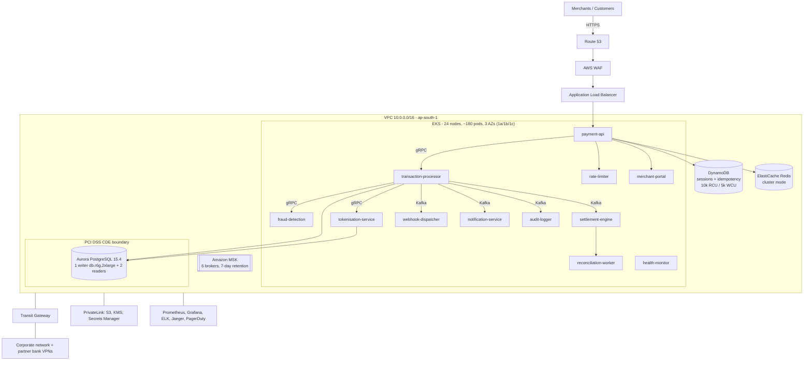

# Current-State Architecture - PaySecure Gateway (Single Region)

## 1. Overview
PaySecure Gateway Private Limited is a mid-tier payment aggregator processing ~3.2 million transactions per day worth ~500 crore INR for ~45,000 merchants. Peak load is ~1,200 TPS during festival sales, P99 end-to-end latency is 180 ms, and trailing-12-month uptime is 99.92% (about 7 hours of downtime). The entire platform runs in one AWS region, **ap-south-1 (Mumbai)**, with no automated cross-region failover. The regulatory mandate is 99.99% uptime (max 52.6 minutes downtime per year) with RPO < 1 minute and RTO < 5 minutes by Q3 2026.

## 2. Architecture Diagram
Source file: `architecture-diagram.drawio` (export to `architecture-diagram.png`). The Mermaid version below is the reference for redrawing in draw.io with AWS icons.

## 3. Compute Layer
The application tier runs on Amazon EKS with 24 worker nodes across three Availability Zones (ap-south-1a/b/c) and about 180 pods. Twelve microservices run as Kubernetes Deployments: payment-api, transaction-processor, settlement-engine, fraud-detection, notification-service, merchant-portal, reconciliation-worker, audit-logger, tokenisation-service, webhook-dispatcher, rate-limiter and health-monitor. Horizontal Pod Autoscaling scales on CPU (target 60%) and a custom metric, transactions per second per pod. Inter-service traffic uses the Istio service mesh with mTLS. Synchronous calls between services use gRPC; asynchronous flows use Kafka.

## 4. Data Layer
| Store | Configuration | Holds |
|---|---|---|
| Aurora PostgreSQL 15.4 | Multi-AZ, 1 writer (db.r6g.2xlarge) + 2 readers | Transactions, merchant configs, tokenised card data, settlement batches |
| DynamoDB | Provisioned 10,000 RCU / 5,000 WCU | Sessions, idempotency keys |
| ElastiCache Redis | Cluster mode enabled | Merchant config cache, rate-limit counters, transaction lookups |
| Amazon MSK | 6 brokers, ~50,000 msg/s at peak, 7-day retention | Transaction events, settlement triggers, webhooks, audit logs |
| S3 | Accessed via PrivateLink | Backups, logs, reports |

## 5. Networking
All services run in a dedicated VPC with private subnets across three AZs. External traffic enters through an Application Load Balancer protected by AWS WAF. A Transit Gateway connects the production VPC to the corporate network and partner bank VPNs. PrivateLink endpoints give private access to S3, KMS and Secrets Manager, so service traffic to these does not cross the public internet. (CIDR blocks shown are assumed for design purposes: VPC 10.0.0.0/16, one private subnet per AZ.)

## 6. Data Flow (a typical payment)
1. The merchant calls payment-api over HTTPS via Route 53, WAF and the ALB.
2. payment-api checks rate-limiter (Redis counters) and looks up the idempotency key in DynamoDB. A repeated key returns the stored result and prevents double processing.
3. transaction-processor calls fraud-detection (gRPC) and tokenisation-service (gRPC, inside the CDE).
4. The transaction record is written to the Aurora writer.
5. An event is published to Kafka. settlement-engine, webhook-dispatcher, notification-service and audit-logger consume it asynchronously.
6. The result returns to the merchant, with a webhook sent later. The target is under 180 ms P99, against the NPCI ceiling of 300 ms for UPI.

## 7. Security and Compliance
KMS manages encryption keys for data at rest and in transit. Secrets Manager stores DB credentials, API keys and partner certificates, rotated every 90 days. CloudTrail logs all API calls and GuardDuty monitors for anomalies. A dedicated PCI DSS boundary (CDE) isolates cardholder data with strict network segmentation (Kubernetes NetworkPolicies and security groups). Certifications held: PCI DSS Level 1, ISO 27001, SOC 2 Type II.

## 8. Observability
Prometheus and Grafana handle metrics, ELK handles logs, Jaeger handles tracing, and PagerDuty receives CloudWatch alarms. About 2,400 metrics and 350 alerts are active.

## 9. Failure Domains
| Domain | Blast radius | Current protection |
|---|---|---|
| Pod / node | Single service instance | Kubernetes rescheduling, HPA |
| Availability Zone | ~33% compute, 1 DB reader, 2 Kafka brokers | Multi-AZ EKS, Aurora Multi-AZ, MSK across AZs |
| **Region (ap-south-1)** | **Entire platform** | **None - this is the gap** |
| Logical / data corruption | Replicated to every replica | PITR backups only |
| Bad deployment | All pods in the region | Rolling updates, rollback |

## 10. Single Points of Failure
1. **Single region:** a regional outage stops all payments. This is why the platform is at 99.92% and cannot reach 99.99%.
2. **Single Aurora writer:** a writer failure means an in-region failover of roughly 30-60 seconds, and no writer exists anywhere else.
3. **Route 53 and DNS:** no secondary DNS provider or tested failover record.
4. **Single KMS key hierarchy and Secrets Manager:** keys and secrets exist in one region, so a regional failure also blocks decryption of backups there.
5. **Single CI/CD pipeline and deployment target:** a compromised or broken pipeline affects the whole platform and cannot deploy to a standby region.
6. **MSK in one region:** loss of the cluster stops settlement, webhooks and audit logging (replay is only possible from that cluster).
7. **Observability stack in the same region:** monitoring may go blind exactly when it is needed.
8. **Transit Gateway and partner VPNs terminate in Mumbai:** partner banks have no path to a second region.

## 11. Implications for the DR Design
- Region failure is the dominant risk, so the design needs a second Indian region (ap-south-2 Hyderabad, 15-25 ms RTT) to keep all data in India per RBI localisation rules.
- Latency budget: 300 ms NPCI ceiling minus 180 ms P99 leaves 120 ms. Synchronous cross-region replication at 15-25 ms RTT is affordable for some components but must be checked per component (see docs/03-data-replication).
- Stateful components (Aurora, DynamoDB, Redis, MSK, S3) define the achievable RPO, so each needs its own replication choice.
- Monitoring, secrets, keys, DNS, partner connectivity and the CI/CD pipeline must be made multi-region too, or they remain single points of failure.

## 12. Failure Mode and Effects Analysis (FMEA)

Method: each failure mode is scored 1 to 10 for Severity (S), Occurrence (O) and Detection (D, higher = harder to detect). Risk Priority Number RPN = S x O x D. The analysis covers 24 failure modes across all major components of the platform. The first nine rows come from the brief's reference table; the rest were added for this design.

| # | Component | Failure mode | Effect | S | O | D | RPN | Mitigation |
|---|---|---|---|---|---|---|---|---|
| 1 | Aurora Writer | Instance crash | Transaction writes fail | 9 | 3 | 2 | 54 | Multi-AZ automatic failover; Aurora Global DB (RB-01) |
| 2 | Aurora Writer | Storage corruption | Data integrity compromised | 10 | 2 | 5 | 100 | Point-in-time recovery; automated integrity checks (RB-02) |
| 3 | Aurora Replication | Lag exceeds RPO | DR region behind primary | 8 | 4 | 3 | 96 | Lag alarm above 500 ms, P1 alert |
| 4 | DynamoDB Global | Conflict resolution error | Duplicate idempotency keys | 7 | 3 | 6 | 126 | Careful key design; home-region writes; conflict monitoring |
| 5 | Route 53 | Health check false positive | Unnecessary failover | 7 | 3 | 3 | 63 | Calculated health checks; threshold tuning |
| 6 | Route 53 | Health check false negative | Failed region keeps receiving traffic | 9 | 2 | 7 | 126 | Multi-layer health checks; synthetic transactions |
| 7 | CI/CD Pipeline | Single-region deploy | Region drift; stale failover | 7 | 4 | 5 | 140 | Pipeline guardrail; drift detection |
| 8 | KMS | Key compromise | All encrypted data exposed | 10 | 1 | 8 | 80 | Key rotation; re-encryption procedure (RB-06) |
| 9 | Cross-Region Network | Network partition | Split-brain or replication halt | 9 | 2 | 3 | 54 | Partition detection; no-promotion rule (RB-05) |
| 10 | MSK Kafka | Broker disk corruption or quorum loss | Events stall; settlements and webhooks delayed | 8 | 3 | 3 | 72 | Outbox bypass; cluster rebuild from replica (RB-04) |
| 11 | EKS | Availability zone power loss | About 33% of compute lost | 7 | 3 | 2 | 42 | AZ spread, HPA, PDB, capacity maths (RB-10) |
| 12 | ElastiCache Redis | Primary shard failure | Cache miss storm raises DB load | 5 | 4 | 3 | 60 | Multi-AZ failover; cache warming on failover |
| 13 | Transit Gateway | Attachment failure | Partner banks and corporate network unreachable | 7 | 2 | 3 | 42 | Recreate attachment; backup VPN (RB-05) |
| 14 | DNS | Poisoning or service failure | Clients resolve to a wrong address | 9 | 2 | 6 | 108 | DNSSEC; secondary DNS provider (RB-03) |
| 15 | TLS certificates | Expiry or misconfiguration | All HTTPS clients fail | 9 | 3 | 2 | 54 | ACM renewal, 30/14/7/1-day alerts, standby certificate (RB-09) |
| 16 | ALB and WAF | DDoS on the payment API | API saturated; legitimate traffic dropped | 8 | 4 | 3 | 96 | Shield Advanced; staged rate rule; merchant allow-list (RB-07) |
| 17 | NPCI / UPI | Third-party network outage | UPI transactions fail at network level | 6 | 5 | 2 | 60 | Queue and retry; clear merchant messaging (RB-08) |
| 18 | fraud-detection | Failure loop | Cascading timeouts; success rate falls | 8 | 4 | 3 | 96 | Circuit breaker; capped bypass; rollback (RB-12) |
| 19 | Pipeline runners | Ransomware | Compromised builds and deploys | 9 | 2 | 5 | 90 | Signed images; rebuild from IaC (RB-11) |
| 20 | Secrets Manager | Rotation failure | Services lose database access | 8 | 3 | 4 | 96 | Staged rotation; replicated secrets; alarms |
| 21 | S3 | Replication halt or deletion | Backups or evidence missing in the DR region | 6 | 3 | 5 | 90 | RTC alarm; delete markers not replicated; Object Lock |
| 22 | MSK Replicator | Lag grows | Settlement events missing after failover | 7 | 4 | 4 | 112 | Lag alarm above 10,000 messages; replay (RB-04) |
| 23 | Monitoring stack | Prometheus or PagerDuty unavailable in the failed region | Blind during failover | 8 | 3 | 5 | 120 | Monitoring in both regions; external probe |
| 24 | Operations | Wrong failover command or human error | Split-brain or data loss | 9 | 3 | 4 | 108 | Drills; dry-run scripts; two-person rule |

### Priorities from the FMEA

The five highest RPN values, which drive where DR investment goes first:

1. **#7 CI/CD Pipeline: Single-region deploy** (RPN 140): Pipeline guardrail; drift detection
2. **#4 DynamoDB Global: Conflict resolution error** (RPN 126): Careful key design; home-region writes; conflict monitoring
3. **#6 Route 53: Health check false negative** (RPN 126): Multi-layer health checks; synthetic transactions
4. **#23 Monitoring stack: Prometheus or PagerDuty unavailable in the failed region** (RPN 120): Monitoring in both regions; external probe
5. **#22 MSK Replicator: Lag grows** (RPN 112): Lag alarm above 10,000 messages; replay (RB-04)

Reading the table: the highest-risk items are not the dramatic ones (a region loss) but the **hard-to-detect ones**: a CI/CD single-region deploy that leaves the standby stale, a health check that wrongly says a failed region is healthy, and conflicting idempotency keys. That is why the design adds drift detection, calculated health checks with synthetic transactions, a weekly automated readiness run, and a home-region rule for writes. The FMEA also shows hidden single points of failure, in the sense of the Visa case study: a primary and a secondary that can be disabled together by one faulty component, which is why failover is tested by fault injection and not only by graceful switchover.
