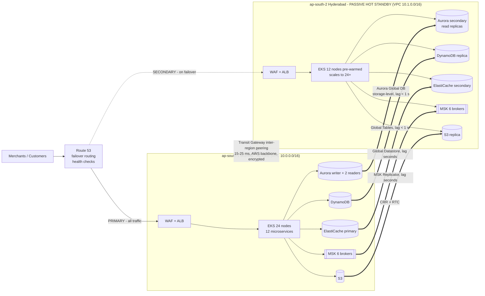

# Active-Passive Multi-Region Design - PaySecure Gateway

## 1. Purpose and Requirements
PaySecure must move from a single AWS region (ap-south-1, Mumbai; 99.92% uptime, ~7 hours of downtime in the trailing 12 months) to a design that meets the regulatory mandate by Q3 2026:

| Requirement | Target | Source |
|---|---|---|
| Uptime | 99.99% (max 52.6 min downtime/year) | Mandate / Company Profile |
| RPO | < 1 minute | Mandate |
| RTO | < 5 minutes | Mandate |
| End-to-end UPI latency | < 300 ms (current P99 180 ms) | NPCI |
| Data residency | All payment data stored in India | RBI Data Localisation |
| Team | 8 platform engineers | Company Profile |
| Cost | Board-approved budget of 1.4x current infrastructure spend (8 crore INR/year) | BCRB brief |

This document specifies the **active-passive** configuration: Mumbai serves all production traffic, and Hyderabad (ap-south-2) holds a continuously replicated, ready-to-promote standby. The active-active alternative is in `active-active-design.md` and both are compared in `comparison-matrix.md`.

## 2. Region Selection and Latency Measurements
AWS operates two regions in India: ap-south-1 (Mumbai) and ap-south-2 (Hyderabad). Reference latency figures used throughout this repository:

| Path | Round-trip time | Use |
|---|---|---|
| Mumbai - Hyderabad | 15-25 ms | Replication and failover |
| Mumbai - Singapore (ap-southeast-1) | 50-80 ms | Tertiary option only |

**Decision: ap-south-2 (Hyderabad) is the DR region.** Reasons:
1. **Data sovereignty.** RBI requires payment data to be stored only in India. Hyderabad is the only other Indian region, so cardholder data, transaction data and merchant data can be replicated without any cross-border transfer.
2. **Latency.** 15-25 ms is the lowest available inter-region latency for an India-based setup, about 3x lower than Singapore.
3. **Geographic separation.** The two regions are roughly 700 km apart, so a regional power, network or flood event in Mumbai is very unlikely to hit Hyderabad as well.

**Latency budget.** The NPCI ceiling is 300 ms and current P99 is 180 ms, leaving **120 ms of headroom**. In active-passive, user traffic never crosses regions during normal operation, so request latency is unchanged (180 ms). Replication is asynchronous, so the write path adds 0 ms. If replication were synchronous, a single cross-region commit would add one round trip plus remote commit time: 15-25 ms + roughly 2-5 ms = about 17-30 ms, giving a worst-case P99 of about 210 ms, still under 300 ms. Synchronous replication is therefore *latency-feasible* for Mumbai-Hyderabad but is not offered natively by Aurora Global Database, DynamoDB Global Tables, ElastiCache Global Datastore or MSK Replicator, all of which replicate asynchronously. Asynchronous replication with typical lag under 1 second still gives an RPO far below the 60-second target (see Section 5).

## 3. Target Topology

**Normal state:** 100% of traffic, all writes and all reads go to Mumbai. Hyderabad runs the full stack, receives all replicated data, serves no customer traffic, and runs synthetic transactions every 60 seconds to prove it is healthy.

**Failover state:** Hyderabad databases are promoted to writers, compute scales to production size, Route 53 moves customer traffic to Hyderabad, and Hyderabad becomes the new primary.

## 4. Standby Tier Choice: Hot Standby
The DR tiers evaluated (full cost model in `docs/06-cost-analysis`):

| Tier | Typical RTO | Typical RPO | Cost multiplier | Verdict |
|---|---|---|---|---|
| Cold | 4-24 hours | Hours to days | 1.05-1.1x | Fails RTO by 48x |
| Warm | 15-60 minutes | Minutes | 1.3-1.5x | Fails RTO by 3x |
| **Hot** | **1-5 minutes** | **Seconds to 1 minute** | **1.6-1.8x** | **Meets RTO/RPO** |
| Active-active | Near-zero | Near-zero to seconds | 1.8-2.2x | Exceeds need, higher complexity |

Only Hot standby (and active-active) can meet RTO < 5 minutes. To keep cost near the low end of the hot range, Hyderabad compute is **pre-provisioned at 50% (12 nodes, all 12 microservices running at minimum replicas)** and scaled to production size during failover using pre-baked node images and the cluster autoscaler. Databases are provisioned at full size because they cannot be resized quickly during an incident. Estimated infrastructure cost is about **1.6x** of the current 8 crore INR/year, around 12.8 crore INR/year (an increase of about 4.8 crore), to be refined line by line in the cost model.

## 5. Component-Level Design
| Component | Mechanism | Lag / RPO contribution | Standby configuration | Promotion method |
|---|---|---|---|---|
| Aurora PostgreSQL 15.4 | Aurora Global Database (storage-level replication) | Typically < 1 s | Secondary cluster in ap-south-2 with reader instance(s) of the same class (db.r6g.2xlarge) | Managed failover of the global cluster to the secondary (planned switchover for drills, failover with data-loss allowance for a real regional outage) |
| DynamoDB (sessions, idempotency keys) | Global Tables, replica in ap-south-2 | Typically < 1 s | Same table, replica with matching provisioned capacity | No promotion needed; replica accepts writes. In active-passive the app writes only in the active region |
| ElastiCache Redis | Global Datastore (async) | Seconds | Secondary replication group in ap-south-2 (read-only) | Promote secondary to primary (failover-global-replication-group) |
| MSK Kafka | MSK Replicator (topics + consumer group offsets) | Seconds to minutes | 6-broker cluster in ap-south-2 | Switch producers and consumers to the Hyderabad bootstrap servers; consumers resume from synced offsets |
| S3 | Cross-Region Replication with Replication Time Control | 15-minute SLA, usually seconds | Versioned destination bucket | Applications switch bucket endpoint; no promotion |
| KMS | Multi-Region keys (primary ap-south-1, replica ap-south-2) | n/a | Same key material in both regions | None; replica key is usable immediately |
| Secrets Manager | Secret replication to ap-south-2 | Seconds | Replicated secrets | None |

**Idempotency keys.** Because the DynamoDB idempotency table is replicated within about a second, a merchant that retries a request after failover will usually hit the replicated key and receive the original result rather than a duplicate charge. The residual risk is the replication-lag window, handled by the reconciliation process in the runbooks (RB-01).

**Why Aurora RPO is not quite zero.** Aurora Global Database replicates at the storage layer asynchronously. Typical lag is under a second, and monitoring alerts at 500 ms (P1). Any transaction committed in Mumbai but not yet replicated when the region dies is lost from the standby. At 1,200 TPS peak, 1 second of lag corresponds to at most about 1,200 transactions at risk; at average load (about 37 TPS over 24 hours; 3.2M/86,400) it is about 37. The documented RPO is therefore "approximately 1 second, alert threshold 500 ms, hard limit 60 seconds".

## 6. Failover Mechanism and Timing
**Detection.** Route 53 health checks run every 10 seconds with a failure threshold of 3, so the minimum detection time is **30 seconds**. A calculated health check combines (a) the deep health endpoint of the payment API, (b) a CloudWatch alarm on payment API success rate (< 99.5% for 2 minutes), and (c) a synthetic-transaction canary. A single failed endpoint does not trigger failover, which prevents false-positive failovers.

**Decision.** Automated for the clear case (health checks failed in all three Mumbai AZs and the standby is healthy and lag is within limits). Manual approval by the Incident Commander for ambiguous cases such as a possible network partition, to avoid split-brain. The decision engine is described in the sandbox topic.

**Execution timeline (nominal).** DNS redirection and database promotion run **in parallel**. Route 53 cannot hold a record back until a database is promoted, so Route 53 flips to Hyderabad as soon as the Mumbai health check fails, while the failover controller promotes the Hyderabad data stores. Until Hyderabad is write-ready, its payment-api returns HTTP 503 with a `Retry-After` header for write operations. Because every request carries an idempotency key, merchant retries during this window are safe.

| Phase | Action | Duration | Cumulative |
|---|---|---|---|
| 1 | Failure occurs; Route 53 health checks fail 3 times (10 s interval) | 30 s | 0:30 |
| 2 | Route 53 flips records to Hyderabad. In parallel the controller decides, fences Mumbai and starts promotion. Clients re-resolve DNS within the 30 s TTL | 15 s decision | 0:45 (DNS fully propagated by about 1:15) |
| 3a | Aurora global failover/promotion in Hyderabad | 60-90 s | |
| 3b | ElastiCache global datastore promotion | 30-60 s | |
| 3c | EKS scale-out from 12 to 24+ nodes | 90-120 s | |
| 3 | Longest parallel step | 120 s | 2:45 |
| 4 | Write-ready gate opens; Hyderabad serves writes. **First successful write at about 2:45** | 5 s | 2:50 |
| 5 | Verification: synthetic transactions, error rate, queue drain | 35 s | 3:25 |

**Nominal RTO is about 2 min 45 s to the first successful write and about 3 min 25 s to fully verified recovery. The documented RTO target is 4 minutes**, leaving about 1 minute 15 seconds of buffer under the 5-minute mandate. Real-world effects (in-flight requests, connection-pool re-establishment, retry storms) can add time, and they are addressed in the mitigations below and in the BCRB responses.

**Mitigations for real-world RTO drift:**
- Route 53 failover records are **CNAME records with a 30-second TTL**. Alias records to an ALB would be cheaper, but their TTL is fixed at 60 seconds and cannot be lowered. The 10-second TTL option raises DNS query cost and load.
- Application clients and the service mesh use exponential backoff with jitter to prevent retry storms.
- Database connection pools use a short maximum lifetime and re-resolve the Aurora endpoint, so they reconnect immediately after promotion.
- Standby compute is pre-warmed, with container images pre-pulled onto nodes.
- Quarterly full-failover drills measure the real RTO, and the dashboards report it continuously.

**Split-brain prevention.** Active-passive has a single writer by design: Aurora Global Database accepts writes in only one region at a time, and the application is configured to write to DynamoDB in the active region only. During failover, Mumbai is fenced first (writes stopped, its Route 53 record deregistered) before Hyderabad is promoted. If a network partition (not a regional failure) is suspected, the runbook requires the Incident Commander to confirm Mumbai is actually down from an independent vantage point (a monitoring probe running in Hyderabad, plus an external probe) before promotion. See RB-05.

## 7. Network Architecture
- **Non-overlapping VPCs:** Mumbai 10.0.0.0/16, Hyderabad 10.1.0.0/16, three private subnets per VPC across three AZs.
- **Inter-region connectivity:** Transit Gateway inter-region peering between the two regions. Traffic travels over the AWS backbone, is encrypted, and never leaves India. Replication traffic additionally uses TLS 1.3.
- **Ingress:** An identical ALB + WAF stack in Hyderabad, deployed from the same Terraform modules so WAF rules are identical.
- **Partner connectivity:** Site-to-site VPNs from partner banks terminate on both Transit Gateways, using BGP so that partner routing follows failover. Partner IP allow-lists must include the Hyderabad egress IPs before go-live (an action in the drill plan).
- **DNS:** Public hosted zone with failover routing records (PRIMARY Mumbai ALB, SECONDARY Hyderabad ALB), DNSSEC enabled, and Route 53 access restricted with IAM and monitored in CloudTrail.

## 8. Standby Warm-Up Sequence (Continuous)
1. Terraform applies the identical module set to ap-south-2 (VPC, EKS, databases, MSK, KMS replica keys, WAF).
2. Argo CD or the CI/CD pipeline deploys the **same image versions** to both clusters. The pipeline fails a release if the Hyderabad deployment fails (no single-region deploys).
3. Aurora secondary cluster, DynamoDB replica, ElastiCache secondary and MSK Replicator are attached and monitored.
4. Hyderabad pods run at minimum replicas, connected to local read-only replicas where applicable.
5. A synthetic transaction runs every 60 seconds against Hyderabad using a test merchant and a test database path.
6. A DR-readiness composite health check reports to the dashboard; any unhealthy component raises a P1 alert.
7. Configuration drift detection compares IAM, security groups and Kubernetes manifests between regions daily.
8. Cache warming: on failover, the first minutes run against a cold Redis replica that is, in fact, a replicated copy. Merchant configuration keys are replicated, so cache misses are limited to short-lived counters.

## 9. Promotion Procedures
**Aurora (summary).** (1) Confirm replication lag from CloudWatch `AuroraGlobalDBReplicationLag`. (2) If lag is within 60 seconds, run the global cluster failover to the Hyderabad cluster (use the planned switchover during drills, and failover with data-loss allowance during a real regional outage). (3) Wait until the Hyderabad cluster shows the writer role. (4) Update the application endpoint configuration (ConfigMap `region-config`). (5) Verify with a test write and read. Full commands are in RB-01.

**ElastiCache (summary).** (1) Check the global datastore replication lag. (2) Promote the Hyderabad replication group to primary. (3) Wait for status `available`. (4) Run cache warm-up scripts for the merchant configuration keys. Full commands are in RB-01.

## 10. Tertiary Failover Option: Singapore (ap-southeast-1)
If **both** Indian regions failed simultaneously (extremely unlikely, since no simultaneous failure of all regions of a provider has been documented), Singapore could provide **compute and processing only**:
- RBI permits processing abroad, but the data must be returned to India within 24 hours and stored only in India. Cardholder data is also under PCI DSS CDE controls, so storing it in Singapore would add compliance exposure.
- Mumbai-Singapore round trip is 50-80 ms. A cross-border database call from Singapore to a recovered Indian region would consume most of the 120 ms latency headroom, putting P99 at about 230-260 ms and leaving almost no margin under 300 ms.
- **Decision:** Singapore is **not** part of the standard design. For a double-region outage, the design relies on (a) infrastructure rebuilt from Terraform, (b) backups in S3 buckets in both Indian regions with cross-account, immutable backup vaults, and (c) the manual runbook RB-01 (extended section). Singapore may host only non-PII operational data (logs, metrics, status page), as allowed by the data classification matrix.

## 11. Quantified Trade-Offs
**Availability math.** The annual downtime budget at 99.99% is 52.6 minutes (525,600 min x 0.0001). If one regional event occurred per year, the added downtime is one RTO (about 4 minutes), leaving about 48 minutes for deployments, application faults and partial failures. The current 7 hours (420 minutes) is 8x over budget.

**Business case (indicative; details in cost analysis).** Revenue per hour is about 37.5 lakh INR (500 crore x 1.8% / 24). Seven hours of downtime is roughly 2.6 crore INR of lost revenue, before merchant compensation, regulatory fines (up to 2 crore per P1 incident in the cost framework, and up to 5 crore under the RBI Master Direction table) and merchant churn. Blocked transaction volume is about 20.83 crore INR per hour. The DR premium is about 4.8 crore INR per year, which pays for itself with a single prevented severe incident or one avoided licence suspension.

**Operational burden.** Active-passive keeps one active production region, so on-call and patching effort is moderate. Standby maintenance is mostly automation (drift detection, drills). With 8 platform engineers this is sustainable, with a recommended on-call rota of 4-week primary/secondary rotations.

## 12. Risks and Mitigations
| Risk | Impact | Mitigation |
|---|---|---|
| Replication lag exceeds RPO at failure time | Data loss > 60 s | P1 alert at 500 ms; lag-aware failover decision; transaction reconciliation with banks |
| Standby configuration drifts from primary | Failover fails or behaves differently | Single IaC source, dual-region deploy pipeline, daily drift detection, quarterly drills |
| False-positive failover | Unnecessary outage | Calculated health checks, multi-signal decision, cool-down to prevent flapping |
| Partner banks have not allow-listed Hyderabad IPs | Partners blocked after failover | Pre-onboarding checklist, tested in Month-3 drill |
| Hyderabad capacity shortage during a regional event | Scale-out delays | Pre-provisioned 50% compute, On-Demand Capacity Reservations for the remaining critical node types |
| Monitoring lost with primary region | Blind failover | Observability stack replicated, with Prometheus/Grafana and PagerDuty running in Hyderabad as well |

## 13. Recommendation
Adopt **active-passive hot standby with Mumbai as primary and Hyderabad as DR**, with automated detection and a lag-aware, human-approved decision for ambiguous cases. Justification:
1. It meets RTO < 5 minutes (nominal about 2 min 45 s to first write, target 4 min) and RPO < 1 minute (typically about 1 second).
2. It keeps all data inside India, giving the simplest compliance narrative for the RBI, NPCI and PCI DSS.
3. A single active writer eliminates split-brain and double-spend risk, which is the Chief Risk Officer's top concern.
4. It costs about 1.6x current infrastructure spend (versus 1.8-2.2x for active-active) and fits what 8 platform engineers can operate.
5. It can be upgraded later to active-active for read traffic or specific services if volume triples (see scaling discussion in the comparison document).
