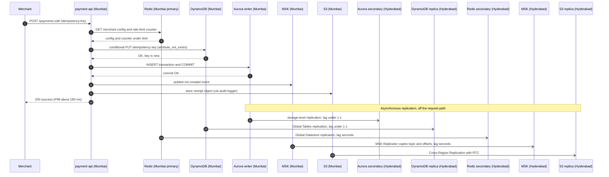
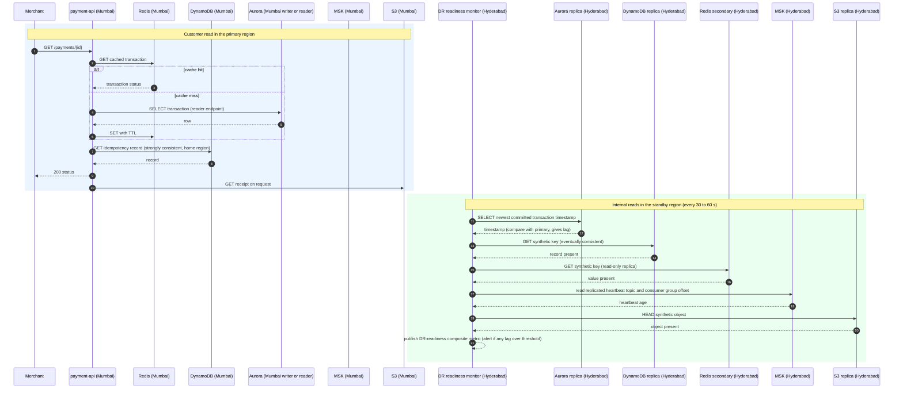
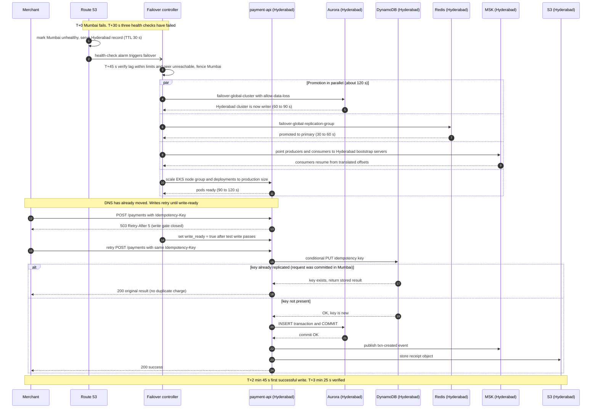
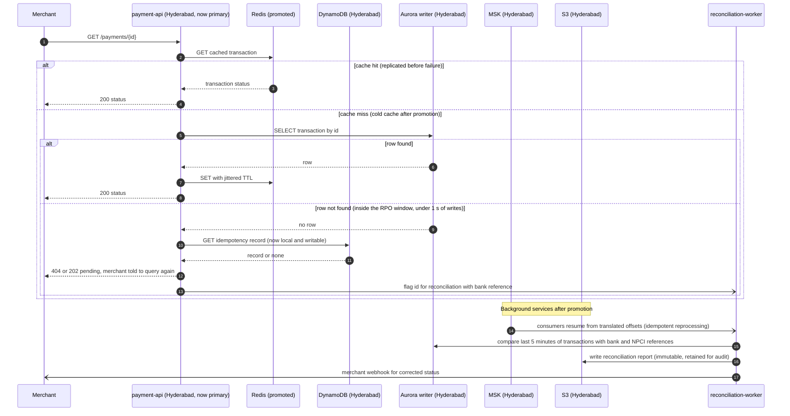
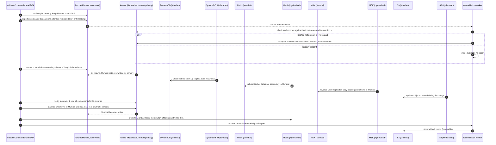

# Replication Sequence Diagrams (Mermaid)

Active-passive design: Mumbai (ap-south-1, `_M`) is primary, Hyderabad (ap-south-2, `_H`) is the standby. These diagrams render natively on GitHub.

**Component coverage.** Every diagram includes all five stateful components, so each has at least one sequence diagram.

| Component | Flow 1 Write | Flow 2 Read | Flow 3 Failover write | Flow 4 Failover read | Flow 5 Failback |
|---|---|---|---|---|---|
| Aurora PostgreSQL | yes | yes | yes | yes | yes |
| DynamoDB | yes | yes | yes | yes | yes |
| ElastiCache Redis | yes | yes | yes | yes | yes |
| MSK Kafka | yes | yes | yes | yes | yes |
| S3 | yes | yes | yes | yes | yes |

---

## Flow 1: Normal Write Path (primary region)
A payment is processed in Mumbai. The merchant gets a response after the local commit. All cross-region replication is asynchronous and off the request path, so P99 stays at about 180 ms.

---

## Flow 2: Normal Read Path (both regions)
Customer-facing reads are served from Mumbai. Hyderabad serves only internal reads (reporting, DR readiness, synthetic checks), which proves the standby is current without sending it production traffic.

---

## Flow 3: Failover Write Path (secondary promoted)
Mumbai is lost. DNS flips to Hyderabad within the first minute while the controller promotes the data stores in parallel. Until Hyderabad is write-ready, writes receive HTTP 503 with Retry-After, and the merchant retries with the same idempotency key.

---

## Flow 4: Failover Read Path (secondary serving)
After promotion, reads are served from Hyderabad. A transaction committed in Mumbai but not yet replicated before the failure will not be found, which is the RPO window. A reconciliation job handles those.

---

## Flow 5: Data Reconciliation After Failback
The original region (Mumbai) recovers. It is rebuilt as a *secondary*, any data that was written in Mumbai but never replicated is recovered and reconciled, and a planned switchover returns the primary role during a low-traffic window.

