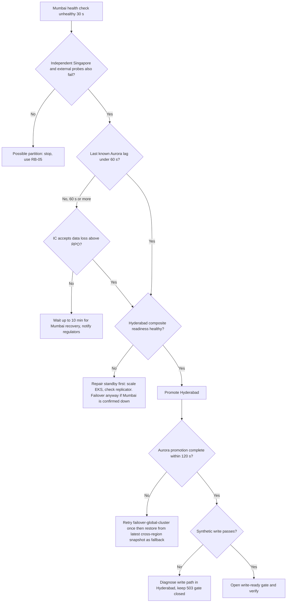

# RB-01: Complete Primary Region Failure (ap-south-1 Mumbai)

## 1. Scenario Identification
| Field | Value |
|---|---|
| ID / name | RB-01 / Complete primary region failure |
| Category | Infrastructure |
| Severity | **P1 - Critical** |
| Affected components | All 12 microservices, EKS (24 nodes), Aurora, DynamoDB, ElastiCache, MSK, ALB/WAF, Transit Gateway, S3, KMS, Secrets Manager |
| Description | The entire ap-south-1 region becomes unavailable due to a cascading infrastructure failure. Compute, databases and networking are unreachable |
| Recovery target | First successful write by about 2:45, documented RTO 4:00, mandate < 5:00. RPO < 60 s (expected about 1 s) |

## 2. Detection Mechanism
| Alert | Source and metric | Threshold | Severity |
|---|---|---|---|
| Route 53 calculated health check unhealthy | `AWS/Route53` `HealthCheckStatus` for `HC-MUM-CALCULATED` (CloudWatch in us-east-1) | `< 1` for 1 evaluation of 30 s | P1 |
| Payment API success rate | `payment_api_success_rate` (2xx / total) | `< 99.5%` for 2 minutes | P1 |
| ALB 5xx surge | `AWS/ApplicationELB` `HTTPCode_ELB_5XX_Count` for `paysecure-mum-alb` | `> 5%` of requests for 2 minutes | P1 |
| Nodes unready | Prometheus `kube_node_status_condition{condition="Ready",status="false"}` | `> 2` nodes for 3 minutes | P2 |
| Replication halted | `AuroraGlobalDBReplicationLag` (Hyderabad cluster) | no datapoints for 2 periods or `> 500 ms` for 2 checks | P1 |
| Independent probe | Singapore synthetic monitor cannot complete a test payment against `api-mum.paysecure.in` | 3 consecutive failures at 10 s | P1 |

Region failure is distinguished from a network partition (RB-05) by the Hyderabad probe, the Singapore probe and an external probe all failing against Mumbai **and** the AWS Health event for ap-south-1 (or total loss of Mumbai API responses).

## 3. Impact Assessment
| Measure | Value |
|---|---|
| Traffic stopped | up to 1,200 TPS at peak, about 37 TPS average (about 250 in business hours) |
| Revenue loss | about 62,500 INR per minute (37.5 lakh INR per hour) |
| Transaction value blocked | about 34.7 lakh INR per minute (20.83 crore INR per hour) |
| Merchants affected | 45,000 (100%) |
| Data at risk | up to the replication lag: about 37 transactions at 1 s at average load, about 1,200 at 1 s at peak |
| Regulatory exposure | RBI (outage notification), NPCI (UPI participant), CERT-In if the cause is cyber. Fines up to 2 crore INR for a P1 incident |
| Reputational | Each minute above RTO increases merchant churn risk |

## 4. Immediate Response (0-2 minutes)
1. **[SRE-1, 0:00-0:30]** Acknowledge the PagerDuty P1 page. Open the war room bridge and the incident channel. Use the PagerDuty app or `pd incident:ack`.
2. **[SRE-1, 0:30]** Freeze all deployments to stop pipeline activity in both regions: `aws codepipeline disable-stage-transition --pipeline-name paysecure-release --stage-name Deploy --transition-type Outbound --reason "RB-01 incident freeze" --region ap-south-2`.
3. **[IC, 0:30-1:00]** Declare P1, assign roles (SRE-1, SRE-2, DBA, NET, DATA, COMMS, COMP). Send the internal template.
4. **[SRE-2, 0:30-1:30]** Confirm automatic Route 53 flip started: `aws route53 get-health-check-status --health-check-id HC-MUM-CALCULATED --query 'HealthCheckObservations[*].[Region,StatusReport.Status]' --output table`.
5. **[IC, by 2:00]** Veto window check: confirm the failover controller has started (Step Functions execution `paysecure-failover` in ap-south-2): `aws stepfunctions list-executions --state-machine-arn arn:aws:states:ap-south-2:ACCOUNT:stateMachine:paysecure-failover --status-filter RUNNING --region ap-south-2`.

## 5. Diagnostic Steps (2-5 minutes, in parallel with Section 6)
6. **[NET, 2:00-3:00]** Confirm the outage is regional and not a partition. From Hyderabad: `ping`/HTTPS probe the Mumbai ALB and Transit Gateway attachment: `aws ec2 describe-transit-gateway-peering-attachments --region ap-south-2 --query 'TransitGatewayPeeringAttachments[*].[TransitGatewayAttachmentId,State]'`.
7. **[SRE-2, 2:00-3:00]** Check AWS Health for ap-south-1: `aws health describe-events --region us-east-1 --filter regions=ap-south-1,eventStatusCodes=open --query 'events[*].[service,eventTypeCode,statusCode]' --output table`.
8. **[DBA, 2:00-3:00]** Record last known replication lag (this is the RPO exposure): `aws cloudwatch get-metric-statistics --namespace AWS/RDS --metric-name AuroraGlobalDBReplicationLag --dimensions Name=DBClusterIdentifier,Value=paysecure-secondary --start-time $(date -u -d '10 minutes ago' +%Y-%m-%dT%H:%M:%S) --end-time $(date -u +%Y-%m-%dT%H:%M:%S) --period 60 --statistics Maximum --region ap-south-2`.
9. **[IC, 3:00]** Decision at this point: see the decision tree below.

## 6. Failover Procedure (5-15 minutes; critical path 2:45 from T+0)
All steps run from the Hyderabad console or an automation host in ap-south-2. Commands run in parallel groups.

10. **[DBA, T+0:45 to 2:15, 60-90 s]** Promote the Aurora secondary:
    `aws rds failover-global-cluster --region ap-south-2 --global-cluster-identifier paysecure-global --target-db-cluster-identifier arn:aws:rds:ap-south-2:ACCOUNT:cluster:paysecure-secondary --allow-data-loss`
11. **[DBA, parallel, 30 s]** Watch role change: `aws rds describe-global-clusters --region ap-south-2 --global-cluster-identifier paysecure-global --query 'GlobalClusters[0].GlobalClusterMembers[*].[DBClusterArn,IsWriter]' --output table`. Expect `IsWriter = True` on `paysecure-secondary`.
12. **[SRE-1, parallel, 30-60 s]** Promote Redis: `aws elasticache failover-global-replication-group --global-replication-group-id paysecure-redis-global --primary-region ap-south-2 --primary-replication-group-id paysecure-redis-hyd --region ap-south-2`.
13. **[SRE-2, parallel, 90-120 s]** Scale compute: `aws eks update-nodegroup-config --cluster-name paysecure-dr --nodegroup-name app-ng --scaling-config minSize=24,maxSize=40,desiredSize=24 --region ap-south-2`. This is the **critical path**.
14. **[SRE-2, 30 s]** Scale the core deployments: `kubectl --context paysecure-dr -n paysecure scale deployment payment-api --replicas=12` and the same for `transaction-processor` and `settlement-engine`.
15. **[DATA, parallel, 30 s]** Point Kafka clients to Hyderabad: `kubectl --context paysecure-dr -n paysecure patch configmap region-config --type merge -p '{"data":{"kafka-bootstrap":"b-1.paysecure-dr.ap-south-2.amazonaws.com:9094"}}'`. Check replicator and consumer lag: `aws kafka describe-replicator --replicator-arn arn:aws:kafka:ap-south-2:ACCOUNT:replicator/paysecure-replicator/UUID --region ap-south-2 --query 'ReplicatorState'`.
16. **[DBA, 15 s]** Update the Aurora endpoint in the region ConfigMap and roll the services: `kubectl --context paysecure-dr -n paysecure patch configmap region-config --type merge -p '{"data":{"aurora-endpoint":"paysecure-secondary.cluster-xxxx.ap-south-2.rds.amazonaws.com"}}'` then `kubectl --context paysecure-dr -n paysecure rollout restart deployment payment-api transaction-processor settlement-engine`.
17. **[DBA, 15 s]** Confirm DynamoDB replica is writable and caught up: `aws dynamodb describe-table --table-name paysecure-idempotency --region ap-south-2 --query 'Table.[TableStatus,Replicas]'`.
18. **[SRE-1, 10 s]** Confirm DNS has flipped: `aws route53 test-dns-answer --hosted-zone-id Z1234567890 --record-name api.paysecure.in --record-type CNAME` (answer must be the Hyderabad ALB).
19. **[SRE-1, 15 s]** Run the pre-gate synthetic write: `curl -s -o /dev/null -w "%{http_code}\n" -X POST https://api-hyd.paysecure.in/v1/payments -H "X-Test-Merchant: SYNTH-001" -H "Idempotency-Key: rb01-$(date +%s)" -d @synthetic-payment.json`. Expect `200`.
20. **[IC, T+2:45]** Approve and open the write-ready gate: `kubectl --context paysecure-dr -n paysecure patch configmap region-config --type merge -p '{"data":{"write_ready":"true"}}'`. **First successful write is expected here.**
21. **[SRE-2, 30 s]** Verify partner connectivity: check BGP sessions for partner bank VPNs on the Hyderabad Transit Gateway: `aws ec2 describe-vpn-connections --region ap-south-2 --query 'VpnConnections[*].[VpnConnectionId,State,VgwTelemetry[0].Status]' --output table`.
22. **[DATA, 2 min]** Start the reconciliation job for the last 5 minutes before failure: `kubectl --context paysecure-dr -n paysecure create job --from=cronjob/reconciliation-worker rb01-reconcile-$(date +%s)`.
23. **[SRE-1, 1 min]** Re-point alerting and dashboards to Hyderabad: confirm PagerDuty integration from the Hyderabad CloudWatch is active and Grafana datasource `prometheus-hyd` is healthy.
24. **[SEC, 2 min]** Confirm KMS replica key and replicated secrets work from Hyderabad: `aws kms describe-key --key-id alias/paysecure-cde --region ap-south-2 --query 'KeyMetadata.[KeyState,MultiRegion]'` and `aws secretsmanager get-secret-value --secret-id prod/aurora --region ap-south-2 --query VersionId`.
25. **[IC, T+15 min]** Open a Premium Support case for the region event in parallel (not as a substitute for the steps above) and record the case ID in the incident.

Timing summary: steps 10-14 in parallel complete by T+2:45 on the critical path (EKS), step 20 at 2:45, verification to 3:25. Buffer to the 5-minute mandate: 1 min 15 s to the 4-minute target and 2 min 15 s to the mandate.

## 7. Communication Protocol
| When | Audience | Channel | Content |
|---|---|---|---|
| T+1 min | Engineering | PagerDuty + incident channel | `[P1] Complete Region Failure - Incident #RB01-{id}. Status: Mitigating. Impact: all payment traffic, Mumbai unreachable. Actions: failover to Hyderabad in progress. ETA: 4 minutes. IC: {name}. War room: {bridge}` |
| T+5 min | Management (CTO, CRO, Compliance, VP Eng) | SMS + email | `PaySecure incident {id}: Mumbai region down. Failover under way, ETA 4 min. Revenue at risk about 62,500 INR/min. Regulatory notification required. Next update T+15 min` |
| T+5 min | Merchants | Status page, merchant portal banner, email | Merchant template: `Subject: PaySecure Service Advisory - {date}. We are experiencing a service disruption and are switching to our backup region. Payment methods affected: all. Estimated restoration: within 5 minutes. Please retry failed payments with the same idempotency key. Updates every 15 minutes. Support: {support_number}` |
| T+15 min | Partner banks, NPCI | Phone + secure email | Confirm Hyderabad egress IPs, request retry of pending UPI collect requests |
| T+30 min (within 6 h at latest) | RBI, NPCI, CERT-In (if cyber cause) | Regulator template | `Mandatory Incident Report - {date}. Classification P1. Time of detection {timestamp_IST}. Nature: loss of primary region ap-south-1. Impact: {quantified_impact}. Remediation: automated failover to ap-south-2. Status: {status}` |
| Resolution | All | Same channels | Final update with restoration time and RPO outcome |

## 8. Verification and Validation
| # | Check | Command or URL | Expected |
|---|---|---|---|
| V1 | Health endpoint | `curl -s https://api.paysecure.in/health/ready` | HTTP 200, region `ap-south-2` |
| V2 | Synthetic transaction | `curl -X POST https://api.paysecure.in/v1/payments -H "X-Test-Merchant: SYNTH-001" -H "Idempotency-Key: rb01-verify-$(date +%s)" -d @synthetic-payment.json` | 200 and a row in Aurora |
| V3 | Writer role | `aws rds describe-global-clusters --global-cluster-identifier paysecure-global --region ap-south-2` | Hyderabad `IsWriter=True` |
| V4 | Success rate | Grafana panel "Payment API success rate" (Incident Response Dashboard) | >= 99.5% for 5 minutes |
| V5 | P99 latency | Grafana "Transaction P99" | < 300 ms, target about 180 ms |
| V6 | Kafka lag | `kafka-consumer-groups.sh --bootstrap-server $DR_BOOTSTRAP --group settlement-processor --describe` | lag draining toward 0 |
| V7 | Pods | `kubectl --context paysecure-dr -n paysecure get pods --field-selector=status.phase!=Running` | none |

## 9. Rollback Procedure
Rollback applies if Hyderabad promotion causes new problems while Mumbai is *still healthy*, which would mean the failover was wrong (for example a false positive).
1. **[IC, 1 min]** Decide to roll back only if Mumbai is confirmed healthy from three independent probes and Hyderabad shows persistent errors.
2. **[SRE-1, 30 s]** Close the write gate in Hyderabad: set `write_ready=false` in `region-config`.
3. **[DBA, 3-5 min]** Reverse Aurora with a planned switchover once Hyderabad has replicated back: `aws rds failover-global-cluster --global-cluster-identifier paysecure-global --target-db-cluster-identifier arn:aws:rds:ap-south-1:ACCOUNT:cluster:paysecure-primary --switchover --region ap-south-1`. Verify lag is 0 first.
4. **[SRE-1, 1 min]** Promote Redis back: `aws elasticache failover-global-replication-group --global-replication-group-id paysecure-redis-global --primary-region ap-south-1 --primary-replication-group-id paysecure-redis-mum`.
5. **[NET, 1 min]** Restore Route 53 by letting the calculated health check return to healthy (do not force records) and confirm with `aws route53 get-health-check-status`.
6. **[SRE-2, 2 min]** Verify with V1-V5 against Mumbai. Total rollback time about 8-10 minutes.

## 10. Post-Incident Review
- **Timeline reconstruction:** export CloudTrail, Route 53 health check history, Step Functions execution history and PagerDuty log to `/post-incident/RB-01-{date}/`. Record T+0, detection, decision, promotion complete, first write, full verification.
- **Root cause (5 whys):** why did the region fail, why was it not detected earlier, why did the RTO differ from 4:00, why were any transactions lost, why did merchants experience errors.
- **Metrics to record:** actual RTO (first write), actual RPO (lost transactions), failed requests, revenue impact, retry volume.
- **Improvement actions:** track in the improvement register with owner and due date (for example: reduce EKS scale-out time, add reserved capacity).
- **Regulatory checklist:** RBI incident report submitted within the required window, NPCI informed, CERT-In if cyber, PCI DSS assessor informed if cardholder data was touched, board summary to the BCRB within 5 business days.
