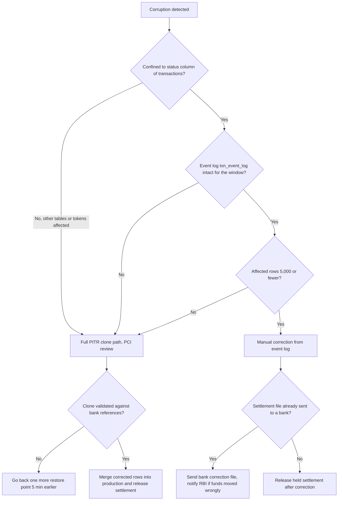

# RB-02: Database Corruption (Aurora PostgreSQL)

## 1. Scenario Identification
| Field | Value |
|---|---|
| ID / name | RB-02 / Database corruption |
| Category | Data |
| Severity | **P1 - Critical** |
| Affected components | Aurora writer and replicas, Hyderabad secondary (corruption replicates), settlement-engine, reconciliation-worker, webhook-dispatcher, merchants' transaction status |
| Description | A software bug corrupts transaction status updates in the primary Aurora PostgreSQL database for the last 15 minutes, about 4,800 transactions. The corruption may already be replicated to Hyderabad |
| Key principle | **Failing over to the secondary does not fix logical corruption**, because the replica holds the same bad data. Recovery is by point-in-time clone, event-log correction or both |
| Recovery target | Containment within 5 minutes, corrected data within 2 hours, zero incorrect settlements |

## 2. Detection Mechanism
| Alert | Source and metric | Threshold | Severity |
|---|---|---|---|
| Status mismatch against event log | `txn_status_event_mismatch_count` (reconciliation-worker, runs every 5 min) | `> 50` in one run | P1 |
| Bank reconciliation break | `settlement_recon_break_ratio` | `> 0.1%` for 5 minutes | P1 |
| Error spike after a release | `payment_api_5xx_rate` correlated with deployment event | `> 1%` within 15 minutes of deploy | P2 |
| Merchant complaints | Support queue tag `wrong-status` | `> 10` tickets in 10 minutes | P2 |
| Data-integrity check | `pg_amcheck` job on the writer (hourly) | any finding | P1 |
| Replication continues normally | `AuroraGlobalDBReplicationLag` stays low | informational: shows corruption replicated | P1 |

## 3. Impact Assessment
| Measure | Value |
|---|---|
| Rows affected | about 4,800 transactions (status field) |
| Value at risk | 4,800 x about 1,562 INR = about 75 lakh INR |
| Merchants potentially affected | up to all 45,000, to be narrowed by query (step 11) |
| Revenue and settlement | wrong status can trigger a wrong settlement, wrong webhook or a wrong refund; settlement batches must be held |
| Regulatory | RBI notification if any financial data was lost or settled incorrectly; PCI DSS review if cardholder-data tables are touched |

## 4. Immediate Response (0-2 minutes)
1. **[SRE-1, 0:00-0:30]** Acknowledge page, open the war room, freeze deployments: `aws codepipeline disable-stage-transition --pipeline-name paysecure-release --stage-name Deploy --transition-type Outbound --reason "RB-02 freeze"`.
2. **[SRE-1, 0:30-1:00]** Roll back the suspect release: `kubectl --context paysecure-primary -n paysecure rollout undo deployment/transaction-processor` then `kubectl --context paysecure-primary -n paysecure rollout status deployment/transaction-processor --timeout=120s`.
3. **[SRE-2, 1:00-1:30]** Stop the bad write path: set the feature flag so status updates queue instead of writing: `kubectl --context paysecure-primary -n paysecure patch configmap region-config --type merge -p '{"data":{"status_updates_enabled":"false"}}'`. New payments continue to be accepted.
4. **[DATA, 1:30-2:00]** Hold settlement: pause the settlement consumer so no incorrect bank file is generated: `kubectl --context paysecure-primary -n paysecure scale deployment settlement-engine --replicas=0`.

## 5. Diagnostic Steps (2-5 minutes)
5. **[DBA, 2:00-2:30]** Take a point-in-time evidence snapshot: `aws rds create-db-cluster-snapshot --db-cluster-identifier paysecure-primary --db-cluster-snapshot-identifier rb02-evidence-$(date +%Y%m%d%H%M) --region ap-south-1`.
6. **[DBA, 2:30-3:00]** Copy the snapshot to Hyderabad for safety (same-country, encrypted): `aws rds copy-db-cluster-snapshot --source-db-cluster-snapshot-identifier arn:aws:rds:ap-south-1:ACCOUNT:cluster-snapshot:rb02-evidence-TIMESTAMP --target-db-cluster-snapshot-identifier rb02-evidence-copy --kms-key-id alias/paysecure-cde --source-region ap-south-1 --region ap-south-2`.
7. **[DBA, 3:00-4:00]** Find when corruption started: `psql -h $WRITER -U dba -d paysecure -c "SELECT date_trunc('minute', updated_at) m, count(*) FROM transactions t JOIN txn_event_log e ON e.txn_id=t.id AND e.seq=(SELECT max(seq) FROM txn_event_log WHERE txn_id=t.id) WHERE t.updated_at > now()-interval '60 minutes' AND t.status <> e.status GROUP BY 1 ORDER BY 1;"`. The first non-zero minute is the corruption start.
8. **[DBA, 4:00-5:00]** Confirm replication to Hyderabad (are the bad rows there?): run the same count against the secondary reader endpoint and note `AuroraGlobalDBReplicationLag` (normally under 1 s, so assume yes).

## 6. Recovery Procedure (5-120 minutes)
9. **[IC, 5:00]** Decide path from the tree: **Path M** (manual correction, event log intact, 5,000 rows or fewer) or **Path P** (point-in-time clone). Record the decision and the criteria values.
10. **[DBA, 5-10 min]** Create the *clean clone* regardless of path. Restore to just before corruption started (example time, replace with step 7 result): `aws rds restore-db-cluster-to-point-in-time --source-db-cluster-identifier paysecure-primary --db-cluster-identifier paysecure-rb02-clone --restore-type copy-on-write --restore-to-time 2026-03-23T14:15:00Z --region ap-south-1`.
11. **[DBA, 10-15 min]** Add an instance to the clone: `aws rds create-db-instance --db-instance-identifier paysecure-rb02-clone-1 --db-cluster-identifier paysecure-rb02-clone --db-instance-class db.r6g.2xlarge --engine aurora-postgresql --region ap-south-1`. Wait: `aws rds wait db-instance-available --db-instance-identifier paysecure-rb02-clone-1`.
12. **[DBA, 15-20 min]** Build the list of affected transaction IDs from production using the step 7 query (without `GROUP BY`) and export: `psql -h $WRITER -d paysecure -c "\copy (SELECT t.id FROM transactions t JOIN txn_event_log e ON e.txn_id=t.id AND e.seq=(SELECT max(seq) FROM txn_event_log WHERE txn_id=t.id) WHERE t.updated_at >= '2026-03-23T14:15:00Z' AND t.status <> e.status) TO '/tmp/affected_ids.csv' CSV"`.
13. **[DBA, 20-30 min]** Extract the correct values from the clone: `psql -h $CLONE -d paysecure -c "\copy (SELECT id,status,status_reason,updated_at FROM transactions WHERE id IN (SELECT id FROM affected_ids)) TO '/tmp/good_status.csv' CSV"` (load the ID list into a temporary table first).
14. **[DATA, 30-40 min]** Cross-check the good values against bank references: `reconciliation-worker --mode verify --input /tmp/good_status.csv --source bank-ref`. Any mismatch is escalated to the IC, not auto-applied.
15. **[DBA, 40-50 min]** Apply the correction in one transaction using a staging table, with an audit row for every change:
    `BEGIN; CREATE TEMP TABLE fix(id uuid, status text, status_reason text); \copy fix FROM '/tmp/good_status.csv' CSV; INSERT INTO txn_correction_audit SELECT t.id,t.status,f.status,now(),'RB-02' FROM transactions t JOIN fix f USING(id); UPDATE transactions t SET status=f.status,status_reason=f.status_reason,updated_at=now() FROM fix f WHERE t.id=f.id; COMMIT;`
16. **[DBA, 50-55 min]** Verify the fix: re-run the step 7 mismatch query. Expected result: 0 rows. Also compare row counts with the bank file counts.
17. **[DATA, 55-70 min]** Replay missed events for corrected transactions to webhook-dispatcher and notification-service: `kubectl --context paysecure-primary -n paysecure create job --from=cronjob/webhook-replay rb02-replay-$(date +%s)` (idempotent by transaction ID and event type).
18. **[SRE-1, 70-75 min]** Re-enable status updates after the fixed release is verified in staging: `kubectl --context paysecure-primary -n paysecure patch configmap region-config --type merge -p '{"data":{"status_updates_enabled":"true"}}'`.
19. **[DATA, 75-80 min]** Release held settlement: `kubectl --context paysecure-primary -n paysecure scale deployment settlement-engine --replicas=6`. Watch the first batch for reconciliation breaks.
20. **[DBA, 80-90 min]** Confirm Hyderabad now has the corrected data (replication lag under 1 s, same mismatch query on the secondary returns 0 rows): `aws cloudwatch get-metric-statistics --namespace AWS/RDS --metric-name AuroraGlobalDBReplicationLag --dimensions Name=DBClusterIdentifier,Value=paysecure-secondary --start-time $(date -u -d '5 minutes ago' +%Y-%m-%dT%H:%M:%S) --end-time $(date -u +%Y-%m-%dT%H:%M:%S) --period 60 --statistics Maximum --region ap-south-2`.
21. **[DBA, 90-100 min]** **Path P only** (wide corruption): promote the clean clone: rename clusters (`aws rds modify-db-cluster --db-cluster-identifier paysecure-primary --new-db-cluster-identifier paysecure-primary-corrupt --apply-immediately`, then rename the clone to `paysecure-primary`), re-create the global cluster relationship, and rebuild the Hyderabad secondary from it. Merge post-clone transactions from the event log and bank references.
22. **[COMP, 100-120 min]** Complete the regulator and bank notices (Section 7) and file the evidence snapshot in the immutable audit bucket.
23. **[IC, 120 min]** Close the incident only after step 16 shows zero mismatches for 3 consecutive 5-minute runs.

## 7. Communication Protocol
| When | Audience | Content |
|---|---|---|
| T+2 min | Engineering | `[P1] Database Corruption - Incident #RB02-{id}. Status: Mitigating. Impact: transaction status wrong for about 4,800 transactions, settlement held. Actions: release rolled back, status updates paused, clone being built. ETA: 2 hours. IC: {name}` |
| T+10 min | Management / CRO | `Incident {id}: about 4,800 transactions (about 75 lakh INR) have wrong status. No funds moved incorrectly so far, settlement held. Decision needed: path M or P at T+5 min. Next update T+30 min` |
| T+20 min | Affected merchants (query result) | Merchant template: `Subject: PaySecure Service Advisory - {date}. Some transaction statuses shown between {start} and {end} may be incorrect. Payments received are safe. Correct statuses will be restored by {time}. Please do not fulfil orders for transactions flagged pending until the update. Support: {support_number}` |
| T+30 min | Bank partners | Pause notice for the settlement file and request for a hold on automatic reconciliation |
| Within RBI window | RBI (if any financial data lost or incorrect settlement happened) | Regulator template: `Classification P1. Nature: logical data corruption in transaction status, about 4,800 transactions. Impact: {quantified_impact}. Remediation: rollback, point-in-time clone, correction with audit trail. Status: {status}` |

## 8. Verification and Validation
| # | Check | Command | Expected |
|---|---|---|---|
| V1 | Mismatch query | step 7 query, primary and secondary | 0 rows |
| V2 | Integrity | `pg_amcheck -h $WRITER -d paysecure --heapallindexed` | no errors |
| V3 | Row counts | `SELECT count(*) FROM transactions WHERE updated_at >= '2026-03-23T14:15:00Z'` on production vs clone | equal, except new traffic |
| V4 | Bank reconciliation | `reconciliation-worker --mode full --window 1h` | break ratio 0% |
| V5 | Test transaction | `curl -X POST https://api.paysecure.in/v1/payments -H "X-Test-Merchant: SYNTH-001" -H "Idempotency-Key: rb02-verify-$(date +%s)" -d @synthetic-payment.json` then read status | consistent status |
| V6 | Dashboard | Grafana "Reconciliation breaks" | flat at 0 |

## 9. Rollback Procedure
If the correction itself causes new inconsistencies:
1. **[DBA, 1 min]** Stop further correction jobs and set `status_updates_enabled=false`.
2. **[DBA, 5 min]** Revert the correction using the audit table: `UPDATE transactions t SET status=a.old_status, updated_at=now() FROM txn_correction_audit a WHERE a.txn_id=t.id AND a.incident='RB-02';` (old values stored by step 15).
3. **[DBA, 15 min]** If the revert is unsafe, restore from the evidence snapshot to a new cluster: `aws rds restore-db-cluster-from-snapshot --db-cluster-identifier paysecure-rb02-rollback --snapshot-identifier rb02-evidence-TIMESTAMP --engine aurora-postgresql --region ap-south-1`.
4. **[DATA, 5 min]** Keep settlement paused until step 2 is verified with V1 and V4.

## 10. Post-Incident Review
- **Timeline:** release time, first corrupt write, first alert, rollback, clone, correction, settlement release. Source: deployment log, `txn_event_log`, CloudTrail, `txn_correction_audit`.
- **Root cause (5 whys):** why was the bug released (test gap), why did the corruption not fail fast (no write-time constraint), why was detection 5-15 minutes (reconciliation interval), why did replication spread it (by design), why was a clean restore point needed.
- **Improvement actions:** add CHECK constraints and a status state machine in the database, reduce reconciliation interval to 1 minute, add canary releases on 5% of traffic with automatic rollback on mismatch count, add per-release schema contract tests.
- **Regulatory checklist:** RBI incident report, bank partner confirmation, PCI DSS assessor note if CDE tables touched, merchant compensation review, audit evidence stored for 7 years.
