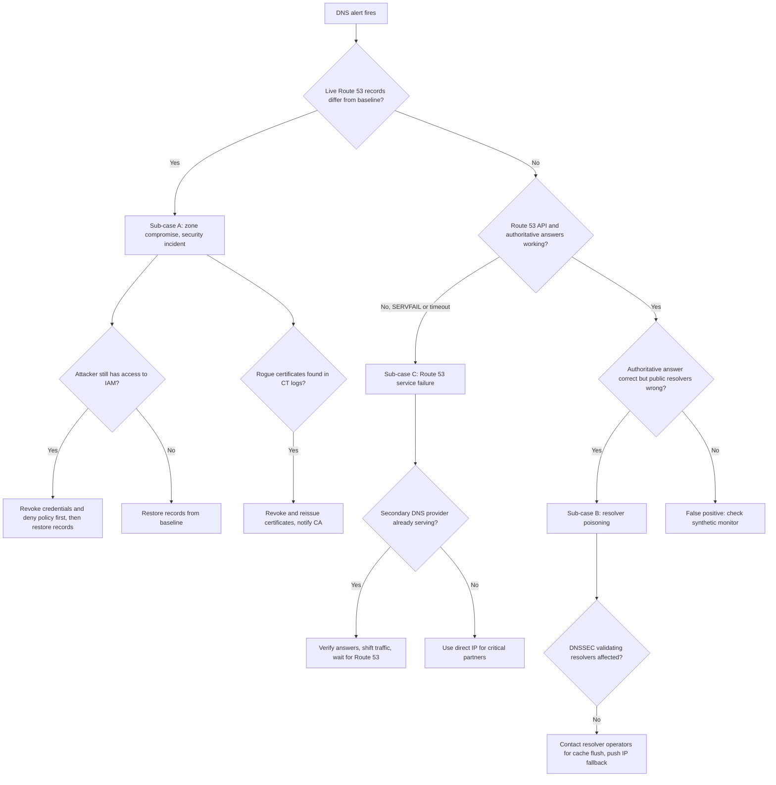

# RB-03: DNS Poisoning / DNS Infrastructure Failure

## 1. Scenario Identification
| Field | Value |
|---|---|
| ID / name | RB-03 / DNS poisoning or DNS infrastructure failure |
| Category | Security |
| Severity | **P2 - High** (escalate to P1 if records are hijacked or customers are redirected to a malicious endpoint) |
| Affected components | Route 53 hosted zone, `api.paysecure.in`, ALBs, every external endpoint, partner bank connections, TLS certificates (issuance risk) |
| Description | PaySecure's DNS records are compromised (zone tampering), resolvers return forged answers (cache poisoning), or Route 53 suffers a service-level failure |
| Three sub-cases | **A** zone compromise (records changed in Route 53). **B** resolver cache poisoning (records are correct, answers are wrong). **C** Route 53 service failure (no answers) |
| Recovery target | Containment 5 minutes, correct resolution restored in 15 minutes for sub-cases A and C, CERT-In report within 6 hours |

## 2. Detection Mechanism
| Alert | Source and metric | Threshold | Severity |
|---|---|---|---|
| DNSSEC validation failure | CloudWatch `AWS/Route53` `DNSSECInternalFailure` and `DNSSECKeySigningKeysNeedingAction` (us-east-1) | `>= 1` for 1 period of 60 s | P1 |
| Unexpected answer | External DNS synthetic check `dns_resolution_mismatch` (queries `api.paysecure.in` from 5 public resolvers and 3 probes outside AWS every 60 s, compares to expected ALB CNAMEs) | `>= 1` mismatch in 2 consecutive runs | P1 |
| Unauthorised record change | CloudTrail event `ChangeResourceRecordSets` by a principal other than the failover controller role or CI role | any | P1 |
| Resolution failures | Probe error `SERVFAIL` or `NXDOMAIN` for `api.paysecure.in` | `> 1%` of queries for 2 minutes | P2 |
| Traffic drop | `payment_api_request_count` vs same-time-last-week | `< 70%` for 5 minutes | P2 |
| Merchant reports | Support tag `cannot-connect` | `> 10` in 10 minutes | P2 |

## 3. Impact Assessment
| Measure | Value |
|---|---|
| Traffic affected | Sub-case B: only clients using poisoned resolvers (percentage unknown at first). Sub-cases A and C: up to 100% |
| Revenue at risk | up to about 62,500 INR per minute (37.5 lakh per hour) at full outage; proportional for partial |
| Security risk | Redirected clients could send payment data to an attacker, so treat as a **data compromise risk** until proven otherwise |
| Partner banks / NPCI | Calls to partner endpoints may fail; UPI callbacks may not arrive |
| Regulatory | CERT-In mandatory reporting within 6 hours; RBI if customers were redirected; PCI DSS incident response (Requirement 12.10) |

## 4. Immediate Response (0-2 minutes)
1. **[SRE-1, 0:00-0:30]** Acknowledge page, open war room, add **SEC** to the bridge immediately because this may be a security incident.
2. **[SEC, 0:30-1:00]** Freeze DNS changes and identify the actor of recent changes: `aws cloudtrail lookup-events --lookup-attributes AttributeKey=EventName,AttributeValue=ChangeResourceRecordSets --max-results 20 --region us-east-1 --query 'Events[*].[EventTime,Username,EventId]' --output table`.
3. **[SRE-2, 1:00-1:30]** Compare live records with the approved set: `aws route53 list-resource-record-sets --hosted-zone-id Z1234567890 --query "ResourceRecordSets[?Name=='api.paysecure.in.']" > /tmp/live.json` and `diff /tmp/live.json s3-baseline/zone-latest.json` (baseline pulled from `aws s3 cp s3://paysecure-dns-backup/zone-latest.json s3-baseline/`).
4. **[NET, 1:30-2:00]** Check what the world sees: `dig +short api.paysecure.in @8.8.8.8`, `dig +short api.paysecure.in @1.1.1.1`, `dig +dnssec api.paysecure.in @9.9.9.9` and compare against the expected Mumbai ALB CNAME.

## 5. Diagnostic Steps (2-5 minutes)
5. **[NET, 2:00-3:00]** Decide the sub-case with the tree below, using the live-vs-baseline diff and the resolver answers.

6. **[SEC, 3:00-4:00]** If sub-case A: check for rogue certificates issued against our domain: search Certificate Transparency logs (for example `curl -s "https://crt.sh/?q=%25.paysecure.in&output=json" | jq '.[] | select(.not_before > "2026-03-23") | [.id,.issuer_name,.name_value]'`) and verify the CAA record restricts issuers: `dig CAA paysecure.in +short`.
7. **[NET, 4:00-5:00]** If sub-case B: identify affected resolvers/ISPs from probe results and support tickets; record resolver IPs, timestamps and wrong answers as evidence.

## 6. Recovery Procedure (5-30 minutes)
**Common steps**
8. **[IC, 5:00]** Confirm sub-case and approve recovery path. Declare P1 if customers were redirected.
9. **[SEC, 5-7 min]** Contain access: list access keys and last use: `aws iam list-access-keys --user-name <suspect-user>`, then deactivate: `aws iam update-access-key --user-name <suspect-user> --access-key-id <KEY> --status Inactive`. For a role, attach an emergency deny: `aws iam put-role-policy --role-name <suspect-role> --policy-name EmergencyDenyRoute53 --policy-document file://deny-route53.json`.

**Sub-case A (zone compromise)**
10. **[NET, 7-10 min]** Restore records from the signed baseline: `aws route53 change-resource-record-sets --hosted-zone-id Z1234567890 --change-batch file://zone-baseline-change-batch.json` (generated from Terraform state, never hand-edited). Verify with `aws route53 get-change --id <CHANGE_ID>` until `INSYNC`.
11. **[SEC, 10-15 min]** Check DNSSEC state and re-sign if the key was touched: `aws route53 get-dnssec --hosted-zone-id Z1234567890`. If the key-signing key was compromised, create a new KSK and update the DS record at the registrar.
12. **[SEC, 15-20 min]** Rotate credentials of all principals with `route53:ChangeResourceRecordSets`, enable MFA delete protection, and review CloudTrail for lateral movement (also invoke RB-11 playbook steps if ransomware indicators appear).

**Sub-case C (Route 53 failure)**
13. **[NET, 5-10 min]** Verify the secondary authoritative DNS provider (pre-delegated, same zone, NS records of both providers listed at the registrar) is answering: `dig api.paysecure.in @ns1.secondary-dns.example +short`. Most resolvers fall back to it automatically.
14. **[NET, 10-15 min]** Update the secondary provider zone if needed from the same Terraform baseline (secondary provider module `modules/dns-secondary`).
15. **[COMMS, 5-10 min]** For critical partner banks, activate the **direct-IP fallback**: give the pre-registered static addresses of the NLBs (`partner-api` listener, one Elastic IP per AZ in each region) and ask the partner to add a hosts/override entry: `partner-api.paysecure.in -> 203.0.113.10 (Mumbai), 203.0.113.20 (Hyderabad)`. These IPs are pre-allow-listed so no firewall change is needed.

**Sub-case B (resolver poisoning)**
16. **[NET, 5-15 min]** Ask public resolver operators to flush the cache for `api.paysecure.in` (Google Public DNS and Cloudflare provide cache-purge pages), contact affected ISPs' NOCs with the evidence, and temporarily lower TTL on helper records.
17. **[SRE-1, 5-10 min]** Enable DNS-independent fallback for merchants: publish the regional hostnames `api-mum.paysecure.in` and `api-hyd.paysecure.in` and the SDK fallback list in the status page.
18. **[SEC, 10-15 min]** Confirm DNSSEC signing is valid so that validating resolvers reject forged answers: `dig +dnssec +multi api.paysecure.in @8.8.8.8` shows the `ad` flag.

**All sub-cases**
19. **[SEC, 20-30 min]** Contain the risk to cardholder data: review WAF and ALB logs for connections from unusual sources during the incident window: `aws logs filter-log-events --log-group-name /aws/alb/paysecure-mum --start-time <epoch_ms> --filter-pattern '"ELB-HealthChecker" -'`; rotate API keys and webhook secrets if redirection occurred.
20. **[AWS support, parallel]** Open an AWS Support case (Business/Enterprise) for Route 53 and a security case with AWS Trust & Safety if the account was accessed. This is parallel and not a substitute for the steps above.
21. **[COMP, within 6 h]** File the CERT-In incident report (see Section 7) and notify RBI if redirection of payment traffic is suspected.
22. **[IC, T+30 min]** Declare mitigated only when all probes (5 public resolvers, 3 external probes) show correct answers for 10 minutes.

## 7. Communication Protocol
| When | Audience | Content |
|---|---|---|
| T+2 min | Engineering | `[P2] DNS Poisoning / DNS Failure - Incident #RB03-{id}. Status: Investigating. Impact: some clients cannot resolve or are resolved to wrong addresses. Components: Route 53, api.paysecure.in. Actions: records compared to baseline, access contained. ETA: 30 min. IC: {name}` |
| T+10 min | Management and CISO | `Incident {id}: possible DNS compromise. Customers may be redirected. Revenue at risk up to 62,500 INR/min at full effect. CERT-In report due in 6 hours. Next update T+30 min` |
| T+10 min | Merchants | `Subject: PaySecure Service Advisory - {date}. Some merchants may have difficulty connecting. Please use the regional endpoints api-mum.paysecure.in or api-hyd.paysecure.in and do not enter or send payment data to any unfamiliar site. Retry failed payments with the same idempotency key. Updates every 15 minutes. Support: {support_number}` |
| T+15 min | Partner banks / NPCI | Direct-IP fallback addresses and authentication check instructions |
| Within 6 h | CERT-In (mandatory), RBI if redirection | Regulator template with indicators of compromise (changed records, change IDs, actor, resolver IPs) |

## 8. Verification and Validation
| # | Check | Command | Expected |
|---|---|---|---|
| V1 | Authoritative answer | `dig api.paysecure.in @$(dig NS paysecure.in +short \| head -1) +short` | Expected ALB CNAME |
| V2 | Public resolvers | `for r in 8.8.8.8 1.1.1.1 9.9.9.9; do dig +short api.paysecure.in @$r; done` | All identical and correct |
| V3 | DNSSEC | `dig +dnssec api.paysecure.in @8.8.8.8` | `ad` flag present |
| V4 | Zone vs baseline | `aws route53 list-resource-record-sets ...` diff | no diff |
| V5 | Synthetic transaction | `curl -s -o /dev/null -w "%{http_code}" https://api.paysecure.in/health/ready` | 200 |
| V6 | CT logs | no new certificates for `*.paysecure.in` except ours | none |
| V7 | CloudTrail | no further unauthorised `ChangeResourceRecordSets` | none |

## 9. Rollback Procedure
If the restored baseline causes errors (for example outdated records):
1. **[NET, 2 min]** Re-apply the previous known-good change batch (kept in S3 with version history): `aws s3api list-object-versions --bucket paysecure-dns-backup --prefix zone-latest.json`, then restore the chosen version and re-run the change batch.
2. **[NET, 3 min]** If the secondary provider records were changed, revert them from the same Terraform state and verify with V1-V3.
3. **[SRE-2, 2 min]** If the emergency IAM deny blocks the failover controller, remove the deny from legitimate roles only: `aws iam delete-role-policy --role-name paysecure-failover-controller --policy-name EmergencyDenyRoute53`.
4. **[SEC, 5 min]** Re-verify with V1-V7. Total rollback time about 12 minutes.

## 10. Post-Incident Review
- **Timeline:** record when the first bad answer was served (from resolver logs and probes), the first alert, the diagnosis, containment, restoration, and the last wrong answer observed.
- **Root cause (5 whys):** how was access gained or how was the resolver poisoned, why was it not blocked (MFA, least privilege, DNSSEC), why detection took the time it did, why was customer impact not zero.
- **Improvement actions:** require MFA and session approval for Route 53 changes, move all DNS changes to Terraform-only pipelines, enable DNSSEC on all zones, CAA records, registrar lock, secondary DNS provider drill (Month 4), partner IP allow-list refresh.
- **Regulatory checklist:** CERT-In within 6 hours, RBI if redirection of payment traffic, PCI DSS Requirement 12.10 incident documentation, partner banks informed, evidence preserved (CloudTrail export, resolver logs).
