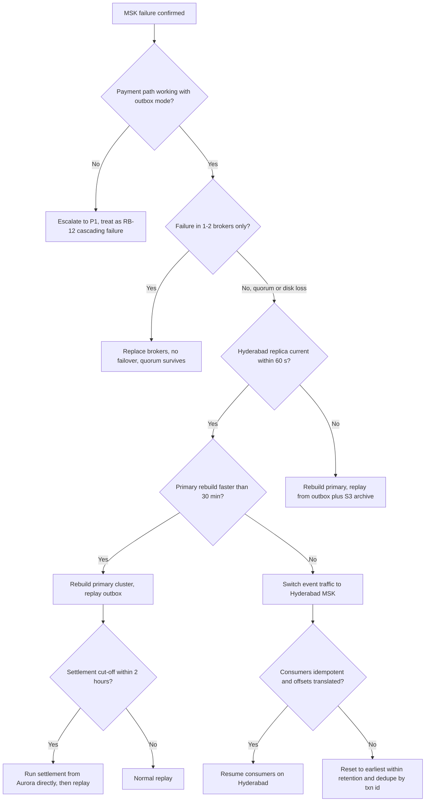

# RB-04: Kafka (Amazon MSK) Cluster Failure

## 1. Scenario Identification
| Field | Value |
|---|---|
| ID / name | RB-04 / Kafka cluster failure |
| Category | Infrastructure |
| Severity | **P2 - High** (P1 if settlement is delayed past the bank cut-off) |
| Affected components | MSK `paysecure-prod` (6 brokers), settlement-engine, webhook-dispatcher, notification-service, audit-logger, reconciliation-worker |
| Description | The MSK cluster fails completely, for example through broker disk corruption or loss of the controller quorum, so no events can be produced or consumed. The core payment path (API to Aurora) can continue if the direct-write bypass is enabled |
| Recovery target | Payments keep flowing within 3 minutes (bypass), full event processing restored within 30-60 minutes, no event lost |

## 2. Detection Mechanism
| Alert | Source and metric | Threshold | Severity |
|---|---|---|---|
| Brokers down | `AWS/Kafka` `ActiveControllerCount` for `paysecure-prod` | `< 1` for 1 period of 60 s | P1 |
| Brokers offline | `AWS/Kafka` `OfflinePartitionsCount` | `> 0` for 2 minutes | P1 |
| Under-replicated partitions | `AWS/Kafka` `UnderReplicatedPartitions` | `> 0` for 5 minutes | P2 |
| Producer failures | `kafka_producer_error_total` (payment services) | `> 1%` of publishes for 1 minute | P1 |
| Consumer lag | `kafka_consumergroup_lag` for `settlement-processor` | `> 10,000` messages for 5 minutes | P2 |
| Disk | `KafkaDataLogsDiskUsed` | `> 85%` | P2 |
| Replicator | MSK Replicator `MessageLag` | `> 10,000` for 5 minutes | P2 |

## 3. Impact Assessment
| Measure | Value |
|---|---|
| Event rate stopped | up to 50,000 messages/s at peak |
| Downstream effects | Settlement triggers stop, webhooks to 45,000 merchants stop, notifications stop, audit log ingestion stops (compliance exposure) |
| Revenue | Payment acceptance can continue with bypass, so direct revenue loss is 0 if bypass is on within 3 minutes. Without bypass about 62,500 INR/min |
| Backlog cost | Each minute of delay at peak queues about 3 million events to replay (50,000 x 60) |
| Regulatory | None unless settlement is delayed beyond the bank cut-off (then notify RBI/partner banks). Audit gap must be backfilled for PCI DSS Requirement 10 |

## 4. Immediate Response (0-2 minutes)
1. **[SRE-1, 0:00-0:30]** Acknowledge page, open war room.
2. **[SRE-1, 0:30-1:00]** Confirm cluster state: `aws kafka describe-cluster-v2 --cluster-arn arn:aws:kafka:ap-south-1:ACCOUNT:cluster/paysecure-prod/UUID --region ap-south-1 --query 'ClusterInfo.State'`.
3. **[SRE-2, 1:00-1:30]** Enable the **queue-bypass** so payments keep working: `kubectl --context paysecure-primary -n paysecure patch configmap region-config --type merge -p '{"data":{"event_mode":"outbox"}}'`. In outbox mode services write events to the `event_outbox` table in Aurora in the same transaction as the payment (no Kafka needed).
4. **[SRE-2, 1:30-2:00]** Pause consumers so they do not thrash: `kubectl --context paysecure-primary -n paysecure scale deployment webhook-dispatcher notification-service --replicas=0` and keep `settlement-engine` ready but idle.

## 5. Diagnostic Steps (2-5 minutes)
5. **[DATA, 2:00-3:00]** List brokers and state: `aws kafka list-nodes --cluster-arn arn:aws:kafka:ap-south-1:ACCOUNT:cluster/paysecure-prod/UUID --region ap-south-1 --query 'NodeInfoList[*].[BrokerNodeInfo.BrokerId,InstanceType,BrokerNodeInfo.AttachedENIId]' --output table`.
6. **[DATA, 3:00-4:00]** Check broker logs and metrics in CloudWatch Logs Insights: `aws logs start-query --log-group-name /aws/msk/paysecure-prod --start-time $(date -d '15 minutes ago' +%s) --end-time $(date +%s) --query-string 'fields @timestamp, @message | filter @message like /ERROR|FATAL|disk|quorum/ | sort @timestamp desc | limit 50'`.
7. **[DATA, 4:00-5:00]** Check replication health to Hyderabad (is a good copy available?): `aws kafka describe-replicator --replicator-arn arn:aws:kafka:ap-south-2:ACCOUNT:replicator/paysecure-replicator/UUID --region ap-south-2 --query '[ReplicatorState,ReplicationInfoList[0].TargetCompressionType]'` and read the last replicated offsets with `kafka-consumer-groups.sh --bootstrap-server $DR_BOOTSTRAP --group settlement-processor --describe`.

## 6. Recovery Procedure (5-60 minutes)
8. **[IC, 5:00]** Choose the path from the tree: **Path R** (rebuild primary), **Path H** (use the Hyderabad cluster), or **Path B** (broker replacement). Record criteria values.
9. **[DATA, 5-10 min, Path B]** If only brokers failed: reboot unhealthy brokers: `aws kafka reboot-broker --cluster-arn arn:aws:kafka:ap-south-1:ACCOUNT:cluster/paysecure-prod/UUID --broker-ids 2 5 --region ap-south-1`. Wait for `ActiveControllerCount = 1`.
10. **[DATA, 5-10 min, Path H]** Switch events to the Hyderabad cluster: `kubectl --context paysecure-primary -n paysecure patch configmap region-config --type merge -p '{"data":{"kafka-bootstrap":"b-1.paysecure-dr.ap-south-2.amazonaws.com:9094"}}'`. Cross-region latency adds about 15-25 ms per publish, so keep `event_mode=outbox` and use an async publisher worker rather than inline publishing.
11. **[DATA, 10-30 min, Path R]** Create a replacement cluster from the Terraform module (`configs/terraform/modules/messaging`): `terraform -chdir=configs/terraform/envs/prod apply -target=module.messaging -var msk_cluster_name=paysecure-prod-v2`.
12. **[DATA, 30-35 min, Path R]** Recreate topics with the same partitions and retention (7 days): `kafka-topics.sh --bootstrap-server $NEW_BOOTSTRAP --create --topic txn-events --partitions 24 --replication-factor 3 --config retention.ms=604800000` for each topic in `topics.yaml`.
13. **[DATA, 5-15 min]** Restore consumer offsets from the replicated copy or from the Aurora outbox watermark: `kafka-consumer-groups.sh --bootstrap-server $TARGET_BOOTSTRAP --group settlement-processor --reset-offsets --to-datetime 2026-03-23T14:25:00.000 --topic txn-events --execute`. Choose a time slightly *before* the failure to avoid loss. Consumers are idempotent, so reprocessing is safe.
14. **[DATA, 30-40 min]** Replay events accumulated in the outbox into the live cluster: `kubectl --context paysecure-primary -n paysecure create job --from=cronjob/outbox-publisher outbox-replay-$(date +%s)`. Monitor with `SELECT count(*) FROM event_outbox WHERE published_at IS NULL;` until 0.
15. **[DATA, 40-45 min]** Start consumers gradually: `kubectl --context paysecure-primary -n paysecure scale deployment notification-service --replicas=3` then `webhook-dispatcher --replicas=6`, then `settlement-engine --replicas=6`. Increase only while lag drains and Aurora CPU stays under 70%.
16. **[DATA, 45-50 min]** Backfill the audit-log gap for the downtime period from the outbox and application logs into `audit-logger` storage, then confirm continuity: `SELECT min(seq), max(seq), count(*) FROM audit_log WHERE ts BETWEEN :start AND :end;` with no gaps.
17. **[DATA, 50-55 min]** Re-attach replication: recreate or resume MSK Replicator from the new primary (`aws kafka create-replicator ... --replicator-name paysecure-replicator`) and confirm `ReplicatorState` is `RUNNING`.
18. **[SRE-1, 55-60 min]** Return to normal mode: `kubectl --context paysecure-primary -n paysecure patch configmap region-config --type merge -p '{"data":{"event_mode":"kafka"}}'` only after the outbox is empty and lag is under 1,000 for 10 minutes.
19. **[IC, 60 min]** Close after verification V1-V6.

## 7. Communication Protocol
| When | Audience | Content |
|---|---|---|
| T+2 min | Engineering | `[P2] Kafka Cluster Failure - Incident #RB04-{id}. Status: Mitigating. Impact: event streaming down, payments continue via outbox, webhooks and settlement delayed. Components: MSK, settlement, webhooks, audit. ETA: 60 min. IC: {name}` |
| T+10 min | Management | `Incident {id}: MSK failure. Payments unaffected. Webhooks/notifications delayed, settlement on hold. Audit logging backfill required. Next update T+30 min` |
| T+10 min | Merchants | `Subject: PaySecure Service Advisory - {date}. Payments are being processed normally. Payment status notifications (webhooks) may be delayed by up to {time}. Please use the status API to confirm payment status. Updates every 30 minutes. Support: {support_number}` |
| If settlement is delayed | Partner banks, RBI | Settlement delay notice with revised file time. Regulator template only if the bank cut-off is missed |

## 8. Verification and Validation
| # | Check | Command | Expected |
|---|---|---|---|
| V1 | Cluster | `aws kafka describe-cluster-v2 ... --query 'ClusterInfo.State'` | `ACTIVE` |
| V2 | Controller and partitions | CloudWatch `ActiveControllerCount` and `OfflinePartitionsCount` | 1 and 0 |
| V3 | Consumer lag | `kafka-consumer-groups.sh --bootstrap-server $BOOTSTRAP --group settlement-processor --describe` | lag draining to < 1,000 |
| V4 | Outbox | `SELECT count(*) FROM event_outbox WHERE published_at IS NULL;` | 0 |
| V5 | End-to-end test | submit synthetic payment, wait for webhook to the test merchant endpoint | webhook received in under 5 s |
| V6 | Audit continuity | audit query in step 16 | no gaps |

## 9. Rollback Procedure
1. **[DATA, 1 min]** If the new cluster or Hyderabad cluster misbehaves, switch back to outbox mode: `event_mode=outbox` (payments keep working).
2. **[DATA, 3 min]** Pause consumers again: scale `webhook-dispatcher`, `notification-service` and `settlement-engine` to 0.
3. **[DATA, 5-10 min]** Restore the previous offsets recorded before step 13 (saved to `s3://paysecure-runbook-state/rb04/offsets-{time}.json`) with `kafka-consumer-groups.sh --reset-offsets --from-file`.
4. **[DATA, 5 min]** If the replacement cluster is the problem, point `kafka-bootstrap` back to the Hyderabad cluster and retry from step 10.
5. **[SRE-2, 5 min]** Run V1-V6 again. Total rollback time about 15-20 minutes.

## 10. Post-Incident Review
- **Timeline:** first alert, outbox enabled (target under 3 minutes), cause identified, path chosen, replay started, lag zero, audit backfilled, return to Kafka mode.
- **Root cause (5 whys):** why the cluster failed (disk, quorum), why capacity alerts did not prevent it, why detection took the time observed, why any events needed manual replay, why settlement was delayed.
- **Improvement actions:** disk usage alert at 70% with automatic storage scaling, test the outbox bypass monthly (Month 2 and Month 8 drills), keep topic definitions in code, add a Hyderabad warm cluster to the drill plan, quarterly replay test, alerts on unreplicated outbox rows.
- **Regulatory checklist:** audit-log gap documented for PCI DSS Requirement 10, partner banks informed of any settlement delay, RBI notification only if the cut-off was missed.
