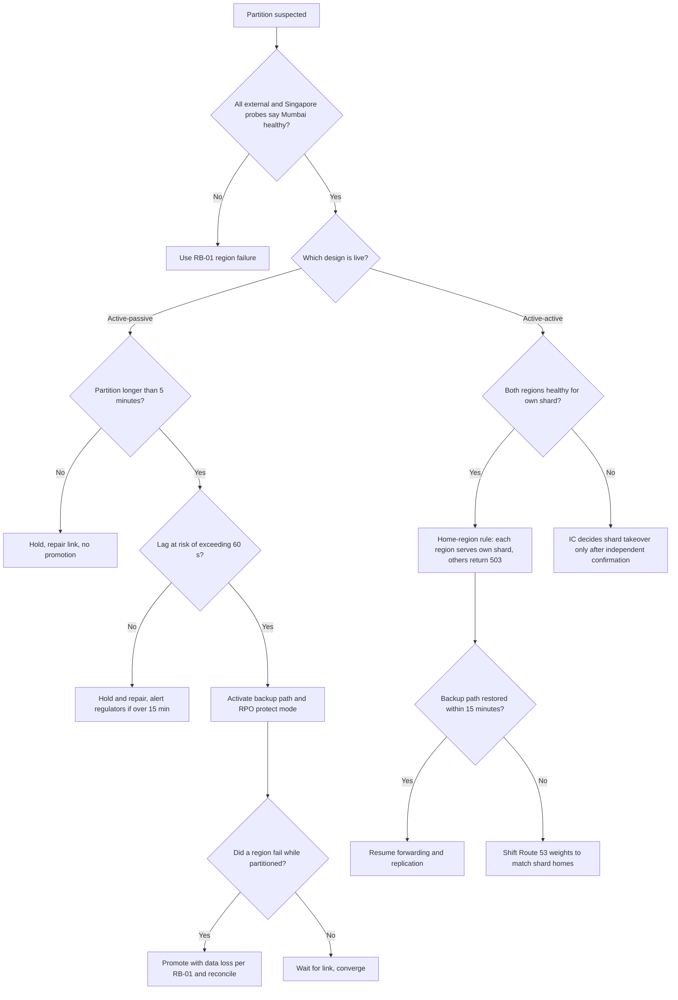

# RB-05: Network Partition Between Regions (Split-Brain Risk)

## 1. Scenario Identification
| Field | Value |
|---|---|
| ID / name | RB-05 / Network partition between ap-south-1 and ap-south-2 |
| Category | Infrastructure |
| Severity | **P1 - Critical** |
| Affected components | Transit Gateway peering, Aurora Global DB replication, DynamoDB Global Tables, ElastiCache Global Datastore, MSK Replicator, S3 CRR, failover controller, cross-region monitoring |
| Description | The network link between Mumbai and Hyderabad is severed while **both regions remain operational**. Replication stops. In active-passive, the standby falls behind. In active-active, a wrong promotion or traffic split would create a split-brain |
| Core principle | A partition is **not** a region failure. Never promote the standby unless the primary is confirmed down from independent vantage points |
| Recovery target | Detect in 60 s, decide in 5 min, restore replication path in 15 min, converge data within 30 min of link return |

## 2. Detection Mechanism
| Alert | Source and metric | Threshold | Severity |
|---|---|---|---|
| Replication lag growing | `AuroraGlobalDBReplicationLag` (Hyderabad cluster) | `> 500 ms` for 2 consecutive checks | P1 |
| DynamoDB lag | `ReplicationLatency` (TableName `paysecure-idempotency`, ReceivingRegion `ap-south-2`) | `> 1000 ms` for 3 checks | P1 |
| Redis lag | `GlobalDatastoreReplicationLag` | `> 2000 ms` for 3 checks | P2 |
| MSK Replicator lag | `MessageLag` | `> 10,000` for 5 minutes | P2 |
| Inter-region probe | `xregion_rtt_ms` and `xregion_packet_loss_pct` (probes in both VPCs) | RTT `> 100 ms` or loss `> 5%` for 60 s | P1 |
| TGW peering traffic | `AWS/TransitGateway` `BytesIn` on the peering attachment | `= 0` for 2 minutes | P1 |
| Region health asymmetry | Route 53 health checks say **Mumbai healthy** but Hyderabad's internal probe of Mumbai fails | any | P1 |

**Distinguishing partition from region failure:** a partition has (a) external probes and Route 53 reporting Mumbai healthy, (b) the Singapore probe able to reach both regions, (c) no AWS Health event for the region. A region failure has all probes failing against Mumbai (see RB-01).

## 3. Impact Assessment
| Measure | Active-passive | Active-active (merchant-sharded) |
|---|---|---|
| Customer traffic | No impact (Mumbai keeps serving) | Requests forwarded across regions fail (about 50% of requests land in the non-home region) until traffic is re-weighted |
| RPO exposure | Grows every second: lag x TPS. At 5 minutes of partition: about 11,100 transactions at average load (37 TPS), about 360,000 at peak (1,200 TPS) not yet replicated | Same per shard |
| Split-brain exposure if both regions wrongly process the same merchant for 3 minutes | n/a | Uncontrolled multi-writer: up to about 6,700 duplicate transactions (about 1.0 crore INR) at average load, about 216,000 (about 33.7 crore INR) at peak. With the home-region rule: effectively 0 duplicates |
| Risk if the primary fails during the partition | RPO breach (data loss equals the lag) | Same per shard |
| Regulatory | RBI/NPCI notification depends on duration and whether RPO is breached | Same |

## 4. Immediate Response (0-2 minutes)
1. **[SRE-1, 0:00-0:30]** Acknowledge the page, open the war room, add **NET** and **DBA** immediately.
2. **[SRE-1, 0:30-1:00]** Freeze all deployments in both regions: `aws codepipeline disable-stage-transition --pipeline-name paysecure-release --stage-name Deploy --transition-type Outbound --reason "RB-05 freeze" --region ap-south-1`.
3. **[IC, 1:00-1:30]** Declare **"no promotion" rule**: nobody promotes Hyderabad or changes Route 53 weights without IC approval. Disable automatic failover temporarily: `aws stepfunctions stop-execution --execution-arn <running-failover-execution-arn> --region ap-south-2` and set the controller to manual: `aws ssm put-parameter --name /paysecure/failover/mode --value manual --overwrite --region ap-south-2`.
4. **[SRE-2, 1:30-2:00]** Check Route 53 view: `aws route53 get-health-check-status --health-check-id HC-MUM-CALCULATED --query 'HealthCheckObservations[*].[Region,StatusReport.Status]' --output table`. If all checkers report Mumbai healthy, partition is likely.

## 5. Diagnostic Steps (2-5 minutes)
5. **[NET, 2:00-3:00]** Check the peering attachment: `aws ec2 describe-transit-gateway-peering-attachments --region ap-south-1 --query 'TransitGatewayPeeringAttachments[*].[TransitGatewayAttachmentId,State,Status.Code]' --output table`.
6. **[NET, 2:00-3:00]** Run a reachability analysis from a Mumbai replication subnet to a Hyderabad one: `aws ec2 start-network-insights-analysis --network-insights-path-id nip-MUM-HYD --region ap-south-1` then `aws ec2 describe-network-insights-analyses --network-insights-analysis-ids <id> --query 'NetworkInsightsAnalyses[0].[Status,NetworkPathFound]'`.
7. **[NET, 3:00-4:00]** Look for route or security-group changes: `aws cloudtrail lookup-events --lookup-attributes AttributeKey=EventSource,AttributeValue=ec2.amazonaws.com --max-results 25 --region ap-south-1 --query 'Events[*].[EventTime,EventName,Username]' --output table`.
8. **[DBA, 3:00-4:00]** Record per-component lag for the RPO exposure (Aurora example): `aws cloudwatch get-metric-statistics --namespace AWS/RDS --metric-name AuroraGlobalDBReplicationLag --dimensions Name=DBClusterIdentifier,Value=paysecure-secondary --start-time $(date -u -d '10 minutes ago' +%Y-%m-%dT%H:%M:%S) --end-time $(date -u +%Y-%m-%dT%H:%M:%S) --period 60 --statistics Maximum --region ap-south-2`.
9. **[SEC, 4:00-5:00]** Rule out a security cause (malicious route change, DoS on the link) and AWS Health: `aws health describe-events --region us-east-1 --filter eventStatusCodes=open,regions=ap-south-1,ap-south-2`.

## 6. Recovery Procedure (5-30 minutes)
10. **[IC, 5:00]** Decide using the tree and record the decision and criteria values.
11. **[NET, 5-10 min]** Activate the **pre-provisioned backup path** (inter-region VPC peering on the AWS backbone, no internet): `aws ec2 describe-vpc-peering-connections --filters Name=status-code,Values=active --region ap-south-1` and make routes prefer it: `aws ec2 replace-route --route-table-id rtb-replication-mum --destination-cidr-block 10.1.0.0/16 --vpc-peering-connection-id pcx-backup-mum-hyd --region ap-south-1` and the mirrored route in ap-south-2: `aws ec2 replace-route --route-table-id rtb-replication-hyd --destination-cidr-block 10.0.0.0/16 --vpc-peering-connection-id pcx-backup-mum-hyd --region ap-south-2`. Both paths stay inside AWS India infrastructure, which preserves data residency.
12. **[NET, 10-12 min]** If the Transit Gateway attachment is unhealthy, recreate it: `aws ec2 delete-transit-gateway-peering-attachment --transit-gateway-attachment-id tgw-attach-xxx --region ap-south-1` followed by `aws ec2 create-transit-gateway-peering-attachment --transit-gateway-id tgw-mum --peer-transit-gateway-id tgw-hyd --peer-account-id ACCOUNT --peer-region ap-south-2 --region ap-south-1` and accept it with `aws ec2 accept-transit-gateway-peering-attachment --transit-gateway-attachment-id tgw-attach-new --region ap-south-2`.
13. **[DATA, 5-10 min]** **RPO-protect mode** (active-passive, partition expected to last): reduce lag risk by shipping the transaction tail through the backup path or to local durable storage. Set the batch jobs to low-volume: `kubectl --context paysecure-primary -n paysecure patch configmap region-config --type merge -p '{"data":{"batch_mode":"low"}}'` and export the committed-transaction ledger every 60 seconds to S3 in **Mumbai** (`aws s3 cp /tmp/ledger-tail.csv s3://paysecure-recovery-mum/ledger/$(date +%s).csv`) so it can be reconciled if Mumbai is lost.
14. **[SRE-1, 5-10 min]** **Active-active only:** enforce the home-region rule: set `cross_region_forwarding=disabled` so a request for the other shard returns `503 Retry-After: 5` instead of hanging: `kubectl --context paysecure-primary -n paysecure patch configmap region-config --type merge -p '{"data":{"cross_region_forwarding":"disabled"}}'` and the same in `paysecure-dr`.
15. **[NET, 8-12 min]** **Active-active only:** after 5 minutes of partition, match Route 53 weights to shard homes using per-merchant hostnames for large merchants. For the remaining traffic keep 50/50 but accept retry errors: `aws route53 change-resource-record-sets --hosted-zone-id Z1234567890 --change-batch file://weights-shard-aware.json`.
16. **[IC, continuous]** **Do not promote.** Promotion is allowed only if both conditions hold: Mumbai is confirmed down from three independent probes **and** lag is within the 60 s RPO or the IC accepts the loss in writing in the incident log.
17. **[DBA, 12-20 min]** When connectivity returns, confirm replication is catching up: poll `AuroraGlobalDBReplicationLag`, DynamoDB `ReplicationLatency`, `GlobalDatastoreReplicationLag` and the replicator `MessageLag` every 60 s. Expected: lag falls monotonically.
18. **[DBA, 20-25 min]** Converge check for Aurora: run the same checksum on both clusters: `psql -h $ENDPOINT -d paysecure -c "SELECT count(*), md5(string_agg(id::text||':'||status, ',' ORDER BY id)) FROM transactions WHERE updated_at > now() - interval '2 hours';"` on the primary and the secondary reader. The values must be equal.
19. **[DATA, 20-25 min]** Converge check for events: compare Kafka consumer offsets and end offsets after replicator catch-up: `kafka-consumer-groups.sh --bootstrap-server $DR_BOOTSTRAP --group settlement-processor --describe`.
20. **[DBA, 25-30 min]** **If a split-brain actually occurred** (both regions accepted writes for the same shard, for example after a wrong promotion): choose the **authoritative cluster** (the one with bank confirmations and more committed transactions), freeze writes on the other, export the losing side's delta by timestamp: `psql -h $LOSER -d paysecure -c "\copy (SELECT * FROM transactions WHERE created_at BETWEEN :start AND :end) TO '/tmp/loser_delta.csv' CSV"`, compare against the authoritative set by `idempotency_key`, replay missing transactions as reconciled entries, refund duplicates via bank reference, and rebuild the losing cluster as a secondary.
21. **[SRE-1, 25-30 min]** Restore normal settings: `cross_region_forwarding=enabled`, `batch_mode=normal`, controller mode `auto`: `aws ssm put-parameter --name /paysecure/failover/mode --value auto --overwrite --region ap-south-2`.
22. **[IC, 30 min]** Close only after lag has been under 500 ms for 15 minutes on all components and the checksums match.

## 7. Communication Protocol
| When | Audience | Content |
|---|---|---|
| T+2 min | Engineering | `[P1] Network Partition Between Regions - Incident #RB05-{id}. Status: Investigating. Impact: replication halted, DR region falling behind. Customer traffic served from Mumbai. Rule: NO promotion without IC approval. ETA: 30 min. IC: {name}` |
| T+10 min | Management / CRO | `Incident {id}: link between regions down, both regions healthy. Unreplicated transactions: {n} (about {amount} lakh INR). If Mumbai fails now we would lose up to {n} transactions. Decision at T+5 min: hold or protect. Next update T+15 min` |
| T+15 min (active-active only) | Merchants | `Subject: PaySecure Service Advisory - {date}. Some requests may fail temporarily and return a retry message. No payments are lost or duplicated. Please retry with the same idempotency key after the retry interval. Estimated restoration: {time}. Updates every 15 minutes. Support: {support_number}` |
| T+30 min if RPO at risk or customers affected | RBI / NPCI | Regulator template: `Classification P1. Nature: loss of inter-region connectivity, DR replication halted. Impact: {quantified_impact}. Remediation: backup path activated, RPO protection. Status: {status}` |

## 8. Verification and Validation
| # | Check | Command | Expected |
|---|---|---|---|
| V1 | Link | `aws ec2 describe-transit-gateway-peering-attachments --region ap-south-1` | State `available` |
| V2 | Latency | probe `xregion_rtt_ms` | 15-25 ms, loss under 0.1% |
| V3 | Lags | CloudWatch metrics for all five components | below alert thresholds for 15 min |
| V4 | Checksums | step 18 query on both clusters | equal |
| V5 | Writers | `aws rds describe-global-clusters --global-cluster-identifier paysecure-global` | exactly one writer for each cluster |
| V6 | Forwarding (active-active) | `curl https://api.paysecure.in/health/ready` repeated 20 times | all 200 |
| V7 | Test transaction | synthetic payment, read from both regions | consistent result |

## 9. Rollback Procedure
1. **[NET, 2 min]** If the backup path causes problems, restore the original routes: `aws ec2 replace-route --route-table-id rtb-replication-mum --destination-cidr-block 10.1.0.0/16 --transit-gateway-id tgw-mum --region ap-south-1` (and the Hyderabad mirror).
2. **[SRE-1, 2 min]** Reverse application settings (`cross_region_forwarding`, `batch_mode`, controller mode) from the values saved before step 14.
3. **[DBA, 10 min]** If a wrongly promoted cluster must be reverted, run a planned switchover back: `aws rds failover-global-cluster --global-cluster-identifier paysecure-global --target-db-cluster-identifier arn:aws:rds:ap-south-1:ACCOUNT:cluster:paysecure-primary --switchover --region ap-south-1` once replication is healthy.
4. **[SRE-2, 5 min]** Run V1-V7.

## 10. Post-Incident Review
- **Timeline:** link failure start, detection time, decision time, backup path active, link restored, convergence, closure. Source: CloudWatch, TGW flow logs, CloudTrail.
- **Root cause (5 whys):** why the link failed, why the backup path was not automatic, why detection took the time observed, why lag could threaten RPO, whether any promotion decision was wrong.
- **Improvement actions:** automate backup path failover with Route Analyzer health checks, add a third independent path option, alarm on TGW attachment state, drill the no-promotion rule (Month 4 and quarterly drills), put partition scenarios in the decision engine.
- **Regulatory checklist:** record RPO exposure and duration, RBI/NPCI notification if RPO was breached or customers affected, PCI DSS documentation of cardholder data paths (confirm none left India), BCRB summary.
