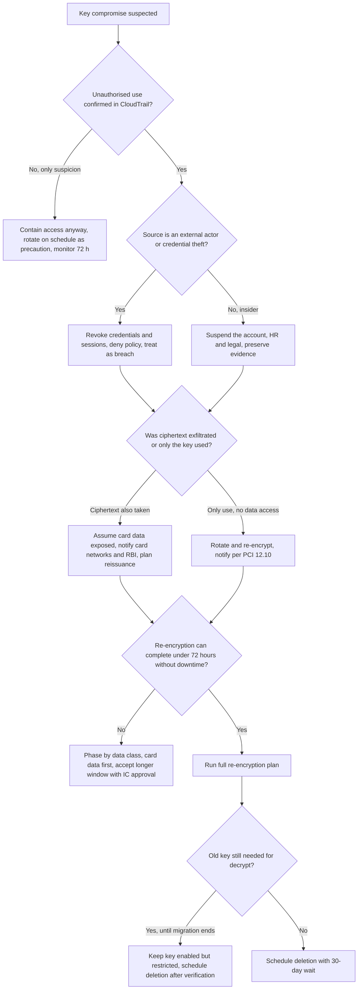

# RB-06: Cryptographic Key Compromise (KMS key for cardholder data)

## 1. Scenario Identification
| Field | Value |
|---|---|
| ID / name | RB-06 / Cryptographic key compromise |
| Category | Security |
| Severity | **P1 - Critical** |
| Affected components | AWS KMS multi-Region key `alias/paysecure-cde` (primary ap-south-1, replica ap-south-2), Aurora storage encryption, tokenisation-service data keys, DynamoDB, S3 backups, Secrets Manager, ElastiCache and MSK encryption |
| Description | A security audit reveals that the KMS key protecting cardholder data may have been compromised |
| Important fact | KMS key material never leaves AWS HSMs. "Compromise" therefore means **unauthorised ability to use the key** (stolen IAM credentials, over-broad key policy or grant, malicious insider, leaked data keys held by an application) rather than stolen key bytes. Containment focuses on removing access, then rotating and re-encrypting |
| Recovery target | Containment within 5 minutes, new key in service within 30 minutes, re-encryption of all data within 72 hours, no payment downtime |

## 2. Detection Mechanism
| Alert | Source and metric | Threshold | Severity |
|---|---|---|---|
| KMS usage anomaly | CloudTrail metric filter `kms_decrypt_count_hourly` for `alias/paysecure-cde` | `> 3x` the normal hourly volume | P1 |
| Unusual caller | CloudTrail `Decrypt`, `GenerateDataKey`, `CreateGrant` by a principal or source IP not on the allow-list | any | P1 |
| Key policy change | CloudTrail `PutKeyPolicy`, `CreateGrant`, `ScheduleKeyDeletion`, `DisableKey` | any outside change windows | P1 |
| GuardDuty | `UnauthorizedAccess:IAMUser/*` or `CredentialAccess` finding for a principal with KMS access | any | P1 |
| Audit finding | Security audit report or bug-bounty report indicating key exposure | manual | P1 |
| Decrypt failures | `kms:Decrypt` `AccessDenied` spike from application roles | `> 1%` | P2 (after containment) |

## 3. Impact Assessment
| Measure | Value |
|---|---|
| Data protected by the key | Tokenised card data and encrypted payment records in Aurora (primary and Hyderabad replica), encrypted backups, S3 exports, DynamoDB tables, secrets |
| Worst case | An attacker with key-use rights and access to ciphertext could decrypt cardholder-related data |
| Payment impact | None if containment is done by changing access, not by disabling the key. Disabling the key would stop all decryption and cause a full outage (about 62,500 INR/min) |
| Regulatory | PCI DSS incident response (Requirement 12.10) with notification to the acquirer immediately and to the card networks within each brand's deadline (PCI DSS itself sets no 72-hour rule; the longest brand window is 72 hours), RBI notification, CERT-In within 6 hours, potential card reissuance coordination |
| Financial | RBI fines up to 5 crore INR, PCI compliance suspension risk, cost of reissuance and forensics |

## 4. Immediate Response (0-2 minutes)
1. **[SRE-1, 0:00-0:30]** Acknowledge the page, open the war room, add **SEC** and **COMP** immediately. Start an evidence log.
2. **[SEC, 0:30-1:00]** Freeze changes: `aws codepipeline disable-stage-transition --pipeline-name paysecure-release --stage-name Deploy --transition-type Outbound --reason "RB-06 freeze"`.
3. **[SEC, 1:00-1:30]** Preserve evidence before anything changes: `aws cloudtrail lookup-events --lookup-attributes AttributeKey=ResourceName,AttributeValue=arn:aws:kms:ap-south-1:ACCOUNT:key/KEYID --max-results 200 --region ap-south-1 > /secure/evidence/rb06/kms-events-$(date +%s).json` and copy to the immutable evidence bucket.
4. **[SEC, 1:30-2:00]** Snapshot the current key policy and grants: `aws kms get-key-policy --key-id KEYID --policy-name default --region ap-south-1 > /secure/evidence/rb06/policy.json` and `aws kms list-grants --key-id KEYID --region ap-south-1 > /secure/evidence/rb06/grants.json`.

## 5. Diagnostic Steps (2-5 minutes)
5. **[SEC, 2:00-3:30]** Identify who and what used the key in the suspect window: Athena or CloudTrail Lake query, or `aws cloudtrail lookup-events --lookup-attributes AttributeKey=EventSource,AttributeValue=kms.amazonaws.com --start-time <T0> --max-results 500 --region ap-south-1 --query 'Events[*].[EventTime,EventName,Username]' --output table`. Look for unknown principals, odd source IPs, Decrypt volume spikes.
6. **[SEC, 3:30-4:30]** Inspect all grants and key policy statements for unexpected principals or `kms:*` permissions (output of step 4).
7. **[SEC, 4:30-5:00]** Check whether suspect credentials are active: `aws iam get-access-key-last-used --access-key-id AKIA...` and `aws iam list-roles --query "Roles[?contains(RoleName,'<suspect>')]"`.

## 6. Recovery Procedure (5 minutes to 72 hours)
**Phase 1: Containment (5-15 min), no downtime**
8. **[IC, 5:00]** Confirm the path from the tree and record the criteria.
9. **[SEC, 5-7 min]** Revoke suspect credentials and sessions: `aws iam update-access-key --user-name <suspect-user> --access-key-id AKIA... --status Inactive`; for roles attach an emergency deny and revoke sessions: `aws iam put-role-policy --role-name <suspect-role> --policy-name EmergencyDenyAll --policy-document file://deny-all.json`.
10. **[SEC, 7-9 min]** Replace the key policy with a minimal one that allows only the tokenisation-service role, the Aurora service role and the break-glass role: `aws kms put-key-policy --key-id KEYID --policy-name default --policy file://minimal-key-policy.json --region ap-south-1`.
11. **[SEC, 9-11 min]** Revoke all grants not on the allow-list: `aws kms revoke-grant --key-id KEYID --grant-id GRANTID --region ap-south-1` (loop over `list-grants` output).
12. **[SEC, 11-13 min]** Confirm production still works: `curl -s -o /dev/null -w "%{http_code}" https://api.paysecure.in/health/deep` expecting 200, and watch for `AccessDenied` on `kms:Decrypt` from legitimate roles.
13. **[SEC, 13-15 min]** Enable stricter detective control: `aws cloudwatch put-metric-alarm --alarm-name kms-decrypt-anomaly --namespace Paysecure/Security --metric-name kms_decrypt_count_hourly --statistic Sum --period 3600 --threshold <3x normal> --comparison-operator GreaterThanThreshold --evaluation-periods 1 --alarm-actions arn:aws:sns:ap-south-1:ACCOUNT:security-p1`.

**Phase 2: New key in service (15-45 min)**
14. **[SEC, 15-20 min]** Create the replacement multi-Region key: `aws kms create-key --multi-region --description "PaySecure CDE key v2" --key-usage ENCRYPT_DECRYPT --region ap-south-1 --query KeyMetadata.KeyId`.
15. **[SEC, 20-23 min]** Replicate it to Hyderabad: `aws kms replicate-key --key-id mrk-NEWKEYID --replica-region ap-south-2 --region ap-south-1`. Verify: `aws kms describe-key --key-id mrk-NEWKEYID --region ap-south-2 --query 'KeyMetadata.KeyState'` = `Enabled`.
16. **[SEC, 23-25 min]** Apply the minimal policy to the new key in both regions: `aws kms put-key-policy --key-id mrk-NEWKEYID --policy-name default --policy file://minimal-key-policy.json --region ap-south-1` and the same with `--region ap-south-2`.
17. **[SEC, 25-27 min]** Point the alias at the new key so all **new** encryption uses it: `aws kms update-alias --alias-name alias/paysecure-cde --target-key-id mrk-NEWKEYID --region ap-south-1` (and ap-south-2). Existing ciphertext remains decryptable because it records the old key ID.
18. **[SRE-1, 27-30 min]** Restart services that cache data keys so they pick up the new key: `kubectl --context paysecure-primary -n paysecure-cde rollout restart deployment tokenisation-service` and the same in `paysecure-dr`. Wait: `kubectl --context paysecure-primary -n paysecure-cde rollout status deployment tokenisation-service --timeout=300s`.
19. **[SEC, 30-35 min]** Rotate secrets that may have been exposed (database credentials, API keys, webhook secrets): `aws secretsmanager rotate-secret --secret-id prod/aurora --region ap-south-1`, then verify `aws secretsmanager describe-secret --secret-id prod/aurora --query 'RotationEnabled'`.

**Phase 3: Re-encryption without production impact (45 min to 72 h)**
20. **[SEC + DBA, 45 min to 4 h]** **Tokenisation layer (card tokens):** re-wrap data keys with the new key (no plaintext decrypt needed): batch job calling `aws kms re-encrypt --ciphertext-blob fileb://dek.enc --destination-key-id mrk-NEWKEYID --region ap-south-1` for every stored data key. Run in batches of 10,000 with a rate limit under the KMS request quota.
21. **[DBA, 2-8 h]** **DynamoDB:** change table encryption in place: `aws dynamodb update-table --table-name paysecure-idempotency --sse-specification Enabled=true,SSEType=KMS,KMSMasterKeyId=mrk-NEWKEYID --region ap-south-1`; repeat for `paysecure-sessions`. Verify replica encryption in Hyderabad.
22. **[DBA, 4-24 h]** **Aurora:** storage encryption keys cannot be changed in place. Build an encrypted-with-new-key cluster in Hyderabad: `aws rds copy-db-cluster-snapshot --source-db-cluster-snapshot-identifier arn:aws:rds:ap-south-1:ACCOUNT:cluster-snapshot:rb06-snap --target-db-cluster-snapshot-identifier rb06-snap-newkey --kms-key-id mrk-NEWKEYID --source-region ap-south-1 --region ap-south-2`, restore it, attach replication, then perform a planned switchover (as RB-01 step 10 with `--switchover`), and rebuild Mumbai from the new primary. Production remains on the old cluster until switchover (zero downtime, switchover under 2 minutes).
23. **[DATA, 4-24 h]** **S3:** re-encrypt backups and exports with S3 Batch Operations (copy objects onto themselves with the new key): `aws s3control create-job --account-id ACCOUNT --operation '{"S3PutObjectCopy":{"TargetResource":"arn:aws:s3:::paysecure-backups","NewObjectMetadata":{},"SSEAwsKmsKeyId":"mrk-NEWKEYID","BucketKeyEnabled":true}}' --manifest file://manifest.json --report file://report.json --priority 10 --role-arn arn:aws:iam::ACCOUNT:role/s3-batch-role --region ap-south-1`.
24. **[DATA, 4-24 h]** **Kafka and Redis:** MSK and ElastiCache use encryption at rest with a KMS key set at creation. Create replacement clusters with the new key during the next maintenance window (RB-04 procedure for MSK), warm Redis from Aurora.
25. **[SEC, 24-48 h]** Invalidate and reissue any application-level credentials derived from the old key (field-level encryption keys for bank details, signing keys for webhooks), and notify merchants to refresh webhook secrets.
26. **[SEC, 48-72 h]** Confirm no data remains under the old key: `aws kms list-resource-tags` is not enough, so run the inventory job `key-inventory --key-id OLDKEYID` that scans RDS, DynamoDB, S3 and EBS encryption metadata. Expected: zero resources.
27. **[SEC, after 72 h verification]** Disable the old key: `aws kms disable-key --key-id OLDKEYID --region ap-south-1` and schedule deletion after the audit retention period: `aws kms schedule-key-deletion --key-id OLDKEYID --pending-window-in-days 30 --region ap-south-1`. (Do not delete earlier, as old backups may still need it. Keep evidence.)

**Regulatory and card-network actions (parallel)**
28. **[COMP, within 6 h]** CERT-In report. **[COMP, immediately, and no later than 72 h]** PCI DSS notification to the acquirer and card networks, with scope and indicators. **[COMP, RBI window]** RBI incident report.
29. **[COMP + IC, within 24-72 h]** If card data exposure is plausible, coordinate with issuing banks and card networks on card reissuance or monitoring (decision after forensic scope is known).
30. **[SEC, within 7 days]** Commission a PCI Forensic Investigator (PFI) review if required by the acquirer.

## 7. Communication Protocol
| When | Audience | Content |
|---|---|---|
| T+2 min | Engineering (restricted to need-to-know) | `[P1] Cryptographic Key Compromise - Incident #RB06-{id}. Status: Investigating. Impact: possible unauthorised use of the card-data key, no customer-visible outage. Actions: access revoked, new key being created. ETA containment 15 min, full re-encryption 72 h. IC: {name}` |
| T+15 min | Management / CISO / CRO / Compliance | `Incident {id}: potential KMS key compromise. Containment done, payments unaffected. PCI 72-hour and CERT-In 6-hour clocks started at {time}. Decisions needed: card network notification scope, forensic firm engagement` |
| T+1 h | Acquirer / card networks | Notification per PCI DSS 12.10 with scope (time window, key, data classes), contact CISO |
| Within 6 h | CERT-In and RBI | Regulator template: `Mandatory Incident Report - {date}. Classification P1. Time of detection {timestamp_IST}. Nature: suspected compromise of encryption key for cardholder data. Impact: {quantified_impact}. Remediation: access revoked, key rotated, data re-encrypted. Status: {status}. Preliminary root cause: {if_known}. Contact: {CISO_name}, {phone}, {email}` |
| T+24 h | Merchants | `Subject: PaySecure Security Advisory - {date}. We have rotated an encryption key as a precaution after a security finding. Payments are unaffected. Please rotate your webhook secrets in the merchant portal. Support: {support_number}` (no technical detail that helps an attacker) |

## 8. Verification and Validation
| # | Check | Command | Expected |
|---|---|---|---|
| V1 | New key state | `aws kms describe-key --key-id mrk-NEWKEYID --region ap-south-2 --query 'KeyMetadata.[KeyState,MultiRegion]'` | `Enabled`, `true` |
| V2 | Alias target | `aws kms list-aliases --key-id mrk-NEWKEYID` | `alias/paysecure-cde` |
| V3 | Policy | `aws kms get-key-policy --key-id mrk-NEWKEYID --policy-name default` | only allowed principals |
| V4 | Payment path | synthetic payment through tokenisation: `curl -X POST https://api.paysecure.in/v1/payments -H "X-Test-Merchant: SYNTH-001" -H "Idempotency-Key: rb06-verify-$(date +%s)" -d @synthetic-payment.json` | 200 |
| V5 | Resources on old key | `key-inventory --key-id OLDKEYID` | none |
| V6 | CloudTrail | no `Decrypt` from unknown principals after containment | none |
| V7 | Alarms | `kms-decrypt-anomaly` alarm state | `OK` |

## 9. Rollback Procedure
1. **[SEC, 3 min]** If a legitimate service broke due to the minimal policy, add the specific role back (never `kms:*`): update `minimal-key-policy.json` and re-apply with `put-key-policy`.
2. **[SEC, 3 min]** If the alias change causes encryption errors, point the alias back to the old key temporarily: `aws kms update-alias --alias-name alias/paysecure-cde --target-key-id OLDKEYID`, fix the issue, then move forward again (the old key stays enabled but restricted until Phase 3 is verified).
3. **[DBA, 10 min]** If the Aurora switchover to the new-key cluster misbehaves, switch back with `aws rds failover-global-cluster --global-cluster-identifier paysecure-global --target-db-cluster-identifier <old primary ARN> --switchover` while the old cluster still exists.
4. **[SEC, 5 min]** Never re-enable a revoked credential. Run V1-V7 again.

## 10. Post-Incident Review
- **Timeline:** first unauthorised use (CloudTrail), detection, containment, new key active, each re-encryption phase complete, key disabled, notifications sent.
- **Root cause (5 whys):** how access was obtained, why least privilege did not prevent it, why detection took the time observed, whether ciphertext was exfiltrated, why the 72-hour re-encryption could not be faster.
- **Improvement actions:** per-service CMKs and key policies (blast radius), `kms:ViaService` and VPC-endpoint conditions on every key, short-lived credentials only, monthly KMS access review, automated key rotation drill (Month 7 drill), hardware-backed MFA for key administrators, split key-admin and key-user roles.
- **Regulatory checklist:** CERT-In 6 h, PCI DSS 12.10 notification within 72 h, RBI incident report, forensic report retained, acquirer and card network confirmations, board and BCRB summary within 5 business days, 7-year evidence retention.
