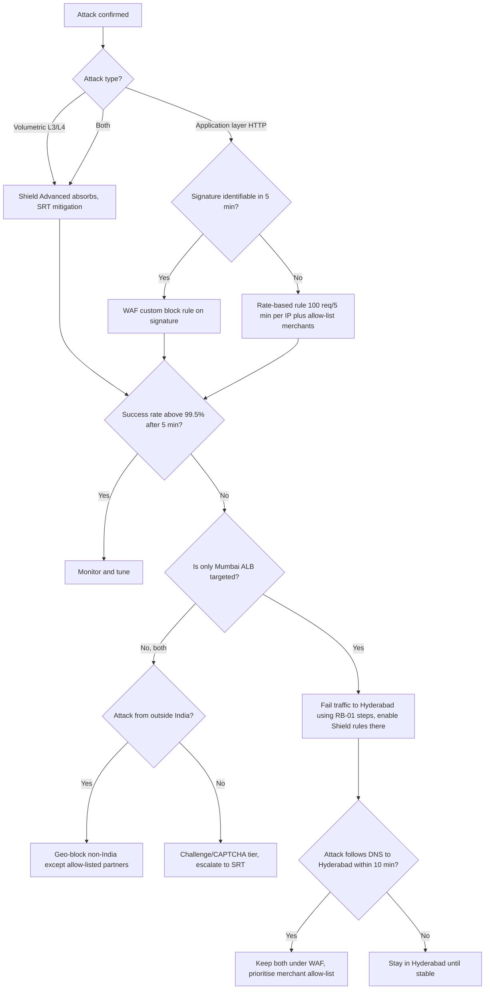

# RB-07: DDoS Attack on the Payment API

## 1. Scenario Identification
| Field | Value |
|---|---|
| ID / name | RB-07 / DDoS attack on payment API |
| Category | Security |
| Severity | **P2 - High** (P1 if legitimate success rate falls below 95% for 5 minutes) |
| Affected components | Route 53, AWS WAF, Application Load Balancer, payment-api, rate-limiter, Redis, EKS capacity, Aurora connection pool |
| Description | Traffic rises from the 1,200 TPS peak to 150,000+ requests per second, about **125x** peak capacity, from distributed sources |
| Recovery target | Attack traffic classified in 3 minutes, legitimate success rate above 99.5% within 10 minutes, full normal operation within 30 minutes |

## 2. Detection Mechanism
| Alert | Source and metric | Threshold | Severity |
|---|---|---|---|
| Shield detection | `AWS/DDoSProtection` `DDoSDetected` for the ALB resource ARN | `>= 1` for 1 period of 60 s | P1 |
| Request surge | `AWS/ApplicationELB` `RequestCount` for `paysecure-mum-alb` | `> 5x` the same-time-last-week baseline for 1 minute (about 6,000 req/s) | P2 |
| WAF blocks | `AWS/WAFV2` `BlockedRequests` and `CountedRequests` | `> 10,000` per minute | P2 |
| Success rate | `payment_api_success_rate` | `< 99.5%` for 2 minutes | P1 |
| Latency | `payment_api_p99_latency_ms` | `> 300 ms` for 5 minutes | P2 |
| Saturation | `kube_node_status_condition` CPU high, HPA at `maxReplicas` | CPU `> 85%` for 3 minutes | P2 |
| Rate-limiter hits | `rate_limiter_rejections_total` | `> 10x` baseline | P3 |

## 3. Impact Assessment
| Measure | Value |
|---|---|
| Capacity gap | Normal capacity about 1,200 TPS; attack about 150,000 req/s, so 125x. Compute cannot absorb it, so it must be filtered upstream |
| Legitimate traffic at risk | up to 1,200 TPS at peak (about 37 TPS average, about 250 in business hours) |
| Revenue | 62,500 INR/min if service is fully unavailable. At 50% success rate about 31,000 INR/min |
| Merchants | 45,000 (all) if the ALB is saturated |
| Cost | Shield Advanced is about 3,000 USD/month with cost-protection credits for scaling charges caused by attacks. Data-transfer charges during the attack should be claimed as credits |
| Regulatory | CERT-In reporting (6 hours); NPCI/RBI if UPI uptime is breached |

## 4. Immediate Response (0-2 minutes)
1. **[SRE-1, 0:00-0:30]** Acknowledge the page, open the war room, add **SEC** and **NET**.
2. **[SEC, 0:30-1:00]** Confirm attack classification in Shield: `aws shield list-attacks --resource-arns arn:aws:elasticloadbalancing:ap-south-1:ACCOUNT:loadbalancer/app/paysecure-mum-alb/ID --start-time FromInclusive=$(date -u -d '30 minutes ago' +%s),ToExclusive=$(date -u +%s) --region us-east-1`.
3. **[SEC, 1:00-1:30]** Engage the Shield Response Team (SRT): open the case in the AWS Support Center and grant access: `aws shield associate-drt-role --role-arn arn:aws:iam::ACCOUNT:role/AWSSRTAccess --region us-east-1`. With proactive engagement enabled, the SRT contacts the 24/7 on-call number.
4. **[SRE-2, 1:30-2:00]** Scale out as a stopgap, since it buys time but does not solve the attack: `kubectl --context paysecure-primary -n paysecure scale deployment payment-api --replicas=40` and `aws eks update-nodegroup-config --cluster-name paysecure-primary --nodegroup-name app-ng --scaling-config minSize=24,maxSize=48,desiredSize=36 --region ap-south-1`.

## 5. Diagnostic Steps (2-5 minutes)
5. **[SEC, 2:00-3:00]** Classify: volumetric (L3/L4), protocol, or application-layer (HTTP flood). Query ALB logs for top talkers: `aws logs start-query --log-group-name /aws/alb/paysecure-mum --start-time $(date -d '10 minutes ago' +%s) --end-time $(date +%s) --query-string 'stats count(*) as c by client_ip | sort c desc | limit 20'`.
6. **[SEC, 3:00-4:00]** Identify the attack signature: user agents, paths (for example `POST /v1/payments` with invalid keys), geo distribution: `fields @timestamp | stats count(*) by user_agent, request_uri | sort count(*) desc | limit 20`.
7. **[NET, 3:00-4:00]** Check whether Hyderabad is also targeted: `aws cloudwatch get-metric-statistics --namespace AWS/ApplicationELB --metric-name RequestCount --dimensions Name=LoadBalancer,Value=app/paysecure-hyd-alb/ID --start-time $(date -u -d '10 minutes ago' +%Y-%m-%dT%H:%M:%S) --end-time $(date -u +%Y-%m-%dT%H:%M:%S) --period 60 --statistics Sum --region ap-south-2`.
8. **[SRE-1, 4:00-5:00]** Measure legitimate success rate by authenticated merchants (valid API key) versus unauthenticated traffic to see how much real traffic is still served.

## 6. Mitigation Procedure (5-30 minutes)
9. **[IC, 5:00]** Approve the mitigation path from the tree.
10. **[SEC, 5-8 min]** Turn the pre-staged emergency WAF rule group from **Count** to **Block** (rate-based rule 100 requests per 5 minutes per source IP on `/v1/payments`). Fetch the lock token: `aws wafv2 get-web-acl --name paysecure-waf --scope REGIONAL --id WEBACLID --region ap-south-1`. Apply the prepared change: `aws wafv2 update-web-acl --name paysecure-waf --scope REGIONAL --id WEBACLID --lock-token TOKEN --cli-input-json file://waf-emergency-block.json --region ap-south-1`.
11. **[SEC, 5-8 min]** Protect known merchants first: maintain an allow-list IP set of merchant server IPs and prioritise it above the rate rule: `aws wafv2 update-ip-set --name paysecure-merchant-ips --scope REGIONAL --id IPSETID --lock-token TOKEN --addresses file://merchant-ips.json --region ap-south-1`.
12. **[SEC, 8-10 min]** If the signature is known, add a custom block rule (user agent, header, URI pattern) in the same `update-web-acl` call.
13. **[SEC, 10-12 min]** If most attack traffic comes from outside India, enable a geo rule that blocks non-IN sources except the partner allow-list (the business is India-only; confirm with COMP).
14. **[NET, 8-12 min]** Traffic engineering: lower Route 53 TTL is already 30 s, so if only Mumbai is attacked fail over to Hyderabad using RB-01 steps 10-20. Ensure Shield Advanced protection is attached to both ALBs: `aws shield describe-protection --resource-arn arn:aws:elasticloadbalancing:ap-south-2:ACCOUNT:loadbalancer/app/paysecure-hyd-alb/ID --region us-east-1`.
15. **[SRE-1, 10-12 min]** Tighten the application rate limiter in Redis for unauthenticated traffic: `kubectl --context paysecure-primary -n paysecure patch configmap region-config --type merge -p '{"data":{"unauth_rate_limit_per_min":"30","authenticated_priority":"true"}}'` and restart `rate-limiter`.
16. **[SRE-2, 10-15 min]** Protect the database: cap payment-api connection pool to prevent Aurora overload: `kubectl --context paysecure-primary -n paysecure patch configmap region-config --type merge -p '{"data":{"db_pool_max":"150"}}'`.
17. **[SEC, 12-15 min]** Enable a CAPTCHA/challenge action for suspicious sessions on the merchant portal and checkout (not on the server-to-server payment API).
18. **[SEC, ongoing]** Maintain a live blocklist: add attacker IP ranges from the log query with `aws wafv2 update-ip-set` (blocklist), reviewed every 5 minutes.
19. **[SRE-1, 15-20 min]** Check that legitimate error rate is falling: Grafana "Authenticated success rate" panel at or above 99.5%.
20. **[SRE-1, 20-25 min]** Scale back down gradually once the attack subsides, never all at once: `kubectl --context paysecure-primary -n paysecure scale deployment payment-api --replicas=12` and `aws eks update-nodegroup-config ... desiredSize=24` after 15 minutes without a spike.
21. **[SEC, 25-30 min]** Hold the WAF rules in Block for at least 24 hours, then convert to Count and review.
22. **[IC, 30 min]** Declare mitigated when the attack rate is below 2x baseline and success rate is above 99.5% for 15 minutes.

## 7. Communication Protocol
| When | Audience | Content |
|---|---|---|
| T+2 min | Engineering | `[P2] DDoS Attack on Payment API - Incident #RB07-{id}. Status: Mitigating. Impact: elevated latency and errors, attack at about {rps} req/s (125x peak). Components: ALB, WAF, payment-api. ETA: 30 min. IC: {name}. SRT engaged` |
| T+10 min | Management / CISO | `Incident {id}: DDoS attack in progress. Success rate {x}%. Revenue at risk up to 62,500 INR/min. WAF and Shield mitigation active. CERT-In report due in 6 hours` |
| T+10 min | Merchants | `Subject: PaySecure Service Advisory - {date}. We are experiencing elevated traffic that may cause some payment requests to be delayed or fail. Payments from registered merchants are prioritised. Please retry failed payments with the same idempotency key and back off for 5 seconds between retries. Updates every 15 minutes. Support: {support_number}` |
| T+15 min | Partner banks / NPCI | Notice that traffic may be shifted to the Hyderabad region and endpoints re-verified |
| Within 6 h | CERT-In | Regulator template: `Classification P2. Nature: distributed denial-of-service against api.paysecure.in. Impact: {quantified_impact}. Remediation: Shield Advanced, WAF rate and signature rules, traffic engineering. Indicators: {top source ranges, signatures}` |

## 8. Verification and Validation
| # | Check | Command | Expected |
|---|---|---|---|
| V1 | Attack rate | CloudWatch `RequestCount` | below 2x baseline |
| V2 | Shield status | `aws shield list-attacks ...` | attack ended |
| V3 | Success rate | Grafana panel | at or above 99.5% for 15 min |
| V4 | Latency | Grafana P99 panel | under 300 ms, target about 180 ms |
| V5 | Merchant test | `curl -X POST https://api.paysecure.in/v1/payments -H "X-Test-Merchant: SYNTH-001" -H "Idempotency-Key: rb07-verify-$(date +%s)" -d @synthetic-payment.json` | 200 |
| V6 | Allow-list | confirm a sample of 20 large merchants can transact | all succeed |

## 9. Rollback Procedure
1. **[SEC, 2 min]** If legitimate traffic is blocked, switch the offending rule back to Count: re-apply `waf-emergency-count.json` with `update-web-acl`.
2. **[SEC, 3 min]** Remove geo-block or rate rule if it is blocking partners; add affected IPs to the merchant allow-list.
3. **[SRE-1, 5 min]** If the region shift to Hyderabad caused errors while Mumbai recovered, switch back using the RB-01 rollback section.
4. **[SRE-2, 5 min]** Restore configuration values (`unauth_rate_limit_per_min`, `db_pool_max`) from the previous ConfigMap saved in Git, then run V1-V6.

## 10. Post-Incident Review
- **Timeline:** attack start, first alert, SRT engagement, WAF block, region decision, success rate recovery, attack end.
- **Root cause (5 whys):** why the origin was reachable at all, why detection took the time observed, why capacity could not absorb it, whether bots exploited a weak endpoint, why legitimate traffic was affected.
- **Improvement actions:** place CloudFront (with WAF) in front of the API for edge absorption, pre-enable proactive SRT engagement, rehearse the WAF switch quarterly, add an attack game day, maintain the merchant IP allow-list and API-key based prioritisation, request Shield cost-protection credits.
- **Regulatory checklist:** CERT-In within 6 hours, NPCI/RBI if uptime obligations breached, PCI DSS documentation, partner bank update, board summary.
