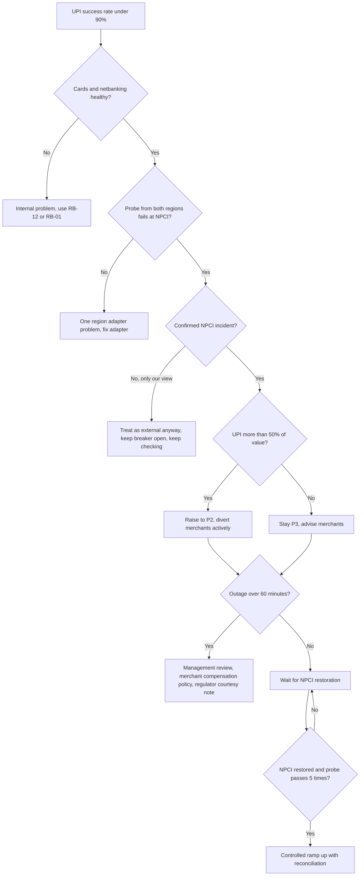

# RB-08: Third-Party Payment Network Outage (NPCI / UPI)

## 1. Scenario Identification
| Field | Value |
|---|---|
| ID / name | RB-08 / NPCI UPI nationwide outage |
| Category | External |
| Severity | **P3 - Medium** (P2 if UPI is more than 50% of transaction value, or the outage lasts over 60 minutes) |
| Affected components | UPI integration only (UPI gateway adapter in transaction-processor), pending-transaction queue, merchant checkout. All PaySecure infrastructure is healthy |
| Description | NPCI's UPI network suffers a nationwide outage. PaySecure's infrastructure is fully operational, but UPI transactions fail at the network level |
| Key principle | **This is not a PaySecure failure. Do not fail over to Hyderabad**, because the same NPCI endpoint is used from both regions and failover would only add risk. Protect customers, avoid duplicate debits and avoid hammering NPCI with retries |
| Recovery target | Distinguish external vs internal within 5 minutes, divert merchants to other methods within 10 minutes, no stuck or duplicate transactions after restoration |

## 2. Detection Mechanism
| Alert | Source and metric | Threshold | Severity |
|---|---|---|---|
| UPI success rate | `upi_txn_success_rate` (per bank and total) | `< 90%` for 3 minutes | P2 |
| NPCI timeouts | `upi_npci_timeout_count` | `> 5%` of UPI requests for 2 minutes | P2 |
| NPCI error codes | `upi_npci_error_total` for system-down codes | `> 20` in 1 minute | P2 |
| Other methods healthy | `card_txn_success_rate`, `netbanking_txn_success_rate` | `> 99%` while UPI is low (confirms external cause) | informational |
| Public confirmation | NPCI status communication, bank notices, public monitors | manual | informational |
| Internal health | `payment_api_success_rate` excluding UPI | `>= 99.5%` | informational |

## 3. Impact Assessment
| Measure | Value |
|---|---|
| Transactions affected | UPI share of the 3.2 million daily transactions (assume 60% for planning, so about 1.9 million/day, about 80,000 per hour at average load) |
| Value at risk | UPI share of 500 crore/day. At an assumed 60% share about 12.5 crore INR per hour of UPI value blocked |
| Revenue | About 37,500 INR per minute if the UPI revenue share is 60% (62,500 INR/min x 60%) and merchants cannot switch |
| Merchants | up to 45,000, mostly those using UPI collect or intent flows |
| Regulatory | No PaySecure notification obligation (NPCI responsibility). Merchants and banks must be informed, and disputes handled under UPI rules |
| Risk | Timeouts create **unknown-status transactions** (debited at the bank, not confirmed) |

(The 60% UPI share is a planning assumption. Replace with the measured share from the cost model if available.)

## 4. Immediate Response (0-2 minutes)
1. **[SRE-1, 0:00-0:30]** Acknowledge the page and open the incident channel (war room not required for P3).
2. **[SRE-1, 0:30-1:00]** Confirm internal health: `curl -s https://api.paysecure.in/health/deep` (expect 200) and check card and netbanking success rate in Grafana.
3. **[SRE-2, 1:00-1:30]** Enable the UPI circuit breaker so PaySecure stops retrying NPCI aggressively: `kubectl --context paysecure-primary -n paysecure patch configmap region-config --type merge -p '{"data":{"upi_circuit_breaker":"open","upi_retry_max":"0"}}'`.
4. **[SRE-2, 1:30-2:00]** Route unknown-status UPI transactions to a **pending** state instead of failed: `kubectl --context paysecure-primary -n paysecure patch configmap region-config --type merge -p '{"data":{"upi_timeout_state":"pending_verify"}}'`.

## 5. Diagnostic Steps (2-5 minutes)
5. **[SRE-1, 2:00-3:00]** Confirm external versus internal using logs: `aws logs start-query --log-group-name /aws/eks/paysecure/upi-adapter --start-time $(date -d '10 minutes ago' +%s) --end-time $(date +%s) --query-string 'stats count(*) by npci_response_code | sort count(*) desc'`.
6. **[SRE-1, 3:00-4:00]** Run a UPI synthetic check from both regions (ReqChkTxn on a test transaction) to confirm failure is on the NPCI side from both: `kubectl --context paysecure-dr -n paysecure exec deploy/upi-adapter -- upi-probe --env prod`.
7. **[COMP, 3:00-5:00]** Check NPCI, partner bank and industry channels for confirmation and ETA, and note the source and time.
8. **[SRE-2, 4:00-5:00]** Count the pending transactions: `SELECT count(*), sum(amount) FROM transactions WHERE status='PENDING_VERIFY' AND method='UPI';` through `psql -h $READER -d paysecure`.

## 6. Response and Recovery Procedure (5-60+ minutes)
9. **[IC, 5:00]** Declare "external dependency outage", record the NPCI incident reference. State explicitly: **no region failover**.
10. **[SRE-1, 5-8 min]** Turn on the checkout banner and alternative-method prompt for all merchants who use PaySecure's hosted checkout: `kubectl --context paysecure-primary -n paysecure patch configmap region-config --type merge -p '{"data":{"checkout_banner_upi_down":"true","checkout_suggest_alternatives":"cards,netbanking,wallets"}}'`.
11. **[SRE-1, 8-10 min]** Disable the UPI option in checkout for merchants who have another method enabled (prevents failed attempts and customer frustration): `kubectl --context paysecure-primary -n paysecure patch configmap region-config --type merge -p '{"data":{"upi_checkout_enabled":"false"}}'`. Merchants that accept only UPI keep the option with a warning banner.
12. **[SRE-2, 8-12 min]** Queue UPI collect requests that merchants submit through the API with HTTP 202 and a retry window instead of failing, with a hard limit so the queue cannot grow without bound (maximum age 15 minutes, collect requests expire at NPCI anyway): `kubectl --context paysecure-primary -n paysecure patch configmap region-config --type merge -p '{"data":{"upi_queue_max_age_min":"15","upi_queue_max_depth":"200000"}}'`.
13. **[DATA, 10-15 min]** Make sure unknown-status transactions are not marked failed prematurely. Run the pending verification worker in "wait" mode: `kubectl --context paysecure-primary -n paysecure scale deployment upi-status-verifier --replicas=2`.
14. **[SRE-1, ongoing every 30 s]** Monitor NPCI recovery with the synthetic probe (alarm `upi-probe-success` when 5 consecutive probes pass): `aws cloudwatch describe-alarms --alarm-names upi-probe-success --query 'MetricAlarms[0].StateValue' --region ap-south-1`.
15. **[IC, on recovery]** When NPCI declares restoration and 5 probes pass, close the breaker in **half-open** mode with a controlled ramp: `kubectl --context paysecure-primary -n paysecure patch configmap region-config --type merge -p '{"data":{"upi_circuit_breaker":"half_open","upi_ramp_percent":"20"}}'`.
16. **[SRE-1, +5 min per stage]** Increase the ramp in stages (20%, 50%, 100%) only while success rate stays above 95% and NPCI timeouts under 2%: update `upi_ramp_percent`.
17. **[DATA, +10 min]** Verify status for every pending UPI transaction using the NPCI transaction-status check (ReqChkTxn) in batches limited to 200 per second so NPCI is not overloaded: `kubectl --context paysecure-primary -n paysecure create job --from=cronjob/upi-status-verifier upi-verify-$(date +%s)`.
18. **[DATA, +20 min]** Resolve each pending transaction as SUCCESS, FAILED or REVERSAL_PENDING, and trigger auto-reversals for debited-but-not-credited cases within the NPCI-defined timelines. Send webhooks to merchants with the final status.
19. **[DATA, +30 min]** Re-enable UPI checkout: `upi_checkout_enabled=true`, clear banners, then run reconciliation against NPCI settlement and raw data files when they arrive (next settlement cycle).
20. **[IC, +60 min]** Close the incident after pending count is 0 and success rate is normal for 15 minutes.

## 7. Communication Protocol
| When | Audience | Content |
|---|---|---|
| T+3 min | Engineering | `[P3] NPCI UPI Outage - Incident #RB08-{id}. Status: Mitigating. Impact: UPI transactions failing at network level. PaySecure infrastructure healthy. Cards and netbanking normal. Actions: circuit breaker open, pending queue active. ETA: dependent on NPCI. IC: {name}` |
| T+10 min | Management | `Incident {id}: nationwide UPI outage (NPCI). Revenue at risk about 37,500 INR/min (planning assumption: UPI is 60% of volume). No PaySecure fault. Merchants diverted to other methods. Next update T+30 min` |
| T+10 min | Merchants | `Subject: PaySecure Service Advisory - {date}. UPI payments are currently unavailable because of a nationwide outage on the UPI network. Our platform and other payment methods (cards, netbanking, wallets) are fully operational. Payment methods affected: UPI. Operational: cards, netbanking, wallets, BNPL. Estimated restoration: depends on NPCI, updates every 30 minutes. Please do not retry UPI payments repeatedly, as unconfirmed debits are auto-reversed per UPI rules. Support: {support_number}` |
| T+15 min | Partner banks | Awareness note with reconciliation plan for pending transactions |
| On recovery | Merchants | Restoration notice and list of transactions with changed status |
| Regulator | NPCI / RBI | **Not required** (NPCI responsibility). Prepare a courtesy summary if the outage exceeds 60 minutes or contractual SLA credits apply |

## 8. Verification and Validation
| # | Check | Command | Expected |
|---|---|---|---|
| V1 | UPI success rate | Grafana panel `upi_txn_success_rate` | above 98% |
| V2 | Probe | `kubectl --context paysecure-primary -n paysecure exec deploy/upi-adapter -- upi-probe --env prod` | success |
| V3 | Pending count | `SELECT count(*) FROM transactions WHERE status='PENDING_VERIFY' AND method='UPI';` | 0 |
| V4 | Breaker | ConfigMap `upi_circuit_breaker` | `closed` |
| V5 | Merchant webhook | test merchant receives final status webhook | received within 5 s |
| V6 | Reconciliation | `reconciliation-worker --mode npci --window 6h` | no breaks |

## 9. Rollback Procedure
1. **[SRE-1, 1 min]** If the ramp-up shows failures, set `upi_circuit_breaker=open` again and `upi_ramp_percent=0`.
2. **[SRE-2, 2 min]** If the queue is growing beyond `upi_queue_max_depth`, stop accepting new UPI collect requests (return 503 with a retry hint).
3. **[SRE-1, 2 min]** Restore the previous checkout settings from Git if the banner or disabled-method flags cause merchant issues.
4. **[DATA, 5 min]** Stop the verification job if NPCI rate-limits it: `kubectl --context paysecure-primary -n paysecure delete job upi-verify-TIMESTAMP`, reduce batch rate to 100 per second and restart. Run V1-V6.

## 10. Post-Incident Review
- **Timeline:** first failed UPI transaction, alert, classification as external, breaker open, merchant diversion, NPCI restoration, ramp-up, pending cleared.
- **Root cause (5 whys):** NPCI's root cause is theirs, but PaySecure reviews why detection took the time observed, why any unknown-status transactions persisted, whether merchants understood the alternative flow, and whether customers were double-debited.
- **Improvement actions:** automated NPCI status ingestion, per-bank circuit breakers, pre-agreed merchant fallback rules, bounded queue with expiry, runbook game day with NPCI-outage simulation (included in the Month 11 chaos drill), merchant education on idempotency keys.
- **Regulatory checklist:** no PaySecure regulatory filing needed. Keep evidence for disputes, SLA credit review with merchants, update NPCI case references, confirm all customer reversals completed within UPI timelines.
