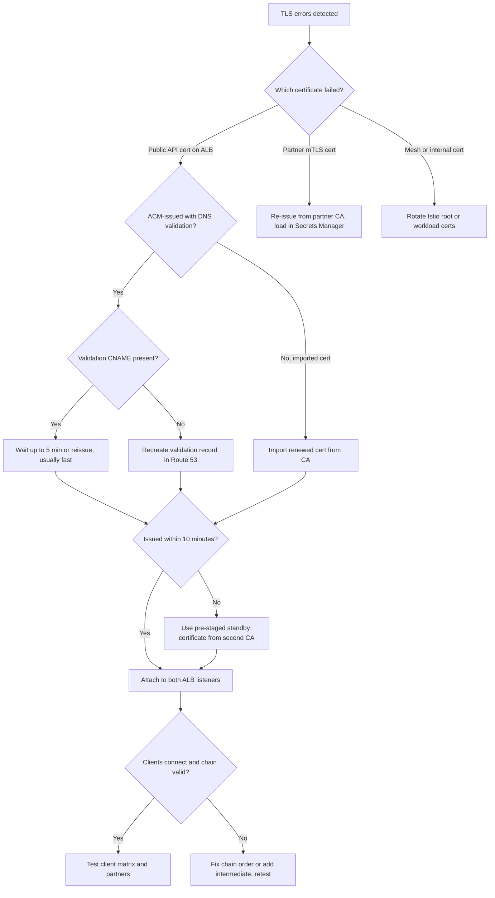

# RB-09: Certificate Expiry / TLS Failure

## 1. Scenario Identification
| Field | Value |
|---|---|
| ID / name | RB-09 / Certificate expiry or TLS misconfiguration |
| Category | Infrastructure |
| Severity | **P2 - High** (P1 if the main payment API certificate has expired or merchants cannot connect) |
| Affected components | ACM certificates on the Mumbai and Hyderabad ALBs (`api.paysecure.in`, `*.paysecure.in`), partner bank mTLS certificates, Istio mesh certificates, webhook endpoints, merchant portal |
| Description | TLS certificates for the payment API domain expire or are misconfigured (wrong chain, wrong SAN, revoked, wrong listener), so clients reject the connection |
| Recovery target | New certificate on the listeners within 15 minutes, all clients connecting within 30 minutes |

## 2. Detection Mechanism
| Alert | Source and metric | Threshold | Severity |
|---|---|---|---|
| Days to expiry | `AWS/CertificateManager` `DaysToExpiry` for each certificate ARN (both regions) | `< 30`, `< 14`, `< 7`, `< 1` day | P4, P3, P2, P1 |
| Synthetic TLS check | `tls_cert_days_remaining` (external probe against every public endpoint and partner endpoint every 60 s) | same ladder | as above |
| Handshake failures | `AWS/ApplicationELB` `ClientTLSNegotiationErrorCount` | `> 1%` of connections for 2 minutes | P1 |
| Success rate | `payment_api_success_rate` | `< 99.5%` for 2 minutes with TLS errors in logs | P1 |
| Renewal failure | EventBridge `ACM Certificate Approaching Expiration` and `ACM Certificate Renewal Action Required` | any | P3 |
| Partner mTLS | Istio `istio_requests_total{response_flags="UF"}` or partner bank rejection codes | `> 1%` | P2 |

## 3. Impact Assessment
| Measure | Value |
|---|---|
| Scope | All HTTPS endpoints if the API certificate expires (merchants, webhooks, portal) |
| Traffic stopped | up to 1,200 TPS at peak, 100% of external traffic because browsers and SDKs reject invalid certificates |
| Revenue | 62,500 INR per minute |
| Merchants | 45,000 |
| Security | Clients may be told to ignore warnings; do not recommend this. Treat any rogue certificate as a possible compromise (RB-03) |
| Regulatory | No notification unless the outage is extended (more than 60 minutes) or the cause is a security event. RBI/NPCI courtesy note if UPI uptime is affected |

## 4. Immediate Response (0-2 minutes)
1. **[SRE-1, 0:00-0:30]** Acknowledge the page and open the war room.
2. **[SRE-1, 0:30-1:00]** See what clients see: `openssl s_client -connect api.paysecure.in:443 -servername api.paysecure.in </dev/null 2>/dev/null | openssl x509 -noout -subject -issuer -dates`.
3. **[SRE-2, 1:00-1:30]** Check which certificate is attached to the listeners in both regions: `aws elbv2 describe-listeners --load-balancer-arn arn:aws:elasticloadbalancing:ap-south-1:ACCOUNT:loadbalancer/app/paysecure-mum-alb/ID --query 'Listeners[?Port==`443`].Certificates' --region ap-south-1` and the same with `--region ap-south-2`.
4. **[SRE-2, 1:30-2:00]** Check ACM status: `aws acm list-certificates --region ap-south-1 --query 'CertificateSummaryList[*].[DomainName,CertificateArn,Status,NotAfter]' --output table`.

## 5. Diagnostic Steps (2-5 minutes)
5. **[SRE-1, 2:00-3:00]** Determine the failure type: expired (`NotAfter` in the past), wrong chain, wrong domain (SAN), revoked, or wrong certificate on the listener. `aws acm describe-certificate --certificate-arn CERTARN --region ap-south-1 --query 'Certificate.[Status,NotAfter,RenewalEligibility,DomainValidationOptions[0].ValidationStatus,FailureReason]'`.
6. **[SRE-1, 3:00-4:00]** If auto-renewal failed, find why: usually DNS validation CNAME missing or changed (see RB-03 if records were altered).
7. **[SEC, 3:00-4:00]** Rule out a rogue certificate or compromise: check Certificate Transparency logs for unexpected issuance and confirm CAA records.
8. **[NET, 4:00-5:00]** Check Hyderabad and all partner mTLS certificates, because the same renewal process may have failed there as well.

## 6. Recovery Procedure (5-30 minutes)
9. **[IC, 5:00]** Choose the path from the tree: renew via ACM, import from CA, or use the standby certificate.
10. **[SRE-1, 5-7 min]** Request a replacement ACM certificate in **both regions**: `aws acm request-certificate --domain-name api.paysecure.in --subject-alternative-names "*.paysecure.in" --validation-method DNS --region ap-south-1 --query CertificateArn` and again with `--region ap-south-2`.
11. **[NET, 7-9 min]** Get the validation records and create them in Route 53: `aws acm describe-certificate --certificate-arn NEWARN --region ap-south-1 --query 'Certificate.DomainValidationOptions[*].ResourceRecord'` then `aws route53 change-resource-record-sets --hosted-zone-id Z1234567890 --change-batch file://acm-validation.json`.
12. **[SRE-1, 9-12 min]** Wait for issuance: `aws acm wait certificate-validated --certificate-arn NEWARN --region ap-south-1`. If ACM cannot issue within 10 minutes, use the **standby certificate**: pre-purchased from a second public CA, stored encrypted in Secrets Manager, import it: `aws acm import-certificate --certificate fileb://standby-cert.pem --private-key fileb://standby-key.pem --certificate-chain fileb://standby-chain.pem --region ap-south-1`.
13. **[SRE-2, 12-14 min]** Attach the new certificate to the Mumbai ALB listener: `aws elbv2 modify-listener --listener-arn LISTENERARN --certificates CertificateArn=NEWARN --region ap-south-1`. Keep the old one only if it is still valid: `aws elbv2 add-listener-certificates --listener-arn LISTENERARN --certificates CertificateArn=OLDARN --region ap-south-1`.
14. **[SRE-2, 14-16 min]** Repeat for the Hyderabad ALB: `aws elbv2 modify-listener --listener-arn HYDLISTENERARN --certificates CertificateArn=NEWHYDARN --region ap-south-2`.
15. **[SRE-1, 16-18 min]** Reestablish the trust chain: verify the served chain is complete and ordered (leaf, intermediate): `openssl s_client -connect api.paysecure.in:443 -servername api.paysecure.in -showcerts </dev/null 2>/dev/null | grep -E "s:|i:"`.
16. **[SEC, 18-20 min]** Partner mTLS: re-issue and load the partner-facing certificates into Secrets Manager and restart the Istio ingress gateway: `aws secretsmanager put-secret-value --secret-id prod/partner-mtls-cert --secret-string file://partner-cert.json --region ap-south-1` then `kubectl --context paysecure-primary -n istio-system rollout restart deployment istio-ingressgateway`.
17. **[SRE-2, 20-23 min]** Cross-client testing matrix: run the automated suite from outside AWS: Java (JDK 11 and 17), Python requests, Node 18, curl, Android and iOS test apps, and the three largest partner bank endpoints. `./scripts/health-checks/tls-client-matrix.sh api.paysecure.in`.
18. **[SRE-1, 23-25 min]** Confirm both regions serve the same certificate fingerprint: `openssl s_client -connect api-mum.paysecure.in:443 -servername api.paysecure.in </dev/null | openssl x509 -noout -fingerprint -sha256` and the same for `api-hyd.paysecure.in`.
19. **[SEC, 25-28 min]** Revoke the old certificate if it was compromised or misissued; otherwise let it expire. Update CAA records if the CA changed.
20. **[SRE-1, 28-30 min]** Deploy **prevention automation**: confirm EventBridge rules for ACM events notify PagerDuty, and the expiry ladder alarms exist: `aws cloudwatch put-metric-alarm --alarm-name acm-expiry-7d --namespace AWS/CertificateManager --metric-name DaysToExpiry --dimensions Name=CertificateArn,Value=NEWARN --statistic Minimum --period 86400 --threshold 7 --comparison-operator LessThanThreshold --evaluation-periods 1 --alarm-actions arn:aws:sns:ap-south-1:ACCOUNT:ops-p2 --region ap-south-1`.
21. **[IC, 30 min]** Close after verification V1-V6.

## 7. Communication Protocol
| When | Audience | Content |
|---|---|---|
| T+2 min | Engineering | `[P2] Certificate Expiry / TLS Failure - Incident #RB09-{id}. Status: Mitigating. Impact: clients fail TLS handshake to {endpoints}. Components: ALB listeners, ACM. Actions: replacement certificate in progress. ETA: 15-30 min. IC: {name}` |
| T+5 min | Management | `Incident {id}: expired/invalid TLS certificate on payment API. Payments blocked for clients that validate certificates. Revenue at risk 62,500 INR/min. Replacement in progress, ETA 15 min` |
| T+5 min | Merchants | `Subject: PaySecure Service Advisory - {date}. Some merchants may be unable to connect securely to the PaySecure API. A replacement certificate is being installed. Please do NOT disable certificate verification. Retry with the same idempotency key after {time}. Updates every 15 minutes. Support: {support_number}` |
| T+10 min | Partner banks | Notice that the endpoint certificate is changing, with the new fingerprint |
| Regulatory | RBI / NPCI | Not required unless over 60 minutes or security-related (then use the regulator template with classification P2) |

## 8. Verification and Validation
| # | Check | Command | Expected |
|---|---|---|---|
| V1 | Certificate dates | `openssl s_client -connect api.paysecure.in:443 -servername api.paysecure.in </dev/null 2>/dev/null \| openssl x509 -noout -dates` | `notAfter` far in future (at least 60 days) |
| V2 | Chain | `openssl s_client ... -showcerts` | complete chain, `Verify return code: 0 (ok)` |
| V3 | Both regions | fingerprint check, step 18 | identical |
| V4 | Handshake errors | CloudWatch `ClientTLSNegotiationErrorCount` | 0 |
| V5 | Client matrix | `./scripts/health-checks/tls-client-matrix.sh api.paysecure.in` | all pass |
| V6 | Transaction | `curl -X POST https://api.paysecure.in/v1/payments -H "X-Test-Merchant: SYNTH-001" -H "Idempotency-Key: rb09-verify-$(date +%s)" -d @synthetic-payment.json` | 200 |

## 9. Rollback Procedure
1. **[SRE-1, 2 min]** If clients fail with the new certificate (for example chain problem), re-attach the previous valid certificate (only possible if it has not expired): `aws elbv2 modify-listener --listener-arn LISTENERARN --certificates CertificateArn=OLDARN`.
2. **[SRE-2, 3 min]** If the old certificate is expired, switch to the standby certificate (step 12) and fix the chain on the new one offline.
3. **[SEC, 5 min]** If partner mTLS breaks, restore the previous secret version: `aws secretsmanager update-secret-version-stage --secret-id prod/partner-mtls-cert --version-stage AWSCURRENT --move-to-version-id PREVID --remove-from-version-id CURRENTID`, then restart the ingress gateway.
4. **[SRE-1, 3 min]** Re-run V1-V6.

## 10. Post-Incident Review
- **Timeline:** certificate notAfter time, first handshake error, alert, diagnosis, issuance, attachment, client recovery.
- **Root cause (5 whys):** why renewal did not occur (validation record missing, imported cert not tracked, alarm missing), why the 30/14/7/1-day alerts did not lead to action, why Hyderabad was out of sync.
- **Improvement actions:** use ACM-managed renewal for all public certificates, certificate inventory in Terraform with expiry alarms at 30/14/7/1 days, monthly renewal test, standby certificate from a second CA kept ready, expiry test in the Month 7 drill (KMS rotation plus certificate renewal), partner certificate expiry register shared with partner banks.
- **Regulatory checklist:** record duration, PCI DSS evidence of certificate management, partner bank notifications, SLA credit review.
