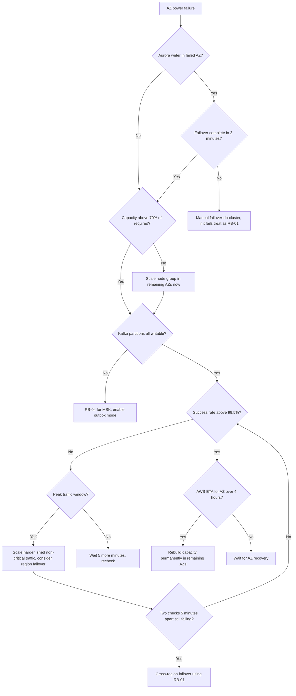

# RB-10: Data Centre Power Failure (Single AZ)

## 1. Scenario Identification
| Field | Value |
|---|---|
| ID / name | RB-10 / Single AZ power failure in ap-south-1 |
| Category | Infrastructure |
| Severity | **P3 - Medium** (P2 if capacity drops below 70% at peak, P1 if automatic recovery fails) |
| Affected components | One of the three AZs (for example ap-south-1b): about 33% of EKS compute (8 of 24 nodes), 1 Aurora instance (possibly the writer), 2 of 6 MSK brokers, one ElastiCache node, one ALB node, NAT gateway for that AZ |
| Description | One AZ in ap-south-1 loses power. The Multi-AZ design should recover automatically; this runbook confirms it, manages capacity and sets the rule for deciding on a cross-region failover |
| Recovery target | Automatic recovery within 2 minutes, capacity restored within 10 minutes, no region failover unless the decision tree says so |

## 2. Detection Mechanism
| Alert | Source and metric | Threshold | Severity |
|---|---|---|---|
| AWS Health event | AWS Health `AWS_EC2_POWER_CONNECTIVITY_ISSUE` or AZ operational issue for ap-south-1 | any | P2 |
| Nodes unready | Prometheus `kube_node_status_condition{condition="Ready",status="false"}` | `> 2` nodes for 3 minutes | P2 |
| Aurora failover | RDS event `failover` / `AuroraReplicaLag` jump | any failover event | P2 |
| Kafka under-replicated | `AWS/Kafka` `UnderReplicatedPartitions` and `OfflinePartitionsCount` | `> 0` for 2 minutes | P2 |
| ALB targets | `AWS/ApplicationELB` `UnHealthyHostCount` for the AZ | `> 30%` of targets | P2 |
| CPU saturation | Cluster CPU after node loss | `> 85%` for 5 minutes | P2 |
| Success rate | `payment_api_success_rate` | `< 99.5%` for 2 minutes | P1 |

## 3. Impact Assessment
| Measure | Value |
|---|---|
| Capacity lost | about 33% of compute: 24 nodes become 16 (about 120 of 180 pods remain until rescheduled) |
| Load check | At the 60% CPU target, 24 nodes at peak run at 60%. With 16 nodes the same peak load would push CPU to about 90% (60% x 24/16), which is why scale-out is required at peak |
| Safe load | At average load (37 TPS) and business hours (about 250 TPS), 16 nodes are enough. At peak (1,200 TPS) they are not |
| Database | Writer in the failed AZ means a 30-60 s automatic failover. A reader loss means no write impact |
| Kafka | 4 of 6 brokers remain. With replication factor 3 and `min.insync.replicas=2`, partitions stay writable |
| Revenue | A brief 30-60 s dip (about 31,000-62,500 INR) if the writer fails over; otherwise no loss if capacity is added in time |
| Regulatory | No notification unless a capacity breach causes an outage over the SLA |

## 4. Immediate Response (0-2 minutes)
1. **[SRE-1, 0:00-0:30]** Acknowledge page, open the incident channel (war room if P2).
2. **[SRE-1, 0:30-1:00]** Check the AWS Health event for the affected AZ: `aws health describe-events --region us-east-1 --filter regions=ap-south-1,eventStatusCodes=open --query 'events[*].[service,eventTypeCode,availabilityZone,statusCode]' --output table`.
3. **[SRE-2, 1:00-1:30]** Count remaining healthy nodes: `kubectl --context paysecure-primary get nodes --no-headers | awk '{print $2}' | sort | uniq -c`.
4. **[SRE-2, 1:30-2:00]** Stop non-essential batch work so remaining capacity serves payments: `kubectl --context paysecure-primary -n paysecure scale deployment reconciliation-worker --replicas=1`.

## 5. Diagnostic Steps (2-5 minutes)
5. **[SRE-1, 2:00-3:00]** Confirm pod rescheduling is working: `kubectl --context paysecure-primary -n paysecure get pods -o wide --field-selector=status.phase!=Running` (expect pending pods to drop).
6. **[DBA, 2:00-3:00]** Check Aurora: `aws rds describe-db-clusters --db-cluster-identifier paysecure-primary --query 'DBClusters[0].DBClusterMembers[*].[DBInstanceIdentifier,IsClusterWriter]' --region ap-south-1` and `aws rds describe-events --source-type db-cluster --source-identifier paysecure-primary --duration 30 --region ap-south-1`.
7. **[DATA, 3:00-4:00]** Check Kafka: `aws kafka list-nodes --cluster-arn arn:aws:kafka:ap-south-1:ACCOUNT:cluster/paysecure-prod/UUID --region ap-south-1` and `kafka-topics.sh --bootstrap-server $BOOTSTRAP --describe --under-replicated-partitions`.
8. **[SRE-2, 4:00-5:00]** Check Redis replication group: `aws elasticache describe-replication-groups --replication-group-id paysecure-redis-mum --region ap-south-1 --query 'ReplicationGroups[0].[Status,NodeGroups[0].NodeGroupMembers[*].[CacheClusterId,CurrentRole]]'`.

**Cross-region failover decision rule (any one is enough):** success rate under 95% for 5 minutes after scale-out, or Aurora writer unavailable for more than 5 minutes after failover attempts, or MSK offline partitions for more than 10 minutes with the outbox mode failing, or a second AZ shows failure. Otherwise stay in Mumbai.

## 6. Recovery Procedure (5-60 minutes)
9. **[IC, 5:00]** Confirm automatic recovery status from the diagnostics and choose the branch.
10. **[SRE-2, 5-8 min]** If the Aurora writer did not fail over automatically: `aws rds failover-db-cluster --db-cluster-identifier paysecure-primary --target-db-instance-identifier paysecure-primary-2 --region ap-south-1`. Verify with step 6 command.
11. **[SRE-1, 5-10 min]** Add compute in the two healthy AZs (node group must have subnets in all three AZs so the autoscaler can place nodes in the remaining ones): `aws eks update-nodegroup-config --cluster-name paysecure-primary --nodegroup-name app-ng --scaling-config minSize=24,maxSize=40,desiredSize=30 --region ap-south-1`.
12. **[SRE-1, 8-12 min]** Make sure critical services keep their replica counts and have priority: `kubectl --context paysecure-primary -n paysecure scale deployment payment-api --replicas=14` and `transaction-processor --replicas=14`. Pod priority classes ensure payment pods preempt batch pods.
13. **[SRE-2, 10-12 min]** Check pod disruption budgets and topology spread so pods are placed across the remaining AZs: `kubectl --context paysecure-primary -n paysecure get pdb` and `kubectl --context paysecure-primary -n paysecure get pods -o wide | awk '{print $7}' | sort | uniq -c`.
14. **[DATA, 8-15 min]** MSK: if only brokers in the failed AZ are down, no action is required. Check that consumers are reading and lag is stable: `kafka-consumer-groups.sh --bootstrap-server $BOOTSTRAP --group settlement-processor --describe`. If partitions are offline, enable outbox mode (RB-04 step 3).
15. **[SRE-1, 12-15 min]** ALB: confirm the load balancer stops sending to the failed AZ (cross-zone enabled): `aws elbv2 describe-target-health --target-group-arn TGARN --region ap-south-1 --query 'TargetHealthDescriptions[?TargetHealth.State!=`healthy`]'`.
16. **[SRE-2, 15-20 min]** Redis: if a node was lost, confirm automatic failover completed and add a replacement replica in a healthy AZ: `aws elasticache increase-replica-count --replication-group-id paysecure-redis-mum --new-replica-count 2 --apply-immediately --region ap-south-1`.
17. **[DBA, 15-25 min]** Add a replacement Aurora reader in a healthy AZ: `aws rds create-db-instance --db-instance-identifier paysecure-primary-3 --db-cluster-identifier paysecure-primary --db-instance-class db.r6g.2xlarge --engine aurora-postgresql --availability-zone ap-south-1c --region ap-south-1`.
18. **[SRE-1, 20-30 min]** Verify capacity headroom against the forecast for the next 4 hours (festival or peak window). If tight, keep the node group at the higher size.
19. **[IC, 30 min]** Decide whether to wait for AZ recovery or to rebalance permanently. If AWS gives an ETA above 4 hours, rebuild the third-AZ capacity in the other two AZs.
20. **[SRE-1, on AZ recovery]** When the AZ returns: scale the node group back, then rebalance pods: `kubectl --context paysecure-primary -n paysecure rollout restart deployment payment-api transaction-processor` one at a time, and re-add MSK brokers: `aws kafka reboot-broker --cluster-arn arn:aws:kafka:ap-south-1:ACCOUNT:cluster/paysecure-prod/UUID --broker-ids 2 5 --region ap-south-1` if they did not rejoin.
21. **[IC, +60 min]** Close the incident when all components report a full three-AZ topology and under-replicated partitions are 0.

## 7. Communication Protocol
| When | Audience | Content |
|---|---|---|
| T+2 min | Engineering | `[P3] Data Centre Power Failure (single AZ) - Incident #RB10-{id}. Status: Mitigating. Impact: AZ {az} down, about 33% compute lost, automatic recovery in progress. Components: EKS, Aurora, MSK, Redis. ETA: 10 min. IC: {name}` |
| T+10 min (only if P2 or a visible impact) | Management | `Incident {id}: one AZ lost. Capacity now {x}% and being restored. Brief errors possible during database failover (30-60 s). No region failover planned. Next update T+30 min` |
| Only if merchants see errors | Merchants | `Subject: PaySecure Service Advisory - {date}. A brief disruption affected some payments between {start} and {end} due to an infrastructure event. Service is stable. Please retry any failed payments with the same idempotency key. Support: {support_number}` |
| Regulator | RBI / NPCI | Not required unless capacity breach causes an outage over the SLA, then use the regulator template with classification P2 |

## 8. Verification and Validation
| # | Check | Command | Expected |
|---|---|---|---|
| V1 | Nodes | `kubectl --context paysecure-primary get nodes` | all Ready, target count reached |
| V2 | Writer | `aws rds describe-db-clusters --db-cluster-identifier paysecure-primary --query 'DBClusters[0].DBClusterMembers'` | one writer in a healthy AZ, 2 readers |
| V3 | Kafka | `kafka-topics.sh --bootstrap-server $BOOTSTRAP --describe --under-replicated-partitions` | no output |
| V4 | Success rate and latency | Grafana panels | 99.5% or more, P99 under 300 ms |
| V5 | Pods | `kubectl --context paysecure-primary -n paysecure get pods --field-selector=status.phase!=Running` | none |
| V6 | Test transaction | synthetic payment with `rb10-verify-` key | 200 |

## 9. Rollback Procedure
1. **[SRE-1, 2 min]** If scaled-out capacity causes cost or scheduling issues, revert node group size: `aws eks update-nodegroup-config --cluster-name paysecure-primary --nodegroup-name app-ng --scaling-config minSize=24,maxSize=40,desiredSize=24`.
2. **[DBA, 5 min]** If a manual Aurora failover chose a poor target, fail over again to the preferred instance with `aws rds failover-db-cluster ... --target-db-instance-identifier`.
3. **[SRE-2, 2 min]** Restore reconciliation worker replicas: `kubectl ... scale deployment reconciliation-worker --replicas=3`.
4. **[SRE-1, 3 min]** If a cross-region failover was started unnecessarily, apply the RB-01 rollback section. Then run V1-V6.

## 10. Post-Incident Review
- **Timeline:** power loss time, detection, automatic recoveries (Aurora, pod reschedule), scale-out, steady state, AZ return.
- **Root cause (5 whys):** the provider's cause, but also why capacity at 16 nodes was close to the limit at peak, why scale-out was manual, why any step was slower than expected.
- **Improvement actions:** run at 3 AZs with N+1 capacity (size nodes so any 2 AZs carry peak load), predictive autoscaling before festivals, pod topology spread constraints, add chaos test for AZ loss (Month 1 and Month 5 drills), automatic Aurora reader replacement.
- **Regulatory checklist:** record duration and impact, SLA calculation, PCI DSS evidence of resilience (no notification normally), update the capacity plan.
