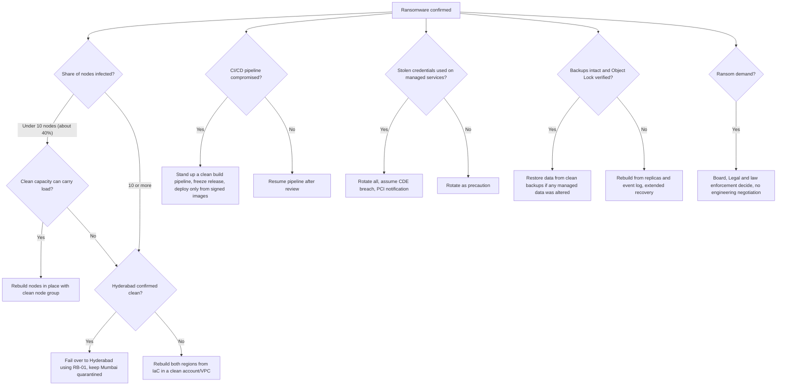

# RB-11: Ransomware Attack on Infrastructure

## 1. Scenario Identification
| Field | Value |
|---|---|
| ID / name | RB-11 / Ransomware on EKS worker nodes and CI/CD pipeline |
| Category | Security |
| Severity | **P1 - Critical** |
| Affected components | EKS worker nodes (multiple), CI/CD pipeline and build agents, container registry trust, Terraform state and pipeline credentials, potentially Secrets Manager access and both regions |
| Description | Ransomware encrypts critical system files on multiple EKS worker nodes and on the CI/CD pipeline |
| Key principles | (1) Contain first, because spreading is the main risk. (2) **Rebuild, never recover infected nodes**, using clean images from infrastructure as code. (3) Assume credentials on infected hosts are stolen. (4) The managed data layer (Aurora, DynamoDB, S3) is not encrypted by host ransomware, but it is reachable with stolen credentials, so rotate. (5) Do not pay or negotiate without Board, legal and law-enforcement direction |
| Recovery target | Containment within 10 minutes, payments served from clean capacity within 30 minutes, full clean rebuild within 24 hours |

## 2. Detection Mechanism
| Alert | Source and metric | Threshold | Severity |
|---|---|---|---|
| Malware / runtime threat | GuardDuty Malware Protection and EKS Runtime Monitoring findings (`Execution:Runtime/MaliciousFileExecuted`, `Impact:Runtime/...`) | any, high severity | P1 |
| Mass file modification | Node agent `file_modification_rate` and `high_entropy_file_writes_total` | `> 500` files/min on a node | P1 |
| Node failures | Prometheus `kube_node_status_condition{condition="Ready",status="false"}` | `> 2` nodes for 3 minutes with unusual disk I/O | P1 |
| Pipeline anomalies | CI/CD audit log: unexpected pipeline changes, new credentials, failed signature checks | any | P1 |
| Ransom note | Files named `README_DECRYPT*` found by file integrity monitoring | any | P1 |
| Outbound anomalies | VPC Flow Logs / DNS Firewall: connections to known C2 domains, large egress | any, or egress `> 3x` baseline | P1 |

## 3. Impact Assessment
| Measure | Value |
|---|---|
| Compute lost | Each infected node removes 1/24 of capacity (about 4.2%). 8 nodes lost is 33% |
| Traffic risk | Up to 1,200 TPS at peak. Payments continue only if clean capacity can carry load |
| Revenue | 62,500 INR/min if service stops |
| Data | Cardholder data sits in Aurora (managed), so not directly encrypted. Stolen credentials may allow access, so treat the CDE as potentially breached until proven otherwise |
| Supply chain | A compromised pipeline can ship malicious images to both regions. Do not deploy anything until trusted |
| Regulatory | CERT-In (6 hours), RBI (cyber incident), PCI DSS 12.10 with acquirer notification, possible police complaint |

## 4. Immediate Response (0-2 minutes)
1. **[SRE-1, 0:00-0:30]** Acknowledge, open the war room (out-of-band bridge, not Slack if possibly compromised), add **SEC**, **COMP** and **IC** with Legal on call.
2. **[SEC, 0:30-1:00]** **Stop all deployments and pipelines:** `aws codepipeline disable-stage-transition --pipeline-name paysecure-release --stage-name Build --transition-type Inbound --reason "RB-11 containment" --region ap-south-1` and the same for `Deploy`. Disable the CI service accounts.
3. **[SEC, 1:00-1:30]** **Isolate infected nodes at the network level** (stop spreading) by moving them to a quarantine security group with no ingress and no egress: `aws ec2 modify-instance-attribute --instance-id i-INFECTED --groups sg-quarantine --region ap-south-1`.
4. **[SRE-1, 1:30-2:00]** Cordon the nodes so nothing new schedules there: `kubectl --context paysecure-primary cordon NODE_NAME`.

## 5. Diagnostic Steps (2-10 minutes)
5. **[SEC, 2:00-4:00]** Preserve forensic evidence before changing nodes: snapshot the volumes of infected instances: `aws ec2 create-snapshot --volume-id vol-XXXX --description "RB-11 evidence $(date +%s)" --tag-specifications 'ResourceType=snapshot,Tags=[{Key=incident,Value=RB-11}]' --region ap-south-1`. Capture memory if tooling exists.
6. **[SEC, 4:00-6:00]** Determine blast radius: list GuardDuty findings: `aws guardduty list-findings --detector-id DETECTORID --finding-criteria '{"Criterion":{"service.archived":{"Eq":["false"]},"severity":{"Gte":7}}}' --region ap-south-1` then `aws guardduty get-findings --detector-id DETECTORID --finding-ids FINDINGID`.
7. **[SEC, 6:00-8:00]** Find the patient-zero path and lateral movement: CloudTrail for `AssumeRole`, `GetSecretValue`, `CreateAccessKey` from the infected instance roles: `aws cloudtrail lookup-events --lookup-attributes AttributeKey=Username,AttributeValue=INFECTED_ROLE_SESSION --max-results 200 --region ap-south-1`.
8. **[SEC, 8:00-10:00]** Check integrity of the clean sources: Terraform state bucket (versioning and Object Lock), container registry image digests and signatures, golden AMIs: `aws ecr describe-image-scan-findings --repository-name paysecure/payment-api --image-id imageTag=CURRENT --region ap-south-1` and verify signatures (`cosign verify`).
9. **[SEC, 8:00-10:00]** Check Hyderabad for indicators of compromise using the same IoCs: GuardDuty findings in ap-south-2, CI/CD tokens usage, replication-channel anomalies.

## 6. Recovery Procedure (10 minutes to 24 hours)
**Phase 1: Contain credentials (10-20 min)**
10. **[IC, 10:00]** Choose the path from the tree: **P-A** rebuild in place (up to 40% of nodes), **P-B** fail over to a clean Hyderabad, **P-C** full rebuild in a clean environment.
11. **[SEC, 10-13 min]** Revoke sessions and credentials for instance roles and pipeline users that touched infected hosts: attach an emergency deny to the roles: `aws iam put-role-policy --role-name paysecure-eks-node-role --policy-name EmergencyDenyAll --policy-document file://deny-all.json` then `aws iam list-access-keys --user-name ci-deployer` and set keys to Inactive with `aws iam update-access-key ... --status Inactive`.
12. **[SEC, 13-17 min]** Rotate secrets that infected nodes could read (database, API, webhook, signing): `aws secretsmanager rotate-secret --secret-id prod/aurora --region ap-south-1` and repeat for each secret in the inventory.
13. **[SEC, 17-20 min]** Review and, if needed, rotate the KMS access (RB-06 phases 1-2), because infected nodes had decrypt permissions.

**Phase 2: Restore capacity from clean sources (20-60 min)**
14. **[SRE-1, 20-25 min, P-A]** Create a clean node group from the golden AMI (built before the incident, verified): `aws eks create-nodegroup --cluster-name paysecure-primary --nodegroup-name app-ng-clean --scaling-config minSize=12,maxSize=40,desiredSize=24 --subnets subnet-a subnet-b subnet-c --node-role arn:aws:iam::ACCOUNT:role/paysecure-eks-node-role-v2 --ami-type CUSTOM --launch-template name=lt-clean-ami,version=3 --region ap-south-1`.
15. **[SRE-1, 25-30 min, P-A]** Wait for readiness: `aws eks wait nodegroup-active --cluster-name paysecure-primary --nodegroup-name app-ng-clean --region ap-south-1`.
16. **[SRE-2, 30-35 min, P-A]** Move workloads: drain infected nodes (they are already isolated): `kubectl --context paysecure-primary drain NODE_NAME --ignore-daemonsets --delete-emptydir-data --force --timeout=120s`, then delete the infected node group after evidence is taken: `aws eks delete-nodegroup --cluster-name paysecure-primary --nodegroup-name app-ng --region ap-south-1`.
17. **[DBA + SRE-1, 20-30 min, P-B]** For Path B, execute RB-01 steps 10-20 to move traffic to Hyderabad, after confirming Hyderabad is clean (step 9). Keep Mumbai isolated.
18. **[SEC, 30-40 min]** Redeploy only from **signed, scanned images** (digest-pinned) built from a clean pipeline: `kubectl --context paysecure-primary -n paysecure set image deployment/payment-api payment-api=ACCOUNT.dkr.ecr.ap-south-1.amazonaws.com/paysecure/payment-api@sha256:KNOWNGOODDIGEST`. Repeat for all 12 services, using the digest list from the last known-good release.
19. **[SEC, 40-50 min]** Enable admission control: only signed images may run (Kyverno or Sigstore policy-controller): `kubectl --context paysecure-primary apply -f configs/kubernetes/policies/verify-signed-images.yaml`.
20. **[SRE-2, 50-60 min]** Rebuild the CI/CD pipeline in a clean account or fresh runner set from IaC: `terraform -chdir=configs/terraform/envs/prod apply -target=module.cicd -var 'runner_ami=ami-CLEAN'` with a new, hardware-MFA protected service identity. Do not re-enable the old pipeline.

**Phase 3: Data integrity and exfiltration check (1-12 hours)**
21. **[SEC, 1-4 h]** Review Aurora, DynamoDB and S3 for malicious access using stolen credentials: Aurora logs for unusual queries, S3 data events, DynamoDB streams: `aws logs start-query --log-group-name /aws/rds/cluster/paysecure-primary/postgresql --start-time $(date -d '6 hours ago' +%s) --end-time $(date +%s) --query-string 'fields @timestamp, @message | filter @message like /COPY|pg_dump|SELECT.*cardholder/ | sort @timestamp desc | limit 100'`.
22. **[SEC, 1-4 h]** Check egress for data exfiltration: VPC Flow Logs query for large outbound transfers from the infected nodes and the CDE namespace.
23. **[DBA, 2-6 h]** If any managed data was tampered with, restore from clean backups (point-in-time restore as in RB-02, Aurora backups protected by AWS Backup Vault Lock): `aws backup list-recovery-points-by-backup-vault --backup-vault-name paysecure-vault-locked --region ap-south-1`.
24. **[SEC, 4-8 h]** Verify the Terraform state and the IaC repository have no unauthorised commits: `git log --since="7 days ago" --stat` reviewed by two engineers, and compare state S3 object versions.
25. **[DATA, 4-8 h]** Re-run reconciliation for the whole incident window to detect tampered or lost transactions: `kubectl --context paysecure-primary -n paysecure create job --from=cronjob/reconciliation-worker rb11-recon-$(date +%s)`.

**Phase 4: Hardening and closure (8-24 hours)**
26. **[SEC, 8-12 h]** Remove any persistence: scan all remaining nodes, images, Lambda functions and IAM for unauthorised changes (new users, roles, access keys, cron jobs, EventBridge rules): `aws iam generate-credential-report` then `aws iam get-credential-report`.
27. **[SEC, 12-16 h]** Restore network egress controls (default-deny with allow-list), enable DNS Firewall and tighten node IAM roles.
28. **[COMP, within 6 h]** File CERT-In report. **[COMP, within RBI window]** RBI cyber incident report. **[COMP, 72 h]** Notify the acquirer and card networks if cardholder-data exposure is possible.
29. **[IC + Legal, ongoing]** File a police cyber-crime complaint and engage the incident response retainer (forensics firm). Preserve all evidence (snapshots, logs) in the immutable evidence bucket.
30. **[IC, ransom decision]** Only the Board with Legal and law-enforcement guidance decides on any ransom communication. Engineering does not contact the attacker.
31. **[IC, 24 h]** Declare recovery only when clean capacity carries 100% of traffic for 4 hours, all secrets are rotated, no IoC remains and the pipeline is rebuilt and verified.

## 7. Communication Protocol
| When | Audience | Content |
|---|---|---|
| T+2 min | Engineering (out-of-band) | `[P1] Ransomware Attack - Incident #RB11-{id}. Status: Containing. Impact: {n} EKS nodes and CI/CD pipeline affected. Payments {continuing|degraded}. Components: EKS, CI/CD. Actions: nodes isolated, deployments frozen, evidence being preserved. ETA containment 10 min, rebuild 24 h. IC: {name}. War room: {phone bridge}` |
| T+15 min | Management, CISO, Legal | `Incident {id}: ransomware on infrastructure. Containment under way. Payments {status}. Revenue at risk 62,500 INR/min if service stops. CERT-In 6-hour and PCI 72-hour clocks started at {time}. Decisions: failover Path A/B/C, law enforcement, forensic firm` |
| T+30 min | Merchants (only if impact) | `Subject: PaySecure Service Advisory - {date}. We are managing a security incident affecting part of our infrastructure. Your data is being protected. Payments are {processing normally|being processed with reduced capacity}. Please retry failed payments with the same idempotency key. Updates every 30 minutes. Support: {support_number}` |
| T+1 h | Partner banks / NPCI / acquirer | Security incident notice, request heightened monitoring |
| Within 6 h | CERT-In (mandatory), RBI | Regulator template: `Classification P1. Nature: ransomware affecting EKS worker nodes and CI/CD pipeline. Impact: {quantified_impact}. Remediation: isolation, rebuild from clean images, credential rotation. Status: {status}. Preliminary root cause: {if_known}. Indicators of compromise attached.` |
| Within 72 h | Acquirer / card networks | PCI DSS 12.10 notification if exposure of cardholder data is possible |

## 8. Verification and Validation
| # | Check | Command | Expected |
|---|---|---|---|
| V1 | No infected nodes | `kubectl --context paysecure-primary get nodes -L eks.amazonaws.com/nodegroup` | only `app-ng-clean` nodes Ready |
| V2 | GuardDuty | `aws guardduty list-findings --detector-id DETECTORID --finding-criteria '{"Criterion":{"service.archived":{"Eq":["false"]},"severity":{"Gte":7}}}'` | no active high findings |
| V3 | Image provenance | `cosign verify --key cosign.pub ACCOUNT.dkr.ecr.ap-south-1.amazonaws.com/paysecure/payment-api@sha256:DIGEST` | verified |
| V4 | Credentials | `aws iam get-credential-report` and last-rotated dates | all rotated after incident start |
| V5 | Service | synthetic payment with `rb11-verify-` key | 200 |
| V6 | Reconciliation | `reconciliation-worker --mode full --window incident` | no breaks |
| V7 | Egress | flow-log query for large outbound transfers | none |

## 9. Rollback Procedure
1. **[SRE-1, 3 min]** If the clean node group fails to carry load, scale the clean node group up (not the infected one): `aws eks update-nodegroup-config --cluster-name paysecure-primary --nodegroup-name app-ng-clean --scaling-config minSize=24,maxSize=48,desiredSize=36`.
2. **[SRE-1, 5 min]** If Hyderabad failover (Path B) causes errors and Mumbai is not clean, **do not** return to Mumbai. Fix in Hyderabad or rebuild Mumbai fully (Path C) before any failback.
3. **[SEC, 3 min]** If the image-signing admission policy blocks legitimate workloads, set it to audit mode temporarily: `kubectl --context paysecure-primary patch clusterpolicy verify-signed-images --type merge -p '{"spec":{"validationFailureAction":"Audit"}}'`, fix the signature, then re-enforce.
4. **[SEC, 5 min]** Credential rotations are not rolled back. Re-run V1-V7.

## 10. Post-Incident Review
- **Timeline:** initial access (from forensic evidence), first detection, containment, each recovery phase, notification times, sign-off.
- **Root cause (5 whys):** initial access (phishing, exposed token, vulnerable image), why it reached multiple nodes and the pipeline, why detection took the time observed, why credentials were usable, why clean images were available.
- **Improvement actions:** immutable node images and read-only root filesystem, runtime security on all nodes, short-lived pipeline credentials and OIDC federation, network egress default-deny, AWS Backup Vault Lock, Object Lock on Terraform state, signed images only, quarterly ransomware game day (Month 11 cascading and chaos drill extended), offline copy of IaC and golden AMI recipe.
- **Regulatory checklist:** CERT-In within 6 hours, RBI cyber incident report, PCI DSS 12.10 (acquirer notified immediately; card brand deadlines apply, 72 hours at the longest), police complaint, forensic report, board report, cyber-insurance notification, 7-year evidence retention.
