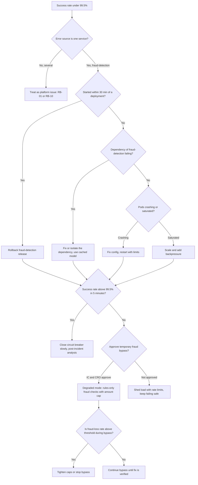

# RB-12: Cascading Microservice Failure (fraud-detection)

## 1. Scenario Identification
| Field | Value |
|---|---|
| ID / name | RB-12 / Cascading microservice failure |
| Category | Application |
| Severity | **P2 - High** (P1 if the success rate stays below 95% for 5 minutes) |
| Affected components | fraud-detection (origin), transaction-processor, payment-api, rate-limiter, Istio sidecars, connection pools, HPA, Aurora connections |
| Description | The fraud-detection microservice enters a failure loop. Its calls time out, callers retry and exhaust threads and connections, and the failure spreads up the call chain. Transaction success rate drops from 99.8% to 42% over 10 minutes |
| Recovery target | Isolate the failing service within 3 minutes, restore success rate above 99.5% within 10 minutes, no loss of fraud protection beyond a controlled degraded mode |

## 2. Detection Mechanism
| Alert | Source and metric | Threshold | Severity |
|---|---|---|---|
| Success rate | `payment_api_success_rate` (2xx / total) | `< 99.5%` for 2 minutes | P1 |
| Latency | `payment_api_p99_latency_ms` | `> 300 ms` for 5 minutes | P2 |
| Fraud service errors | `istio_requests_total{destination_service="fraud-detection",response_code=~"5.."}` rate | `> 5%` for 1 minute | P2 |
| Pod restarts | `kube_pod_container_status_restarts_total{pod=~"fraud-detection.*"}` | `> 3` in 5 minutes (CrashLoopBackOff) | P2 |
| Connection saturation | `envoy_cluster_upstream_cx_overflow` and `envoy_cluster_upstream_rq_pending_overflow` | `> 0` sustained | P2 |
| Retry storm | `istio_requests_total` retries ratio | `> 3x` baseline | P3 |
| Aurora connections | `AWS/RDS` `DatabaseConnections` | `> 80%` of `max_connections` | P2 |

## 3. Impact Assessment
| Measure | Value |
|---|---|
| Success rate drop | 99.8% to 42% over 10 minutes. At 42% success, 58% of requests fail |
| Revenue | At 42% success, about 58% x 62,500 = about 36,250 INR per minute lost, and growing as retries fail |
| Throughput | At average load 37 TPS about 21 failures/s; at peak 1,200 TPS about 700 failures/s |
| Merchants | Most of the 45,000 see failures; webhooks for failed payments |
| Risk of the fix | Bypassing fraud detection exposes PaySecure to fraud losses, so the bypass must be **time-limited, capped and monitored** |
| Regulatory | None unless the uptime SLA is breached (then notify NPCI/RBI as P2) |

## 4. Immediate Response (0-2 minutes)
1. **[SRE-1, 0:00-0:30]** Acknowledge the page and open the war room.
2. **[SRE-1, 0:30-1:00]** Freeze deployments: `aws codepipeline disable-stage-transition --pipeline-name paysecure-release --stage-name Deploy --transition-type Outbound --reason "RB-12 freeze"`.
3. **[SRE-2, 1:00-1:30]** Find the origin service from the trace and error map: in Grafana "Errors by microservice", and `kubectl --context paysecure-primary -n paysecure get pods --sort-by=.status.startTime | grep -v Running`.
4. **[SRE-2, 1:30-2:00]** Check the last deployments (a common trigger): `kubectl --context paysecure-primary -n paysecure rollout history deployment/fraud-detection` and `kubectl --context paysecure-primary -n paysecure get events --sort-by=.lastTimestamp | tail -30`.

## 5. Diagnostic Steps (2-5 minutes)
5. **[SRE-1, 2:00-3:00]** Check the failing service's logs and resource use: `kubectl --context paysecure-primary -n paysecure logs deploy/fraud-detection --tail=100` and `kubectl --context paysecure-primary -n paysecure top pods -l app=fraud-detection`.
6. **[SRE-1, 3:00-3:30]** Inspect traces for the slow span in Jaeger (search service `payment-api`, min duration 1s) and confirm the dependency chain: payment-api, transaction-processor, fraud-detection.
7. **[DBA, 3:00-4:00]** Check whether the database is a victim: `aws rds describe-db-clusters --db-cluster-identifier paysecure-primary --query 'DBClusters[0].Status'` and the `DatabaseConnections` metric.
8. **[SRE-2, 4:00-5:00]** Look for a downstream dependency of fraud-detection (Redis, third-party scoring API, model service) that is the real root cause: `kubectl --context paysecure-primary -n paysecure exec deploy/fraud-detection -- curl -s localhost:8080/health/deps`.

## 6. Recovery Procedure (5-30 minutes)
9. **[IC, 5:00]** Choose the branch from the tree and **record who approved any fraud bypass** (IC plus CRO, in the incident log).
10. **[SRE-1, 5-6 min]** **Activate the circuit breaker** around fraud-detection so callers fail fast instead of piling up. Apply the prepared Istio policy: `kubectl --context paysecure-primary -n paysecure apply -f configs/kubernetes/istio/fraud-detection-circuit-breaker.yaml` (outlier detection with `consecutive5xxErrors: 5`, `interval: 5s`, `baseEjectionTime: 30s`, `maxEjectionPercent: 100`, connection pool `http1MaxPendingRequests: 50`, `maxRequestsPerConnection: 10`).
11. **[SRE-1, 6-8 min]** **Stop retry amplification** at the mesh: set retries to 0 for fraud-detection in the VirtualService: `kubectl --context paysecure-primary -n paysecure patch virtualservice fraud-detection --type merge -p '{"spec":{"http":[{"retries":{"attempts":0},"timeout":"800ms","route":[{"destination":{"host":"fraud-detection"}}]}]}}'`.
12. **[SRE-2, 5-8 min]** **Rollback the most recent fraud-detection release** if the trigger was a deployment: `kubectl --context paysecure-primary -n paysecure rollout undo deployment/fraud-detection` then `kubectl --context paysecure-primary -n paysecure rollout status deployment/fraud-detection --timeout=180s`.
13. **[IC + CRO, 8-9 min]** **Approve the temporary fraud-detection bypass** only if step 10-12 do not restore success rate. The degraded mode uses a local rules engine (velocity checks, blocked BIN/IP lists, device flags) and a hard cap per transaction (for example 25,000 INR) with every bypassed transaction flagged for post-review: `kubectl --context paysecure-primary -n paysecure patch configmap region-config --type merge -p '{"data":{"fraud_mode":"degraded_rules_only","fraud_degraded_max_amount":"25000","fraud_degraded_flag":"true"}}'`.
14. **[SRE-1, 9-10 min]** Restart the transaction-processor and payment-api pods that hold exhausted connections: `kubectl --context paysecure-primary -n paysecure rollout restart deployment transaction-processor payment-api` (one at a time with `maxUnavailable: 0`).
15. **[SRE-2, 8-12 min]** Relieve database pressure: cap per-pod connections and kill idle-in-transaction sessions from stuck callers: `psql -h $WRITER -d paysecure -c "SELECT pg_terminate_backend(pid) FROM pg_stat_activity WHERE state='idle in transaction' AND state_change < now() - interval '60 seconds';"`.
16. **[SRE-1, 10-12 min]** Shed load temporarily to protect the system: lower the unauthenticated and per-merchant rate limits by 30%: `kubectl --context paysecure-primary -n paysecure patch configmap region-config --type merge -p '{"data":{"rate_limit_scale":"0.7"}}'`.
17. **[SRE-2, 12-15 min]** Scale payment-api and transaction-processor if CPU is high, but **not** fraud-detection until it is healthy (scaling a broken service can worsen the loop): `kubectl --context paysecure-primary -n paysecure scale deployment payment-api --replicas=18`.
18. **[SRE-1, 15-18 min]** When fraud-detection is healthy (readiness passing, error rate under 1% in isolation tests), canary it back with 10% of traffic via the mesh and watch: `kubectl --context paysecure-primary -n paysecure patch virtualservice fraud-detection --type merge -p '{"spec":{"http":[{"route":[{"destination":{"host":"fraud-detection","subset":"stable"},"weight":90},{"destination":{"host":"fraud-detection","subset":"canary"},"weight":10}]}]}}'`.
19. **[SRE-1, 18-22 min]** Increase to 50% then 100% while checking success rate and latency at each step (5 minutes each).
20. **[SRE-2, 22-25 min]** Turn the fraud bypass off: `kubectl --context paysecure-primary -n paysecure patch configmap region-config --type merge -p '{"data":{"fraud_mode":"full"}}'`, restore `rate_limit_scale` to `1.0` and normal retry policy (1 attempt, 800 ms timeout).
21. **[DATA, 25-35 min]** **Review every transaction processed during bypass** with the full fraud model after recovery: `kubectl --context paysecure-primary -n paysecure create job --from=cronjob/fraud-rescore rb12-rescore-$(date +%s)`. Hold settlement for flagged items until reviewed.
22. **[IC, 30 min]** Declare mitigated when success rate is above 99.5% and P99 under 300 ms for 15 minutes, the breaker is closed, and bypass is off.

## 7. Communication Protocol
| When | Audience | Content |
|---|---|---|
| T+2 min | Engineering | `[P2] Cascading Microservice Failure - Incident #RB12-{id}. Status: Mitigating. Impact: transaction success rate {x}%, timeouts. Origin: fraud-detection. Actions: circuit breaker, rollback, retry limits. ETA: 15 min. IC: {name}` |
| T+8 min | Management / CRO | `Incident {id}: fraud-detection failure causing cascade. Success rate {x}%. Revenue loss about 36,000 INR/min at 42% success. Decision needed: temporary degraded fraud mode with 25,000 INR cap. CRO approval requested. Next update T+15 min` |
| T+10 min | Merchants | `Subject: PaySecure Service Advisory - {date}. We are experiencing intermittent payment failures and delays. Our team is restoring service. Payment methods affected: all. Please retry failed payments with the same idempotency key, with a 5-second wait between attempts. Large payments above 25,000 INR may be briefly held for additional checks. Updates every 15 minutes. Support: {support_number}` |
| On recovery | Merchants | Restoration notice; list of transactions held for review |
| Regulatory | RBI / NPCI | Not required unless the SLA is breached. If uptime is breached, use the regulator template with classification P2 |

## 8. Verification and Validation
| # | Check | Command | Expected |
|---|---|---|---|
| V1 | Success rate | Grafana "Payment API success rate" | 99.5% or more for 15 minutes |
| V2 | Latency | Grafana P99 | under 300 ms (target 180 ms) |
| V3 | Fraud service | `kubectl --context paysecure-primary -n paysecure get pods -l app=fraud-detection` | all Ready, restarts stable |
| V4 | Breaker | `kubectl --context paysecure-primary -n paysecure get destinationrule fraud-detection -o yaml` | no ejected hosts |
| V5 | Connections | `DatabaseConnections` metric | under 60% of max |
| V6 | Fraud mode | `kubectl --context paysecure-primary -n paysecure get configmap region-config -o jsonpath='{.data.fraud_mode}'` | `full` |
| V7 | Test transaction | synthetic payment with `rb12-verify-` key, including fraud score in response | 200, score present |

## 9. Rollback Procedure
1. **[SRE-1, 2 min]** If the circuit breaker is too aggressive and blocks healthy pods, delete the prepared policy: `kubectl --context paysecure-primary -n paysecure delete -f configs/kubernetes/istio/fraud-detection-circuit-breaker.yaml`.
2. **[SRE-2, 3 min]** If the rollback release is worse, roll forward to the previous good revision: `kubectl --context paysecure-primary -n paysecure rollout undo deployment/fraud-detection --to-revision=N`.
3. **[SRE-1, 2 min]** If the canary fails, set the weights back to 100% stable and keep degraded mode active.
4. **[IC, 1 min]** If fraud losses rise above the agreed threshold during bypass, turn the bypass off immediately and accept lower throughput. Re-run V1-V7.

## 10. Post-Incident Review
- **Timeline:** deployment or trigger, first latency rise, first alert, circuit breaker, bypass decision, recovery, bypass off, rescoring complete. Source: Prometheus, Jaeger traces, deployment history, incident log.
- **Root cause (5 whys):** why fraud-detection failed (bug, dependency, load), why retries amplified the failure, why no circuit breaker was in place or tuned, why the bulkhead did not isolate the failure, why detection took the time observed.
- **Improvement actions:** circuit breakers and timeouts on all service-to-service calls, bulkheads and per-dependency connection pools, retry budgets (maximum 10% retries), canary releases with automatic rollback, load shedding, fraud-detection fallback model embedded in transaction-processor, chaos experiment in Month 11 (cascading failure simulation).
- **Regulatory checklist:** record duration and impact for the SLA, CRO review of fraud losses during bypass, RBI/NPCI only if SLA was breached, PCI DSS documentation for the temporary control change, board summary.
