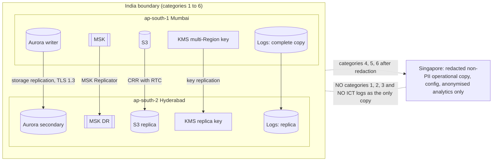

# Data Sovereignty Compliance Matrix - PaySecure Gateway

Scope: every category of data PaySecure holds, mapped to the Indian and industry rules that govern where it may live, how it is protected and what proof is needed. The design keeps **all data in India**: ap-south-1 (Mumbai) primary and ap-south-2 (Hyderabad) DR. Companion files: `docs/03-data-replication/replication-strategy.md` (how each store replicates) and `docs/05-runbooks/` (what to do in a failure).

Baseline (same as every other document): 3.2M txns/day | 500 crore INR/day | 1,200 peak TPS | 180 ms P99 | 45,000 merchants | 8 crore INR/yr infra | uptime 99.92% -> 99.99% | RPO < 1 min | RTO < 5 min.

## 1. How to read this document

Each regulatory reference carries a verification tag. This matters because clause numbers are the first thing an auditor checks.

| Tag | Meaning |
|---|---|
| **[V]** | Checked against public text or published summaries on 7 Nov 2026 (sources in Section 10) |
| **[B]** | Taken from the project brief or earlier documents in this repository; not independently re-checked |
| **[C]** | Reference given from general knowledge. The Compliance Officer (COMP) or the PCI QSA must confirm the exact clause number against the current published text before this is shown to an auditor |

This is a design document, not legal advice. Anything tagged [C] or flagged in Section 9 needs sign-off from COMP and external counsel.

## 2. The six data categories

The categories are the six defined in the project brief (Section A3.6, "Data Classification for DR"). The brief gives the residency rule, replication scope and encryption requirement for each; the last column adds the stores used in this design.

| # | Category | Examples (brief) | Residency (brief) | Replication scope (brief) | Encryption (brief) | Stores in this design |
|---|---|---|---|---|---|---|
| 1 | Cardholder Data (CHD) | Card numbers, CVV, expiry dates (tokenised) | India only (RBI and PCI DSS) | Indian regions only | AES-256 at rest, TLS 1.3 in transit, KMS-managed keys | Aurora CDE cluster, tokenisation-service, KMS key `alias/paysecure-cde` |
| 2 | Transaction Data | Transaction IDs, amounts, timestamps, status | India only (RBI) | Indian regions only | AES-256 at rest, TLS 1.3 in transit | Aurora, DynamoDB (idempotency), MSK topics, S3 exports |
| 3 | Merchant Data | Merchant profiles, settlement configs, bank details | India only (RBI) | Indian regions only | AES-256 at rest, field-level encryption for bank details | Aurora, Redis (config cache), S3 (KYC documents) |
| 4 | Operational Data | Logs, metrics, traces, health check data | India preferred; operational copies in Singapore acceptable | Indian regions plus Singapore (non-PII) | Encryption at rest; PII redacted for cross-border copies | Prometheus, Grafana, Jaeger, ELK, S3 log buckets, CloudTrail, VPC flow logs |
| 5 | Configuration Data | Feature flags, routing rules, rate limits | No residency constraint | All regions | Encrypted in transit; no PII | Git, Terraform state, Kubernetes manifests, ConfigMaps |
| 6 | Analytics Data | Aggregated transaction volumes, trend data (anonymised) | No residency constraint if truly anonymised | All regions | Anonymisation must be irreversible; verify with the DPO | Analytics exports (aggregated only) |

**Backups, snapshots, exports and replicas are not a separate category.** They inherit the category of the data inside them. A Hyderabad copy of the transaction table is category 2 data, in India, under the same rules as the original.

**What Singapore may and may not receive.** Only categories 4, 5 and 6 may leave India, and only in the form the brief allows: operational data with PII redacted, configuration data without PII, and irreversibly anonymised analytics. Categories 1, 2 and 3 never leave India, in any form, including during failover. Separately, CERT-In expects ICT system logs to be kept for 180 days within Indian jurisdiction, so the **primary and complete copy of every operational log stays in India** and a Singapore copy may only be an additional, redacted copy. A tertiary compute option in Singapore is allowed by the brief only if all data is replicated back to India within the RBI timeframe; this design does not use it.

## 3. Master matrix

Rows are the brief's six data categories; columns are the four regimes the brief asks for. Section 4 gives the clause detail behind each cell.

| Category | RBI | PCI DSS v4.0.1 | NPCI | IT Act, CERT-In, DPDP |
|---|---|---|---|---|
| 1 Cardholder Data | Stored only in India. The 2018 circular applies to payment gateways and service providers [V] | Req 3 (protect stored data), 4 (transit), 3.6 and 3.7 (keys), 1.2.4 and 12.5.2 (data flows and scope) [C] | Card data is outside UPI; any UPI-linked card data follows the same India-only rule [C] | IT Act s.43A and SPDI Rules for sensitive financial data [C]; DPDP security safeguards [C] |
| 2 Transaction Data | End-to-end transaction details stored only in India; processing abroad would need deletion within 24 hours, which this design avoids [V] | Req 10 (logging), 3.2 (retention), 12.10 (incident response) [C] | UPI transaction data; 300 ms end-to-end ceiling, failover within 5 minutes, uptime target [B]; circular numbers to be attached by COMP | CERT-In logs of financial transactions in Indian jurisdiction [V]; 6-hour incident reporting [V] |
| 3 Merchant Data | PA Directions 2025: onboarding, KYC and data storage in India [V] | Req 12.8 (third parties), 7 (access control), 3.5 for any stored account data [C] | Merchant and VPA data held for UPI follows India-only storage [C] | DPDP: data fiduciary duties for personal data in merchant KYC [C]; SPDI Rules [C] |
| 4 Operational Data | No direct rule if it holds no payment data; payment data must not leak into it. Brief: India preferred, redacted non-PII copy in Singapore acceptable [B] | Req 10.2, 10.3, 10.5.1 (retain 12 months, 3 months immediately available); logs or traces containing PAN would pull them into scope [C] | Participation audit trails per NPCI requirements [C] | CERT-In: ICT logs, rolling 180 days, within Indian jurisdiction (copies abroad only if producible on request) [V] |
| 5 Configuration Data | No residency constraint [B]; no payment data or secrets in it | Req 2.2 and 6.5 (secure configuration, change control) [C] | None | None, provided it holds no personal data |
| 6 Analytics Data | No constraint if truly anonymised [B]; derived data must not allow re-identification of payment records | Out of scope if it contains no account data [C] | None | DPDP applies to personal data only; irreversible anonymisation to be verified by the DPO [C] |

## 4. Clause detail by regime

### 4.1 RBI

| Reference | What it requires | How PaySecure meets it | Tag |
|---|---|---|---|
| Circular DPSS.CO.OD.No.2785/06.08.005/2017-18, 6 April 2018, "Storage of Payment System Data" | The entire data relating to payment systems must be stored in a system only in India. Applies to payment gateways and other intermediaries as well as operators | Both regions are Indian (ap-south-1, ap-south-2). No replica, backup or log store outside India | [V] |
| RBI FAQs on the above (26 June 2019) | Processing abroad is allowed but data must be deleted abroad and brought back within one business day or 24 hours, whichever is earlier. Data must include complete end-to-end transaction details. Overseas regulator access needs RBI approval | PaySecure processes only in India, so the deletion-window case never arises | [V] |
| Reserve Bank of India (Regulation of Payment Aggregators) Directions, 2025, issued 15 Sep 2025 | Consolidated PA framework. Requires compliance with the 2018 storage circular, PCI DSS, CERT-In empanelled auditor audits and the RBI cyber resilience directions | This matrix, the DR design and the drill plan are the evidence set. COMP to map to the Direction's paragraph numbers | [V] for the existence and themes; paragraph numbers [C] |
| RBI Cyber Resilience and Digital Payment Security Controls directions, 2024 | Cyber resilience controls for payment system operators. Referred to by the PA Directions | Runbooks RB-03, RB-06, RB-07, RB-11 and the annual drills | [V] for existence; clause numbers [C] |
| RBI incident reporting to the regulator | Cyber incidents and cardholder data breaches are reported within stipulated timeframes | Runbook regulator template; COMP confirms current timeframe | [V] for the duty; exact window [C] |
| Master Direction on IT Governance, Risk, Controls and Assurance Practices (Nov 2023) | DR, BCP and IT assurance benchmark for regulated entities | Use as a design benchmark. Whether it binds a non-bank PA directly must be confirmed | [C] |

The earlier documents (`active-active-design.md` Section 10) state an RBI DR requirement of RTO under 4 hours with near-zero RPO. That figure comes from the project brief and was **not** re-verified here. Do not quote it to an auditor without COMP confirming the source paragraph.

### 4.2 PCI DSS v4.0.1

PCI DSS does not require data to stay in a country. Its relevance to sovereignty is **scope**: every region, replica, backup and log store that touches cardholder data is in the Cardholder Data Environment (CDE) and must be assessed.

| Requirement | Meaning for the DR design | Tag |
|---|---|---|
| 1.2.4 | Accurate data-flow diagrams showing all account-data flows, including cross-region replication | [C] |
| 3.2.1 | Keep stored account data to the minimum needed; retention and disposal defined | [C] |
| 3.3.1 | Sensitive authentication data is not kept after authorisation | [C] |
| 3.5.1 | PAN is unreadable wherever stored. Replicas and backups must use the same protection | [C] |
| 3.6 and 3.7 | Key management. The multi-Region KMS key `alias/paysecure-cde` and its Hyderabad replica must follow the same rotation and access rules | [C] |
| 4.2.1 | Strong cryptography in transit. Cross-region replication uses TLS 1.3 [B] | [C] |
| 10.2, 10.3, 10.5.1 | Audit logs capture required events, are protected, and are retained 12 months with the latest 3 months immediately available | [C] |
| 12.5.2 | Scope is documented and confirmed at least every 12 months, and after significant change. The Hyderabad build counts as a significant change | [C] |
| 12.8 | Third-party service providers (AWS, PagerDuty and any other) are managed and listed | [C] |
| 12.10.1 and 12.10.2 | Incident response plan exists and is tested at least every 12 months. The annual drill plan supplies this evidence | [C] |

### 4.3 NPCI

NPCI circulars are issued to participants through the member portal and were not publicly retrievable for this review. The rows below come from the project brief.

| Requirement | Design response | Tag |
|---|---|---|
| End-to-end UPI latency below 300 ms | 180 ms P99 today; asynchronous replication adds 0 ms on the write path | [B] |
| Automated failover within 5 minutes | Documented RTO 4 minutes, nominal about 2 min 45 s | [B] |
| Uptime target (brief quotes 99.95% for NPCI and 99.99% overall) | Design targets 99.99% | [B] |
| UPI data stored in India | Follows from the RBI 2018 circular; NPCI participation terms to be attached by COMP | [C] |
| Partner and PSP onboarding of the DR region | Hyderabad egress IPs allow-listed before go-live; tested in the Month 3 drill | [B] |

**Action for COMP:** attach the specific NPCI operating circular numbers and clause references for data storage, outage reporting and failover. These are deliberately not filled in here to avoid inventing citations.

### 4.4 IT Act, CERT-In and DPDP

| Reference | Requirement | PaySecure response | Tag |
|---|---|---|---|
| IT Act 2000, s.70B(6) with CERT-In directions of 28 April 2022 | Report specified cyber incidents within 6 hours of noticing them | Every security runbook (RB-03, 06, 07, 11) carries the 6-hour step and COMP owner | [V] |
| Same directions | Enable logs of all ICT systems and keep them securely for a rolling 180 days within Indian jurisdiction. CERT-In FAQs allow copies abroad if logs can be produced on request, but PaySecure keeps them in India | CloudTrail, WAF, flow and application logs go to Indian S3 with Object Lock | [V] |
| IT Act s.43A and Reasonable Security Practices Rules 2011 (SPDI Rules), Rule 8 | Reasonable security practices for sensitive personal data (ISO 27001 is a named example) | ISO 27001 held [B]. Note that DPDP commencement is expected to replace s.43A | [C] |
| IT Act s.72A | Penalty for disclosure of personal information in breach of a lawful contract | Access controls, encryption and vendor contracts | [C] |
| Digital Personal Data Protection Act 2023, s.8(5), 8(6), 8(7), s.16 | Security safeguards, breach intimation, erasure, and a government power to restrict transfers abroad | All storage in India; breach template to add DPDP Board notice | [C] |

## 5. Data flow and sovereignty boundary

Detailed flows per category, including the failover path, are in `data-flow-diagrams.md`. The summary:



Control points that keep the boundary closed: the Service Control Policy in Section 6, S3 replication rules (destination limited to approved buckets), no cross-border VPC peering or Transit Gateway attachment for payment accounts, default-deny egress, and the redaction step on the operational data pipeline.

## 6. Technical controls that enforce residency

1. **Region deny policy.** An AWS Organizations Service Control Policy denies every action outside ap-south-1 and ap-south-2 for the **payment accounts**, with exceptions for global services. A separate, narrower policy lets a dedicated operations account use ap-southeast-1 for the redacted operational copy only (see `configs/terraform/modules/guardrails`). Test both in a sandbox OU first.

```json
{
  "Version": "2012-10-17",
  "Statement": [{
    "Sid": "DenyOutsideIndia",
    "Effect": "Deny",
    "NotAction": [
      "iam:*", "organizations:*", "sts:*", "route53:*", "route53domains:*",
      "cloudfront:*", "waf:*", "shield:*", "support:*", "health:*",
      "budgets:*", "ce:*", "trustedadvisor:*"
    ],
    "Resource": "*",
    "Condition": {
      "StringNotEquals": { "aws:RequestedRegion": ["ap-south-1", "ap-south-2"] }
    }
  }]
}
```

   The exceptions are global or metadata-only services. The AWS Health API is called in us-east-1 in RB-05; it returns event metadata only and no payment data.
2. **Replication guardrails.** S3 replication rules have an Indian destination only. A Config rule alerts on any replication configuration whose destination region is not in the approved list. The same rule applies to Aurora global members, DynamoDB replicas, Redis global members and MSK Replicator targets.
3. **KMS.** Multi-Region keys are created only in the two Indian regions. Key policies deny `kms:ReplicateKey` to any other region.
4. **Logs.** CloudTrail is multi-Region within the Indian regions plus an organisation trail to an Indian bucket. Logs are retained at least 180 days (CERT-In) and the PCI 12-month rule is applied to audit logs, with 3 months readily available.
5. **Scrubbing.** No PAN, token, VPA or mobile number may appear in a log line, metric label, trace span or alert payload. A log-pipeline filter blocks or masks card-number patterns and a weekly sample check confirms it.
6. **Third-party tools.** PagerDuty receives CloudWatch alarms and is a processor outside the data boundary. Alert payloads contain only alarm name, severity and resource ID. Any other SaaS tool must be listed in the vendor register with the data it receives.
7. **Support access.** AWS support sessions and cases never include payment data. Screen sharing is not used on CDE resources.
8. **Drift detection.** The weekly cross-region drift comparison (replication-strategy Section 9) also checks that no resource exists in a non-approved region.

## 7. Sovereignty during failure and recovery events

| Event | Sovereignty risk | Control |
|---|---|---|
| Regional failover Mumbai to Hyderabad (RB-01) | None: both regions in India | Verify with the Section 8 evidence query after the event |
| Failback to Mumbai | Un-replicated Mumbai writes recovered from backup | Restore only inside Indian accounts and regions; reconciliation runs in India |
| Restore from backup (RB-02, RB-11) | Engineer restores to a convenient but wrong region | SCP blocks it; runbook names the region in every command |
| Key compromise (RB-06) | New key created in the wrong region | Key creation limited to the two Indian regions by SCP |
| Incident with outside forensics | Evidence or images sent abroad | Forensic partner works inside the Indian environment; export needs COMP and counsel approval |
| Singapore operational copy or tertiary compute | Redacted copy leaks PII, or ICT logs exist only abroad | Redaction filter on the pipeline; complete log copy stays in India (CERT-In); categories 1-3 never replicated; see open item 1 |
| Overseas regulator or card network request | Data shared abroad | Needs RBI approval for payment-system data per the RBI FAQ [V] |

## 8. Evidence pack and audit calendar

| Evidence | Source | Frequency | Owner |
|---|---|---|---|
| Region inventory proving all resources are in the two Indian regions | AWS Config aggregator and resource explorer export | Weekly automated, monthly signed review | SEC |
| Replication topology report (Aurora, DynamoDB, Redis, MSK, S3, KMS) | Terraform state and API describe calls | Monthly | DBA and DATA |
| SCP and Config rule configuration with change history | Organizations and Config | Quarterly | SEC |
| Data-flow diagram refresh including the Hyderabad region | `docs/01-current-state` and `docs/02-multi-region-design` diagrams | Every 12 months and on significant change (PCI 12.5.2) | Platform lead |
| Log retention check: 180 days in India, PCI 12 months | S3 lifecycle and Object Lock configuration | Quarterly | SEC |
| Scrubbing test results | Log pipeline sample check | Weekly sample, quarterly report | SEC |
| Drill evidence: post-drill sovereignty check passed | `docs/08-dr-drill-plan` template, Section 6 | After every drill | COMP |
| System Audit Report from a CERT-In empanelled auditor, covering storage, backups and restoration | External auditor | Annually | COMP |
| PCI DSS assessment including DR scope | QSA | Annually | COMP |

**Post-drill and post-incident sovereignty query (run and attach):**
```
aws configservice select-aggregate-resource-config \
  --configuration-aggregator-name paysecure-org \
  --expression "SELECT resourceId, resourceType, awsRegion WHERE awsRegion NOT IN ('ap-south-1','ap-south-2')" \
  --region ap-south-1
```
Expected result: no rows, apart from the global-service exceptions listed in Section 6.

## 9. Open items, assumptions and gaps

1. **Singapore.** The brief allows redacted non-PII operational data in Singapore (category 4), and `replication-strategy.md` Section 9.1 follows it. Counsel should confirm that the redacted copy contains no personal data, and the complete ICT log copy must stay in India (CERT-In). The independent probe in `health-check-config.yaml` sends and receives health endpoints only. Categories 1, 2 and 3 never go to Singapore.
2. **Brief facts not independently verified.** The brief's own regulatory claims (for example the RBI "Master Direction on Payment Systems (2024)" RTO under 4 hours for Tier-1 processors) could not be matched to a published instrument; see `docs/deliberate-errors-found.md`, findings 7 to 9.
3. **Clause numbers tagged [C]** (PCI, DPDP, IT Act sections, RBI paragraph numbers) need confirmation by COMP and the QSA against current text.
4. **NPCI circular numbers** are not included because they are not publicly available. COMP to attach them.
5. **DPDP commencement.** The DPDP Act 2023 and its rules are being brought into force in phases. One source reviewed gives May 2027 for the main obligations; confirm the current schedule before relying on any date.
6. **Applicability of the RBI IT Governance Master Direction** to a non-bank payment aggregator is unconfirmed.
7. **RBI DR figures** (RTO under 4 hours, near-zero RPO) come from the brief, not from a checked RBI paragraph.
8. **AWS Hyderabad service parity.** Before go-live, confirm every service in the design (Aurora Global Database, MSK Replicator, ElastiCache Global Datastore, KMS multi-Region keys, Shield Advanced) is available in ap-south-2. This is a design assumption, not a verified fact in this repository.

9. **Route 53 health checkers.** The health checks in `docs/04-dns-failover/route53-config.json` probe `/health/deep`, `/health/synthetic` and `/health/live` from AWS locations in the US, Europe and Asia-Pacific (none of the checker locations I know of is in India; confirm against the current AWS list). They touch only those endpoints, so those endpoints must never return payment data. The independent probe in Singapore named in `health-check-config.yaml` falls under open item 1.

## 10. Sources checked (7 Nov 2026)

- RBI, "Storage of Payment System Data" FAQs, rbi.org.in (circular DPSS.CO.OD.No.2785/06.08.005/2017-18 dated 6 April 2018; FAQs dated 26 June 2019)
- CERT-In directions under s.70B(6) of the IT Act, 28 April 2022, and published legal summaries of them (6-hour reporting, 180-day logs in India)
- Reserve Bank of India (Regulation of Payment Aggregators) Directions, 2025, issued 15 September 2025, via published legal summaries
