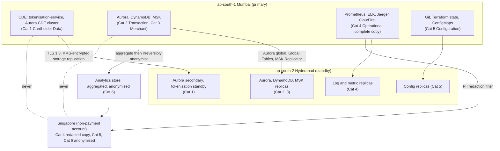
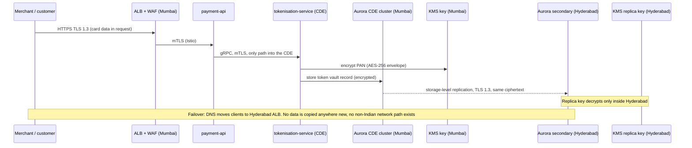
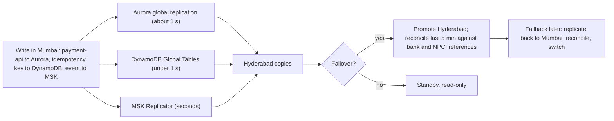
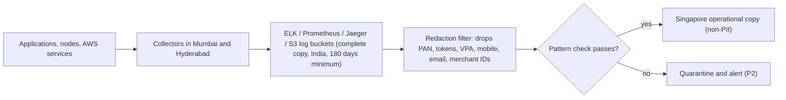
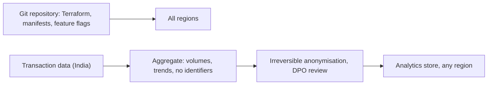

# Data Flow Diagrams - Where Each Data Category Lives and Moves

These diagrams show, for each of the six data categories defined in the brief (A3.6), where the data is stored and how it moves in normal operation and during a failover. They support the compliance matrix (`compliance-matrix.md`) and answer BCRB Challenge 5 ("show me exactly where cardholder data resides, at rest and in transit, and whether it ever crosses a non-Indian path").

Legend: solid arrows are allowed flows. Every payment data path stays inside the two Indian regions, ap-south-1 (Mumbai) and ap-south-2 (Hyderabad).

## 1. Category map

## 2. Cardholder data (Category 1): normal and failover path

Where CHD exists: only in the CDE namespace (`paysecure-cde`), in the Aurora CDE cluster in both Indian regions, and in KMS-encrypted backups in Indian S3 buckets. It is encrypted at rest with AES-256 under `alias/paysecure-cde` and in transit with TLS 1.3 or mTLS. NetworkPolicy and PCI DSS segmentation (Requirement 1) restrict access to the payment-api and tokenisation-service.

## 3. Transaction and merchant data (Categories 2 and 3): replication and reconciliation

All three stores replicate inside India. Merchant bank details are field-level encrypted before they are stored, so replicas never hold them in clear text.

## 4. Operational data (Category 4): redaction before any cross-border copy

PagerDuty and other third-party tools receive alarm name, severity and resource ID only.

## 5. Configuration and analytics data (Categories 5 and 6)

Secrets are not configuration data: they live in Secrets Manager with India-only replication, encrypted under `alias/paysecure-data`.

## 6. Residency checkpoints during a failover

| Step | Checkpoint | Evidence |
|---|---|---|
| Before | Weekly sovereignty check passed within 7 days | `scripts/health-checks/sovereignty-check.sh` output |
| Promotion | Both Aurora clusters, DynamoDB replicas, Redis, MSK and S3 are in Indian regions | Terraform state and AWS describe calls |
| During | Traffic path: client to Hyderabad ALB to Hyderabad cluster; no peering to non-Indian networks | VPC flow logs, Transit Gateway route tables |
| After | Post-drill or post-incident Config query returns no resources outside ap-south-1 and ap-south-2 | `post-drill-reconcile.sh` |
| After | Operational copy in Singapore passed the redaction check | Pipeline quarantine report |
